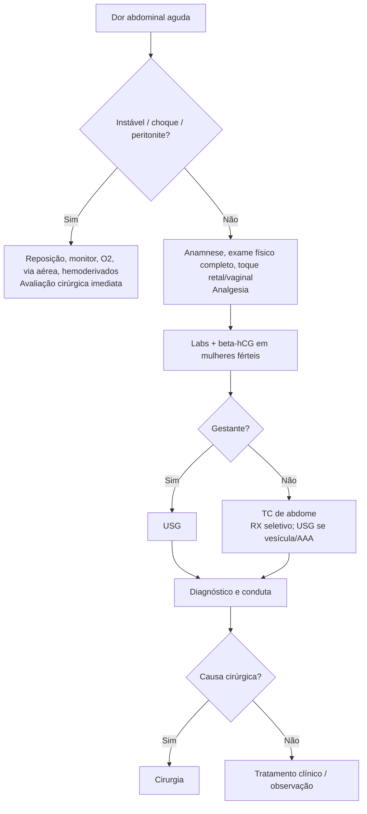

# Abdome Agudo

> Resumo em palavras próprias do Whitebook (Condutas Cirúrgicas > Cirurgia Geral e do Aparelho Digestivo), sem fisiopatologia, autoria e referências. Confira detalhes e doses na fonte: https://whitebook.pebmed.com.br/conteudo/?id=50761&categoryId=207&subcategoryId=211

**Definição:** síndrome clínica de dor abdominal de início súbito, potencialmente ameaçadora à vida, por causas inflamatórias, obstrutivas, isquêmicas, infecciosas ou perfurativas; frequentemente exige diagnóstico e intervenção imediatos, muitas vezes cirúrgicos.

## Epidemiologia
- Dor abdominal = **7–10%** das visitas à emergência (EUA); mais comum em homens; ~**60%** são dor inespecífica e cólica renal.
- Idosos: diverticulite e colecistite; jovens: apendicite e nefrolitíase. Lactentes: hérnia inguinal encarcerada e invaginação; crianças maiores: apendicite.

## Anamnese
- **Localização:** epigástrio (gastroduodenal, tronco celíaco); periumbilical (jejuno-íleo, apêndice, cólon proximal: AMS); suprapúbica (cólon distal, reto, bexiga, órgãos pélvicos); subcostal direita (hepatobiliar); lombar (nefrolitíase).
- **Duração:** forte e > 6 h = doença grave; transitória < 6 h = leve.
- **Início e padrão:** súbito sem sintomas prévios = isquemia, perfuração ou ruptura de aneurisma; cólica cíclica com náuseas/vômitos = inflamatório (colecistite, pancreatite) ou obstrutivo; vaga periumbilical que localiza e piora = apendicite, diverticulite, perfuração bloqueada.
- **Caráter:** constante e aguda = víscera oca perfurada; cólica cíclica = obstrução; em barra contínua = pancreatite; surda e constante = isquemia; difusa vaga com paciente quieto = peritonite.
- **Irradiação:** ombro/escápula direita = colecistite; dorso = pancreatite; inguinal/perineal = nefrolitíase.
- **Relação com alimentação/movimento:** melhora com comida = úlcera duodenal; piora = úlcera gástrica, colelitíase, isquemia crônica; piora com movimento = peritonite.
- **Associados:** dor antes do vômito = cirúrgico; vômito antes da dor = clínico (gastroenterite); diarreia aquosa = gastroenterite; diarreia recorrente = DII; parada de gases e fezes = obstrução; icterícia = hepatobiliar; hematúria = urológico; amenorreia = ectópica.
- **Risco aumentado:** > 65 anos; imunossupressão; etilismo; doença cardiovascular (DAC, DVP, HAS, FA); comorbidades (câncer, diverticulose, cálculos, DII, pancreatite, IR); cirurgia/manipulação GI recente; gravidez precoce.

## Exame físico
- Febre baixa: supuração localizada (apendicite, diverticulite, colecistite); febre alta: repercussão sistêmica (colangite, ITU, DIP).
- Distensão: obstrução (sem ascite) ou ascite/hemoperitônio.
- Dor localizada: FID (McBurney) = apendicite; FIE = diverticulite; QSD = colecistite; difusa com descompressão dolorosa e defesa = peritonite difusa.
- Hipertimpanismo: obstrução maligna; timpanismo hepático (**sinal de Jobert**): pneumoperitônio.
- Sempre: toque retal, toque vaginal, região inguinal.

## Exames
- **Labs:** hemograma, eletrólitos, ureia, creatinina; glicemia, ânion gap e cetonemia; amilase/lipase; bilirrubina, FA, transaminases; urina I; β-hCG; D-dímero, lactato e fosfato se suspeita de isquemia ou sepse.
- **RX** (abdome AP em pé e deitado + tórax PA; decúbito lateral esquerdo com raios horizontais se não ficar em pé): baixo rendimento, útil em obstrução, perfuração, corpo estranho. Ar livre: em ~2/3 das perfurações gastroduodenais e ~1/3 do delgado distal/cólon; 5 mL em RX abdominal, 1–2 mL em RX de tórax após 5–10 min em pé. Delgado **> 2,5 cm** sugere obstrução. Isquemia: normal no início; depois pneumatose, espessamento, íleo.
- **USG:** de escolha na gravidez; inicial em AAA e vesícula; avalia ectópica, hemoperitônio, hidronefrose, pancreatite, trombose venosa.
- **TC:** exame de escolha na dor indiferenciada; define o diagnóstico em ~2/3; útil em idosos, AAA estável (~100% de sensibilidade), hemorragia retroperitoneal.
- **Angiografia/angio-TC:** isquemia mesentérica; se choque/vasopressor, confirmar na laparotomia; não tem papel na ruptura de AAA.

## Diagnóstico rápido (pearls)
- **Pancreatite:** dor em faixa para o dorso + vômitos. **Colecistite:** HCD > 6 h, escapular, pós-gordura. **Colangite:** Charcot (dor + febre com calafrios + icterícia). **Apendicite:** periumbilical → FID, ± massa. **Diverticulite:** periumbilical → FIE, ± massa. **Peritonite difusa:** dor súbita intensa que piora ao mover + defesa + Blumberg. **Úlcera duodenal:** queimação que alivia ao comer. **Ruptura de AAA:** dor mesogástrica súbita + massa pulsátil + hipotensão. **Isquemia mesentérica:** dor desproporcional ao exame + acidose + FA. **Obstrução mecânica:** cólica + distensão + peristalse de luta e depois aperistalse; **funcional:** hipoperistaltismo. **Parede abdominal:** piora com contração. **Nefrolitíase/pielonefrite:** lombar + disúria + Giordano. **CAD:** dor + desidratação + hiperglicemia + acidose. **Gastroenterite:** cólica + náuseas/vômitos + diarreia aquosa.

## Diferenciais
- **Idoso (comuns e graves):** AAA, dissecção de aorta torácica, isquemia mesentérica, IAM, obstrução, perfuração, vesícula, doença diverticular, volvo, hérnia encarcerada, abscesso, ruptura/infarto esplênico, pielonefrite.
- **Por região:** QSD (hepatite, colecistite, colangite, cólica biliar, pancreatite, Budd-Chiari, pneumonia/empiema, abscesso subdiafragmático); FID (apendicite, salpingite, ectópica, hérnia inguinal, nefrolitíase, DII, adenite mesentérica); epigástrio (úlcera, DRGE, gastrite, pancreatite, IAM, pericardite, AAA); periumbilical (apendicite precoce, gastroenterite, obstrução, Meckel, AAA); QSE (abscesso/infarto esplênico, gastrite, úlcera, pancreatite); FIE (diverticulite, salpingite, ectópica, hérnia, nefrolitíase, SII, DII); difusa (gastroenterite, isquemia, cetoacidose/porfiria, malária, FMF, obstrução, peritonite, SII, hérnia interna).
- **Extra-abdominais:** cardíaca, pulmonar (pneumonia, TEP, pneumotórax), esofágica (Boerhaave), geniturinária, hematológica (falciforme, Henoch-Schönlein, leucemia), infecciosa (tifoide, malária, mononucleose), metabólica (CAD, porfiria, uremia, crise adrenal, tireoide), intoxicações (chumbo, metanol), radiculares, parede, animais peçonhentos.

## Tratamento
- **Estabilização:** sinais vitais e consciência; descartar hemorragia/hipovolemia; se instável: acesso, reposição, monitor, O₂, via aérea, hemotransfusão se preciso. Choque ou peritonite = avaliação cirúrgica imediata; aminas vasoativas se indicadas.
- **Analgesia:** estudos randomizados refutam que atrapalhe a avaliação; opioides podem alterar o exame mas não prejudicam a conduta; monitorar depressão respiratória; dependentes de opioide precisam de doses maiores; objetivo é tornar a dor suportável, nunca abolir ou sedar.
- **Mulheres:** exame ginecológico, β-hCG, USG transabdominal/transvaginal.
- **Indicações cirúrgicas:** hemorrágicas (trauma de órgão sólido, aneurisma roto, ectópica rota, HDA incontrolável, MAV, úlcera, fístula aortoduodenal, pancreatite hemorrágica, Mallory-Weiss, ruptura esplênica); infecciosas (apendicite, colecistite, Meckel, abscesso hepático/diverticular/psoas); perfurativas (úlcera, câncer, Boerhaave, divertículo); obstrutivas (brida, volvo sigmoide/cecal, hérnia encarcerada, DII, neoplasia, intussuscepção); vasculares (Buerger, trombose/embolia mesentérica, torção de ovário, colite isquêmica, torção testicular, hérnia estrangulada).

## Fluxograma (refeito, a partir do texto)

