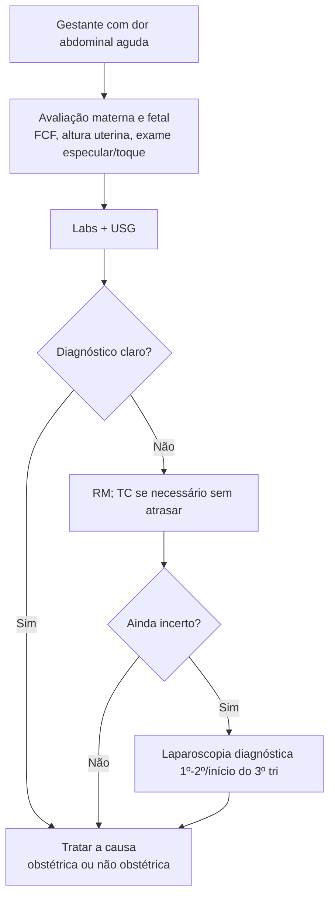

# Abdome Agudo na Gestação

> Resumo em palavras próprias do Whitebook (Condutas Cirúrgicas > Cirurgia Geral e do Aparelho Digestivo), sem fisiopatologia, autoria e referências. Confira detalhes e doses na fonte: https://whitebook.pebmed.com.br/conteudo/?id=23686&categoryId=207&subcategoryId=211

**Definição:** dor abdominal aguda, intensa e súbita. Abordagem semelhante à de não gestantes, mas considerando as alterações fisiológicas/anatômicas, a idade gestacional e o bem-estar fetal. Atraso diagnóstico/terapêutico eleva a morbimortalidade materna e fetal.

## Quadro clínico
- Desconforto leve a moderado é comum e transitório (crescimento uterino, posição fetal, Braxton Hicks). Ligamento redondo/crescimento uterino: início da gestação; contrações e movimentos fetais: 3º trimestre.
- Sugerem doença: dor intensa, súbita, constante, com náuseas/vômitos, sangramento vaginal ou localizada no abdome superior. **Peritonite nunca é normal na gestação.**
- Náuseas/vômitos comuns no início e tendem a cessar por volta da 20ª semana; não são normais com dor, febre, diarreia, cefaleia ou achados abdominais.
- A partir da ~**12ª semana** o útero é órgão abdominal: dificulta localizar a dor e avaliar irritação peritoneal.
- Útero comprime o trato urinário (hidroureter, hidronefrose) e pode causar compressão aortocaval (tontura/síncope em decúbito dorsal, melhora em decúbito lateral esquerdo).
- Progesterona reduz tônus do esfíncter esofágico, motilidade intestinal e esvaziamento biliar e tônus ureteral → refluxo, constipação, colelitíase, nefrolitíase.
- Hematologia: leucócitos 10.000–14.000/mm³ (até 30.000 no parto, normaliza em 1 semana; desvio para formas jovens não é normal); anemia fisiológica (Hb normal ≥ 10,5–11 g/dL); FC +10–15 bpm pode mascarar hemorragia leve.
- Perguntar história obstétrica atual e prévia (pré-eclâmpsia com DPP ou rotura hepática, cesárea prévia e rotura uterina) e perdas vaginais.

## Exame físico
- Além do exame habitual: FCF e altura uterina (correlacionar com a idade gestacional); monitorização fetal contínua em gestações **≥ 22 semanas**.
- Avaliar tamanho, tônus, sensibilidade e atividade uterina; exame especular e toque para membranas e colo.
- Sensibilidade e hipertonia uterina não são normais: trabalho de parto, DPP, rotura uterina, infecção intrauterina.

## Exames
- **Labs:** hemograma com diferencial, urina, transaminases, bilirrubinas, amilase, lipase; culturas de sangue e urina se febre/instabilidade; coagulação e tipagem se instável; eletrólitos e função renal se êmese/anorexia.
- **USG:** primeira escolha. **RM** preferível à TC quando a USG for inconclusiva.
- A preocupação com radiação não deve retardar o diagnóstico (a prioridade é materna); quase todos os exames ficam abaixo do limiar de malformação; RX de tórax e abdome têm dose abaixo da lesiva ao feto.
- **Laparoscopia** diagnóstica: segura como a laparotomia, em geral no 1º e 2º trimestres e início do 3º.

## Diferenciais
**Relacionadas à gestação:** abortamento (< 20 sem; dor pélvica e sangramento; beta-hCG seriado e USG); gravidez ectópica (tubária, cervical, cornual, cicatriz de cesárea, heterotópica; USG + beta-hCG); encarceramento uterino (14ª–16ª sem: dor suprapúbica, disúria, dificuldade de micção); trabalho de parto; DPP (sangramento, dor, hipertonia, FCF alterada, CIVD, óbito fetal; hematoma retroplacentário na USG pode faltar); rotura uterina (cesárea prévia ou miomectomia; FCF alterada, irritação peritoneal); corioamnionite (febre, dor, taquicardia materna e fetal); doenças hepáticas; **pré-eclâmpsia grave** (PA ≥ 160×110, proteinúria 300 mg/24 h, cefaleia, escotomas, oligúria, dor epigástrica); **HELLP** (hemólise, enzimas hepáticas elevadas, plaquetopenia; hipertensão ≥ 140×90 e proteinúria em ~85%); esteatose hepática aguda (3º trimestre; náuseas/vômitos 75%, dor epigástrica 50%, icterícia).
**Não relacionadas:** DRGE, colelitíase/colecistite, hepatite, pancreatite, pneumonia, constipação, obstrução, úlcera perfurada, esplenopatias, hérnia hiatal, hematoma de reto, hemorragia adrenal, apendicite, nefrolitíase, DII, diverticulite, crise falcêmica, trauma, gastroenterite, trombose mesentérica, abscesso de psoas, síndrome do nervo cutâneo anterior, hérnias de parede.
**Ginecológicas:** torção ovariana/tubária/uterina, cisto roto ou hemorrágico, mioma (degeneração/torção), DIP.

## Pós-parto
Cólicas por hipertonia uterina pioram na amamentação e se resolvem em ~1 semana. Considerar: endometrite (febre, útero doloroso, lóquios fétidos), complicações da incisão (hematoma, seroma, infecção, deiscência), **fascite necrosante** (dor desproporcional, eritema, febre, CPK alta, anestesia cutânea; diagnóstico cirúrgico), tromboflebite ovariana (1 semana pós-parto; veia direita 80%), colite por *C. difficile*, retenção urinária, hemorragia intra/retroperitoneal, síndrome compartimental abdominal, disjunção da sínfise púbica, corpo estranho esquecido (RX), lesão visceral não reconhecida, abscesso/ISC (24–48 h), IAM (raro; mais no 3º tri e puerpério precoce).

## Tratamento
Varia com a causa (clínico ou cirúrgico).

## Fluxograma (refeito, a partir do texto)

