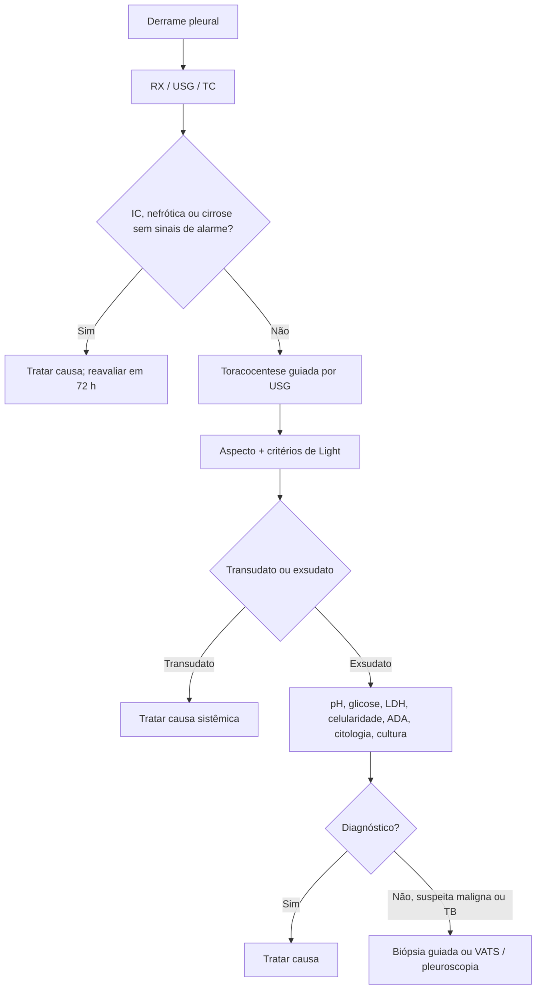

# Abordagem Diagnóstica do Derrame Pleural

> Resumo em palavras próprias do Whitebook (Condutas Cirúrgicas > Cirurgia Torácica), sem fisiopatologia, autoria e referências. Confira detalhes e doses na fonte: https://whitebook.pebmed.com.br/conteudo/?id=23225&categoryId=207&subcategoryId=215

**Definição:** acúmulo anormal de líquido no espaço pleural por desequilíbrio entre formação e absorção; pode decorrer de condições sistêmicas, pleuropulmonares, medicamentos, trauma ou iatrogenia.

## Conceitos
- Produção normal ~8,4 ± 4,3 mL (0,01 mL/kg/h), a partir dos capilares da pleura parietal; absorção linfática (0,2–0,4 mL/kg/h, podendo aumentar até 20×); absorção mais eficaz à esquerda (por isso, em causas sistêmicas como ICC, acúmulo mais fácil à direita).
- **Transudato:** fator sistêmico, não inflamatório (desequilíbrio de pressões hidrostática/oncótica). **Exsudato:** fator local, inflamatório (↑ permeabilidade).
- Mecanismos de acúmulo: ↑ líquido intersticial pulmonar, ↑ pressão hidrostática, ↓ pressão oncótica, ↑ permeabilidade, obstrução/displasia linfática, lesão de ducto torácico, ascite/poros diafragmáticos, iatrogenia, ↑ pressão venosa sistêmica, aquaporinas. Efeitos: pior troca gasosa, dinâmica ventilatória, comprometimento hemodinâmico (volumosos), dor, atelectasia/shunt.

## Etiologias
- **Transudatos:** ICC, cirrose, síndrome nefrótica, glomerulonefrite, SVCS, urinotórax, diálise peritoneal, mixedema, hipoalbuminemia, sarcoidose, fístula liquórica, pericardite constritiva, Meigs.
- **Exsudatos:** neoplasias (metástases, mesotelioma, linfoma); infecciosas (parapneumônico, bacterianas, fúngicas, parasitárias, virais, tuberculose); TEP; GI (pancreatite, abscessos subfrênico/hepático/esplênico, perfuração esofágica, pós-operatório abdominal, hérnia diafragmática, pós-transplante hepático, esclerose de varizes); cardíacas (Dressler, pericardiopatia, pós-revascularização, pós-IAM); gineco-obstétricas (hiperestimulação ovariana, pós-parto, endometriose); colagenoses (AR, LES ou lúpus-like por drogas, Sjögren, FMF, Churg-Strauss, Wegener); fármacos (amiodarona, anti-TNF, betabloqueadores, bleomicina, bromocriptina, ciclofosfamida, cisplatina, dantrolene, daptomicina, dasatinibe, fenitoína, hidralazina, interferon, metildopa, metotrexato, nitrofurantoína, procarbazina); miscelânea (asbestose, pós-transplante de pulmão/medula, unhas amarelas, sarcoidose, uremia, radioterapia, afogamento, amiloidose, queimadura elétrica, hemotórax).
- **Epidemiologia:** ~75% por ICC, câncer, pneumonia e tuberculose; transudatos: ICC e cirrose; exsudatos: maligno, pneumonia, TEP. No Brasil, tuberculose pleural deve sempre ser excluída em exsudato. Pode haver duas ou mais causas.

## Clínica
Dor pleurítica (75%), dispneia (pouca correlação com o volume), tosse, febre, choque (hemotórax traumático), perda ponderal; "quiloptise" (expectoração quilosa em fístula pleurobrônquica). Perguntar: procedimentos pleurais, cirurgias, medicamentos, tabagismo/asbesto, neoplasias, TB, pneumonia recente, trauma, paracentese, radioterapia, imunossupressão. Exame: taquipneia, ↓ expansibilidade, assimetria, desvio traqueal contralateral, ↓ frêmito, macicez, ↓/abolição do murmúrio, atrito, egofonia; pistas de hepatopatia, ICC, malignidade.

## Imagem
- **RX de tórax:** disponível, pouca radiação; subestima volume; normal não exclui. Velamento inferior com obliteração do seio costofrênico (~200 mL), parábola de Damoiseau, derrame subpulmonar (elevação aparente do hemidiafragma), desvio contralateral, atelectasia. No leito (supino): ↑ opacidade com vasos preservados, perda do contorno do diafragma, fissuras espessadas. **Decúbito lateral** (Laurell): detecta ~50 mL; espessura > 10 mm autoriza toracocentese.
- **USG:** alta sensibilidade (15–20 mL), acurácia 91–93%, à beira-leito, sem radiação, melhor que TC para loculações, diferencia espessamento, consolidação, atelectasia e massas, reduz complicações (recomendada como adjuvante); dependente do operador. Modo B: área anecoica/hipoecoica; classificação de Tsai: mínimo (≤ 100 mL, só seio costofrênico), pequeno (100–500), moderado (500–1.500), grande (> 1.500 mL). Abordável se > 1 cm. Septações: complicados (malignidade, infecção, procedimentos). Padrões: transudato — anecoico, sem espessamento pleural, geralmente bilateral; exsudato — septado ou não, espessamento; hemotórax — hiperecogênico homogêneo; empiema — septações, consolidação com broncograma; maligno — septações complexas, espessamento irregular, nódulos pleurais/diafragmáticos, metástases hepáticas.
- **TC de tórax** (padrão-ouro; contraste IV para a pleura): derrames pequenos, complexos/loculados, de difícil acesso, exsudatos sem diagnóstico, infectados; estima o volume, avalia pulmão, planejamento. Densidade 20–30 UH (exsudato) e 10–15 UH (transudato). Malignidade: nódulos pleurais, espessamento circunferencial/mediastinal, espessamento > 1 cm. Desvantagens: radiação (crianças, gestantes), transporte, custo.
- **RM:** diferencia benigno × maligno em T2; não rotina; opção se alergia a contraste. **PET-CT:** valor limitado (falso-positivo em pleurite, infecção, pleurodese). **Broncoscopia:** não rotineira; hemoptise, obstrução brônquica, não reexpansão após drenagem, aspiração de corpo estranho; idealmente após drenar.

## Toracocentese diagnóstica
- **Indicação:** todos, exceto ICC, nefrótica ou cirrose com ascite sem sinais de alarme (unilateral/assimétrico, febre, dor torácica). Sem alarme: diurético e reavaliar; se não reduzir em 72 h, puncionar. Outras indicações: dor torácica, dispneia súbita, febre, hepatoesplenomegalia, adenopatia, sintomas sistêmicos, perda ponderal, pneumonia com derrame > 10 mm, neoplasia, SIDA.
- **Contraindicações:** INR > 1,5, plaquetas < 150.000, anticoagulação plena, janela < 10 mm. **Complicações:** pneumotórax (principal), hemotórax, infecção, edema de reexpansão. Guiar por USG/TC; retirar até 1.500 mL ou parar com sintomas/tosse; interromper se tosse persistente, dor, dispneia, saída de ar, ↓ frêmito no hemitórax superior.
- **Aspecto:** sanguinolento (neoplasia, TB, trauma, TEP), turvo (lipídios/proteínas/células), leitoso (quilotórax, pseudoquilotórax), amarelo-esverdeado (AR), purulento (parapneumônico complicado), partículas alimentares (ruptura esofágica), bilioso (fístula biliar), odor de urina (urinotórax), pútrido (empiema).
- **Critérios de Light** (≥ 1 = exsudato; sensibilidade 98%, 25–30% de transudatos mal classificados, sobretudo ICC com diurético ou derrame sanguinolento; NT-proBNP sérico > 1.500 pg/mL ajuda na ICC): proteína pleural/sérica > 0,5; LDH pleural/sérico > 0,6; LDH pleural > 2/3 do limite sérico ou > 200 U/L. Adicionais: gradiente de albumina (soro − pleura) < 1,2 g/dL, proteína pleural > 3 g/dL, colesterol pleural > 55 mg/dL, colesterol pleural/sérico > 0,3. Sem exame sérico: proteína > 3 g/dL, colesterol > 55 mg/dL, LDH > 2/3 do normal (boa sensibilidade, especificidade reduzida).
- **pH:** < 7,3 (parapneumônico, TB, AR, ruptura esofágica, acidose, câncer); parapneumônico < 7,2: considerar drenar; neoplasia < 7,2: pior prognóstico.
- **Celularidade:** neutrófilos > 50% (agudo: parapneumônico, embolia, pancreatite, asbestose, TB aguda); linfócitos > 50% (crônico: neoplasia, TB, pós-bypass, pleurite inespecífica, linfoma, quilotórax, AR, uremia, sarcoidose, unhas amarelas); eosinófilos > 10% (sangue/ar, drogas, asbestose, paragonimíase, Churg-Strauss).
- **Outros:** Gram/cultura (40% positivas em infecção); LDH > 1.000 U/L (empiema, parapneumônico complicado, AR, neoplasia, ruptura esofágica); glicose < 60 mg/dL (parapneumônico complicado, neoplasia, lúpus/AR; mais raros hemotórax, TB, paragonimíase, Churg-Strauss); amilase pleural/sérica > 1 (pancreatite aguda, pseudocisto, ruptura esofágica, gravidez ectópica rota, adenocarcinoma); hematócrito do líquido/sangue: < 1% não significativo, 1–20% (trauma, embolia, TB, neoplasia), > 50% hemotórax; triglicérides > 110 mg/dL quilotórax, 50–110 possível (lipoproteínas: quilomícrons), < 50 não é quilotórax (leitoso: colesterol > 250 mg/dL = pseudoquilotórax); ureia/creatinina elevadas = urinotórax.
- **Citologia oncótica:** sensibilidade ~60%; maior com > 50 mL e em adenocarcinoma; citometria de fluxo para linfoma; marcadores tumorais no líquido não têm papel.
- **ADA:** valor de corte 40 U/L; TB, AR, alguns linfomas e a maioria dos empiemas; sensibilidade 91,8%, especificidade 88,4%; com pré-teste ~50% (Brasil), VPP 88,7% e VPN 91,5%. Interferon-gama > 3,7 U/mL; BAAR; PCR para TB (especificidade > 90%); culturas para micobactérias; FAN e FR na suspeita de colagenose.
- **Resumo por etiologia (padrões):** parapneumônico simples — turvo, glicose > 60, pH > 7,2, PMN, LDH < 1.000, cultura negativa; complicado — glicose < 40, pH < 7,2, LDH > 1.000, cultura negativa; empiema — purulento, pH < 7,2, cultura/Gram positivos, glicose ↓↓, LDH > 1.000, PMN; tuberculose — glicose ↓, pH < 7,4, ADA > 40, leucócitos < 10.000 mononucleares; neoplasia — glicose ↓↓, pH < 7,3, < 10.000 mononucleares, citologia positiva em ~60%; quilotórax — leitoso, TG > 110, colesterol baixo, quilomícrons; pseudoquilotórax — leitoso, colesterol > 200, cristais de colesterol, sem quilomícrons.

## Biópsia pleural
- **Agulha às cegas (Cope/Abrams):** não deve ser feita, salvo alta suspeita de TB com recursos limitados; sensibilidade 57% em malignidade e 67–92% em TB; pneumotórax 3–15%, hemoptise, hemotórax, dor, hematoma, febre, vasovagal; guiada por TC/USG: 75%, até 90% se espessamento > 1 cm.
- **Agulha cortante guiada por TC/USG:** nódulos/espessamento pleural com suspeita de malignidade; mais sensível e menos complicações que a cega; importante para mesotelioma.
- **Pleuroscopia (anestesia local):** pleuroscópio rígido/semirrígido, sedação consciente, drenagem e pleurodese; sensibilidade para malignidade alta e 89–100% para TB; exige cooperação (decúbito lateral ≥ 30 min), mal tolerada com hipoxemia grave, precisa de derrame suficiente, pior se encarceramento/loculações; complicações: hemorragia, empiema, pneumonia, fístula aérea persistente, óbito 0,4%.
- **VATS (padrão-ouro):** sensibilidade 95%, especificidade 100%, VPN 94%; anestesia geral; também lise de lojas, posicionamento do dreno, biópsia de outras lesões, talco; indicada em exsudato linfocítico com toracocentese inconclusa e suspeita de neoplasia ou dúvida persistente; contraindicada se inapto à anestesia, desempenho muito ruim, cardiopatia isquêmica limitante. Complicações: pneumotórax, hemotórax, empiema.
- **Biópsia a céu aberto:** mesmas indicações da VATS, com espessamento pleural importante; toracotomia ± costectomia; sem drenagem se a cavidade não for violada.

## Diagnóstico diferencial
Derrame pericárdico, massa pulmonar, tumores mediastinais, tumores pleurais, placas pleurais, atelectasia, pneumotórax, abscesso, consolidação.

## Tratamento (não maligno)
Depende da causa e dos sintomas. Assintomáticos: geralmente sem intervenção pleural; toracocentese diagnóstica e se suspeita de complicação; derrames moderados: considerar drenar para evitar pulmão não expansível. Sintomáticos: tratar/otimizar a causa; toracocentese (guiada por USG) ± dreno ou pigtail, drenagem em até 24 h quando indicada, 1–1,5 L por sessão (edema de reexpansão). Recorrência apesar de toracocenteses e terapia ideal → cateter pleural de demora e/ou pleurodese; prognóstico reservado ou recusa → toracocenteses repetidas; shunt pleuroperitoneal/pleurovenoso ou pleurectomia só como último recurso.

## Fluxograma (refeito; o original traz três algoritmos em figura: exsudato × transudato, aspecto do líquido e exsudatos indefinidos)

