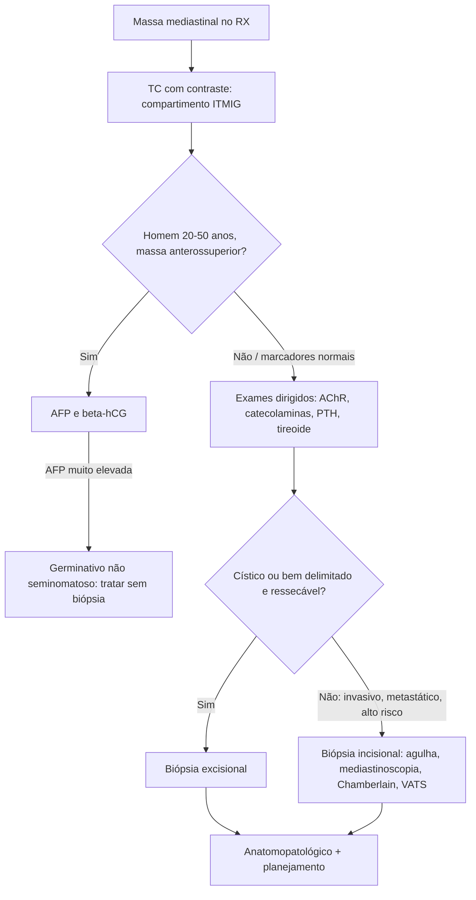

# Abordagem Diagnóstica dos Tumores Mediastinais

> Resumo em palavras próprias do Whitebook (Condutas Cirúrgicas > Cirurgia Torácica), sem fisiopatologia, autoria e referências. Confira detalhes e doses na fonte: https://whitebook.pebmed.com.br/conteudo/?id=23226&categoryId=207&subcategoryId=215

## Anatomia e compartimentos (ITMIG, 2017 — padrão atual, baseado em TC)
- Limites do mediastino: superior — estreito torácico; inferior — diafragma; laterais — pleuras parietais; anterior — plastrão condroesternal; posterior — coluna torácica com fáscia pré-vertebral.
- **Prevascular (anterior):** do estreito torácico ao diafragma, entre o esterno e a borda anterior do pericárdio; contém timo, tecido mesenquimal, linfonodos, e pode ser separado do superior por linha do ângulo de Louis ao 4º disco torácico.
- **Visceral (médio):** pericárdio e conteúdo; limite posterior = linha vertical 1 cm atrás da margem anterior dos corpos vertebrais; contém coração, aorta, cava superior, vasos pulmonares intrapericárdicos, traqueia e brônquios principais, esôfago, ducto torácico, ázigos, frênicos, linfonodos.
- **Paravertebral (posterior):** posterior ao limite visceral até a face lateral do processo transverso; medula e estruturas nervosas, partes moles paravertebrais. Vasos pulmonares extrapericárdicos são estruturas pulmonares.

## Epidemiologia
~75% benignos; crianças (paravertebral, neurogênicos) e adultos de 20–40 anos (pré-vascular, timoma). Localização mais comum: pré-vascular (60%); malignidade: pré-vascular (50%) e visceral (25%). Frequência: neurogênicos 19,4%, linfomas 15,8%, cistos broncogênicos/pericárdicos 14,2%, germinativos 12,8%, timomas 11,5%, bócios 6%. Malignos dão mais sintomas.
- **Benignos:** bócio mergulhante, tireoide ectópica, cistos tímicos/mesoteliais, hemangiomas, linfangiomas, mixomas, aneurismas, teratomas, lipomas, fibromas. **Malignos:** timomas, carcinoma e carcinoide tímico, germinativos, linfomas, mesenquimais, tireoide/paratireoides.
- **Visceral:** linfoma (principal), cistos entéricos/broncogênicos/pericárdicos (maioria cística), adenomegalias, hérnia de hiato, aneurismas, mieloma, tumores esofágicos. **Paravertebral:** neuroblastoma, ganglioneuroma, schwannoma, feocromocitoma, meningocele lateral, mielolipoma; osteomielite, discite, hematomas, hematopoese extramedular.
- **Classificação:** tímicos (hiperplasia, timoma, carcinoma); neurogênicos (neurofibroma, neurilemoma, paraganglioma, ganglioneuroma, neuroblastoma, quemodectoma, neurossarcoma); linfomas (Hodgkin, linfoblástico, células gigantes); germinativos (teratodermoide, seminoma, não seminoma — embrionário, coriocarcinoma, endodérmico); mesenquimais (fibro/lipo/leiomio/rabdossarcoma, xantogranuloma, mixoma, mesotelioma, hemangioma e variantes, linfangioma); endócrinos (bócio, paratireoide, carcinoide); cistos (broncogênico, pericárdico, entérico, tímico, ducto torácico); Castleman; condroma; hematopoese extramedular.

## Clínica
Muitos são incidentalomas. Sintomas por compressão ou invasão (surgimento precoce sugere malignidade) ou por paraneoplasia: dor torácica, dispneia, tosse, estridor, disfagia, rouquidão, febre, perda de peso; síndrome de veia cava superior, tamponamento, IC/estenose pulmonar/arritmias, pneumonite obstrutiva, paralisia frênica ou de pregas vocais, Horner, Pancoast, radiculopatia, quilotórax/quilopericárdio.
- **Manifestações endócrinas/paraneoplásicas:** tireotoxicose (tireoide); hipoglicemia (mesotelioma, teratoma, fibrossarcoma, neurossarcoma); hipertensão (feocromocitoma, ganglioneuroma, neuroblastoma, quemodectoma); diarreia (ganglioneuroma, neuroblastoma, neurofibroma); ginecomastia (germinativos não seminomatosos); hipercalcemia (paratireoide, Hodgkin).
- **Síndromes associadas:** timoma — miastenia gravis, aplasia de série vermelha, anemias aplásica/hemolítica, hipogamaglobulinemia, esclerose sistêmica, megaesôfago, dermatomiosite, LES, miocardite; linfoma — anemia, miastenia; neurofibroma — von Recklinghausen; carcinoma — Cushing; carcinoide/timoma — NEM; timoma, neurofibroma, neurilemoma, mesotelioma — osteoartropatia; Hodgkin — dor com álcool, febre de Pel-Ebstein; neuroblastoma — opsoclonus-mioclonus; cistos entéricos — anomalias vertebrais, úlcera péptica.

## Diagnóstico
- **Laboratório:** alfafetoproteína e beta-hCG em homens de 20–50 anos com massa anterossuperior (AFP elevada é praticamente diagnóstica e dispensa biópsia; elevados em 80% e 30% dos germinativos não seminomatosos); anticorpo anti-receptor de acetilcolina (miastenia em ~1/3 dos timomas); LDH (linfomas, progressão); catecolaminas, metanefrinas, VMA (neuroblastoma, feocromocitoma); TSH, T4L, calcitonina; PTH + cálcio; outros hormônios conforme suspeita.
- **RX de tórax (com perfil):** alargamento mediastinal, sinal da silhueta, sobreposição do hilo, sinal cervicotorácico. **"4 Ts"** do mediastino anterossuperior (95%): timoma, teratoma, tireoide, "terrível" linfoma.
- **TC multidetector com contraste IV (escolha):** tamanho, localização, calcificação, consistência, cisto/gordura/partes moles, invasão, diferenciais, guia de biópsia; avaliar nódulos pulmonares associados. Origem de grandes lesões: centro da lesão no corte de maior volume e estruturas desviadas.
- **RM:** indicações específicas — cístico × sólido, componentes necróticos, septos, alergia a contraste iodado, invasão de grandes vasos/coração, extensão ao canal medular (neurogênicos), timo × hiperplasia, gordura.
- **Ecocardiograma / USG (EBUS, EUS):** mediastino médio, lesões císticas, tamponamento, estenose pulmonar. **Angiografia:** raramente; artéria de Adamkiewicz.
- **Cintilografias:** I-131 (tireoide), gálio (germinativos não seminomatosos), MIBG (neuroendócrinos). **PET-FDG:** papel controverso (timoma — estadiamento, hiperplasia, extracapsular, metástase; muitos falsos); hiperplasia tímica e mediastinite fibrosante captam; monitoriza resposta.
- **Biópsia:** nem sempre necessária (pode ir direto à ressecção). Incisional: suspeita de metástase, tumores sólidos grandes de alto risco cirúrgico, sinais de invasão ou limites mal definidos. Excisional: tumores císticos, bem delimitados com plano de clivagem, incapacidade da incisional. Vias: transtorácica guiada por imagem (agulha cortante), mediastinoscopia, mediastinostomia anterior (Chamberlain), VATS, toracotomias, esternotomia, bitoracotomia ± esternotomia transversa (clam shell). Associar congelação; pode não ser diagnóstica (necrose, fibrose, esmagamento, liquefação).

## Considerações pré-operatórias
Diferenciar massa primária de outras; reconhecer manifestações sistêmicas (miastenia, hipercalcemia, hipogamaglobulinemia, tireotoxicose, hipertensão maligna); avaliar efeito compressivo (via aérea, artéria pulmonar, VCS); extensão à coluna; marcadores de germinativo não seminomatoso; ressecabilidade; otimizar condições (evitar bloqueador neuromuscular em miastenia, betabloqueio prévio no feocromocitoma). Atenção à indução anestésica (comprometimento traqueal/mediastinal, via aérea difícil), maior risco com SVCS e dispneia posicional.

## Fluxograma (refeito, a partir do texto; o original não traz algoritmo)

