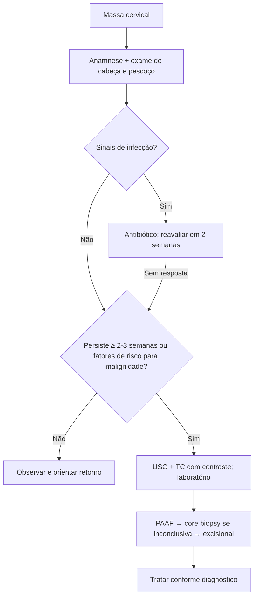

# Abordagem Geral das Massas Cervicais

> Resumo em palavras próprias do Whitebook (Condutas Cirúrgicas > Cirurgia de Cabeça e Pescoço), sem autoria e referências. Confira detalhes e doses na fonte: https://whitebook.pebmed.com.br/conteudo/?id=39165&categoryId=207&subcategoryId=289

**Definição:** espectro amplo de lesões, ~95% benignas; problema comum na atenção primária, muitas vezes apenas uma "protuberância".

## Anamnese
- Doenças prévias, tabagismo e etilismo (↑ risco de malignidade), história familiar.
- **Idade:** crianças → inflamatória/congênita; 16–40 anos → maioria benigna (com aumento de neoplasias); **> 40 anos → considerar neoplásica e potencialmente maligna**.
- **Evolução:** anos sem mudar → neoplasia benigna (glândula salivar, bainha nervosa, paraganglioma); expansão rápida → infecção ou linfoma; varia com infecções de via aérea alta → cisto congênito.
- **Sintomas:** dor (crescimento rápido/invasão neural); disfonia, disfagia, otalgia (metástase de neoplasia do trato aerodigestivo); sinais flogísticos (infecção); febre, sudorese noturna e perda de peso (sintomas B de linfoma); picos febris altos (infecção aguda). Exposição ocupacional, animais, viagens.

## Localização
Pré-auricular/ângulo da mandíbula → parótida (cuidar do nervo facial); central → tireoide, maligno ou cisto dermoide; anterior ao esternocleidomastóideo, jugulodigástrico alto → linfonodo (suspeita maligna em adulto) ou cisto de 2ª fenda branquial; **triângulo posterior → alta suspeita de malignidade**; **supraclavicular (esp. esquerda)** → metástase pulmonar, ginecológica ou GI.

## Exame físico
Cutâneo (edema, ulceração), tamanho, consistência, mobilidade, dor, pulsatilidade, frêmito, movimento com deglutição/Valsalva; cavidade oral e língua (retirar próteses), orelha, glândulas salivares e tireoide; otoscopia, nasoscopia, pares cranianos, laringoscopia.
- Linfonodo reativo: discreto, móvel, firme/elástico, às vezes doloroso. Maligno: endurecido, fixo. Metastático: aderido, indolor. Infeccioso: isolado, doloroso, quente, eritematoso, flutuante. Cisto congênito: macio, circunscrito, móvel (cisto em adulto pode ser metástase de CEC de orofaringe por HPV). Infecção/linfoma: crescimento em dias a semanas. Glômico/schwannoma vagal: massa lateral firme que se move para os lados, não para cima/baixo. Vascular: pulsátil com sopro/frêmito. Tireoidiana/ducto tireoglosso: fixa, na linha média.

## Exames
- **Laboratório** se a causa não parecer reativa transitória; massa recente que **persiste > 3 semanas** exige investigação. Hemograma, VHS/PCR, hemocultura se febril, sorologias (EBV/CMV se adenopatia difusa, HIV com risco, toxoplasma, brucelose, bartonella, tularemia), PPD, anti-Ro/SSA e anti-La/SSB (Sjögren), medula óssea se hemograma sugerir doença hematológica.
- **Imagem:** USG (cística × sólida, guia de punção); **TC com contraste** (melhor método diagnóstico; planos profundos); RM (partes moles, perineural, SNC); PET (foco primário/metástase).
- **Invasivos** (dúvida, crescimento progressivo, fossa supraclavicular, > 3 cm, suspeita de linfoma): **PAAF** preferida (acurácia 93%, sensibilidade 90%, especificidade 97% para malignidade; após imagem; aspirado: sangue → vascular; seroso castanho → papilífero; viscoso amarelo → mucocele; turvo amarelado → fenda branquial; pus → abscesso; PCR para EBV e HPV); **core biopsy** se PAAF inconclusiva (superior para linfoma; primeira escolha se suspeita de linfoma); **biópsia excisional** se anteriores inconclusivos (incisional aberta desencorajada, salvo lesões grandes aderidas a estruturas nobres ou subtipagem de linfoma; avisar sobre esvaziamento cervical e fazer congelação).

## Diferencial
Anomalias vasculares, laringocele, rânula, teratoma, cisto dermoide, fenda branquial, ducto tireoglosso, cisto tímico, tireoide ectópica, linfadenopatias (viral, bacteriana, parasitária), doenças inflamatórias, metástase/CEC de cabeça e pescoço, câncer de tireoide, bócio, tumor de pele, salivar, linfoma, paraganglioma, schwannoma, lipoma, Madelung, Castleman, Kikuchi-Fujimoto, linfangioma, hemangioma, hematoma, pseudoaneurisma, FAV.

## Manejo
Sem antibiótico empírico de rotina, a não ser que haja infecção; reavaliar em 2 semanas, de novo em 2–4 semanas se melhorar, e prosseguir investigação se não melhorar. **Risco aumentado de malignidade:** sem causa infecciosa; lesão ≥ 2 semanas sem flutuação; fixa, firme, > 1,5 cm ou ulcerada; > 40 anos, tabagismo, etilismo, disfagia, otalgia, úlcera oral, disfonia recente, perda auditiva, perda de peso, neoplasia prévia, assimetria tonsilar, obstrução nasal/epistaxe, lesão cutânea, lesão indolor. Manter seguimento mesmo sem risco. Tumores volumosos podem necrosar e infectar. TC com contraste e biópsias conforme a suspeita. (O algoritmo original é uma figura.)

## Fluxograma (refeito, a partir do texto; o original é uma figura)

