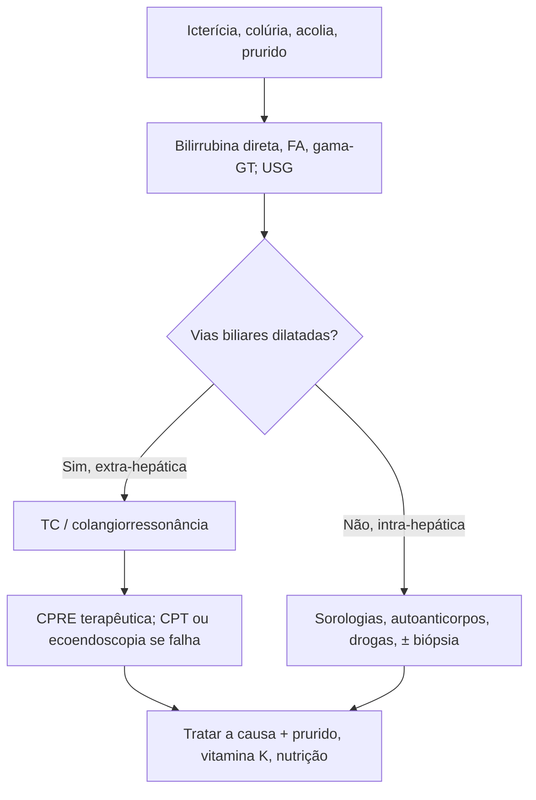

# Abordagem da Síndrome Colestática

> Resumo em palavras próprias do Whitebook (Condutas Cirúrgicas > Cirurgia Geral e do Aparelho Digestivo), sem fisiopatologia, autoria e referências. Confira detalhes e doses na fonte: https://whitebook.pebmed.com.br/conteudo/?id=45174&categoryId=207&subcategoryId=211

**Definição:** síndrome colestática é o conjunto de sinais e sintomas do bloqueio do fluxo de bile ao duodeno, com predomínio de bilirrubina direta; colestase é a estagnação ou redução da secreção/fluxo de bile no fígado.

## Classificação
- **Intra-hepática** (hepatite viral, alcoólica ou medicamentosa, cirrose): hepatocanalicular (intralobular), ductular (colangíolos/canais de Hering) ou ductal (interlobular).
- **Extra-hepática:** coledocolitíase (mais comum), compressão extrínseca (neoplásica ou benigna), colangiocarcinoma distal, fibroses pós-cirúrgicas.

## Clínica
Icterícia, prurido, colúria, acolia fecal, esteatorreia; história de álcool, drogas, medicamentos, idade, comorbidades, características da dor, náuseas/vômitos, saciedade precoce, anemia, colelitíase, neoplasias, hemorragia digestiva, hepatite, cirurgias prévias, diabetes, diarreia.
**Exame:** icterícia, dor em QSD, ascite, vesícula palpável (Courvoisier-Terrier sugere tumor periampular), massas, desnutrição/osteopenia, deficiência de vitaminas A, D, E, K, hiperpigmentação, xantomas.

## Diagnóstico
- **Laboratório:** hemograma, hepatograma (transaminases, bilirrubinas, enzimas canaliculares, proteínas, coagulograma), função renal, eletrólitos. Bilirrubina direta elevada, sem diferenciar a causa. **FA e gama-GT** mais altas (3–5× o normal) nas obstruções extra-hepáticas. TP pode aumentar (má absorção de vitamina K); colesterol e lipoproteínas podem subir. Sorologias (hepatites A, B, C, HIV); autoanticorpos: antimitocondrial (cirrose biliar primária), pANCA (colangite esclerosante primária), anti-CAII/ANA/ASMA (colangite autoimune), ANA/ASMA/pANCA (hepatite autoimune). Urina: bilirrubina ↑ e urobilinogênio ↓; fezes: gordura ↑ e urobilinogênio ↓.
- **USG:** método inicial, barato e acurado; distingue colestase intra de extra-hepática.
- **TC:** detalha fígado, vasos e nível da obstrução.
- **Colangiorressonância:** sensível para cálculos, estenoses, dilatações, cistos e massas.
- **Cintilografia hepatobiliar:** ocasional, em colecistite aguda.
- **CPRE:** terapêutica (eventualmente só diagnóstica); padrão-ouro para a árvore biliar quando há intervenção — esfincterotomia e retirada de cálculos; stents/drenos em falha ou lesões malignas.
- **Colangiografia percutânea trans-hepática:** lesões proximais ao hepático comum; quando a CPRE falha ou há variação anatômica.
- **Ecoendoscopia:** pâncreas e via biliar distal, biópsia, acesso biliar alternativo.
- O texto traz um algoritmo de diagnóstico diferencial em figura (ver fonte).
- **Diferenciais:** pancreatite aguda/crônica, hepatite alcoólica/viral, carcinoma periampular, estenose, tumores de via biliar/vesícula/pâncreas, colangiocarcinoma, colangite, coledocolitíase, colecistite, cisto de colédoco, cirrose, CBP e CEP, sarcoidose, doença enxerto-contra-hospedeiro, rejeição, adenoma hepático, hiperbilirrubinemia, drogas (carbamazepina, ciclosporina, amoxicilina-clavulanato, SMX-TMP, nitrofurantoína, azitromicina, clorpromazina, alopurinol, barbitúricos, fenitoína, clindamicina, itraconazol), causas congênitas (Alagille, hipoplasia de ductos, fibrose cística, deficiência de α1-antitripsina, Zellweger).

## Tratamento
- **Prurido:** leve — hidratantes; moderado — colestiramina e anti-histamínico; refratário — rifampicina, naloxona, ácido ursodesoxicólico. A melhora da icterícia melhora o prurido.
- **Medidas gerais:** vitamina K 10 mg IM 3 dias antes de procedimento; antibiótico se colangite; hidratação (proteger o rim); drenagem biliar temporária (CPRE ou cirurgia); probióticos; nutrição com vitaminas lipossolúveis A, D, E, K; doença óssea; medicamentos específicos; biópsia hepática se necessária.
- **Específico:** tratar a causa — desobstruir a via biliar (CPRE ou cirurgia), tratar infecções etc.

## Fluxograma (refeito, a partir do texto; o original é uma figura do algoritmo)

