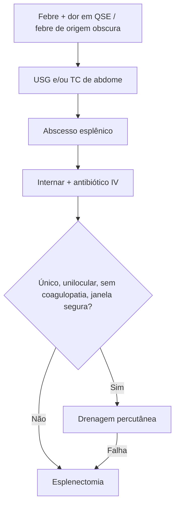

# Abscesso Esplênico

> Resumo em palavras próprias do Whitebook (Condutas Cirúrgicas > Cirurgia Geral e do Aparelho Digestivo), sem fisiopatologia, autoria e referências. Confira detalhes e doses na fonte: https://whitebook.pebmed.com.br/conteudo/?id=44537&categoryId=207&subcategoryId=211

**Definição:** infecção localizada dentro da cápsula esplênica, em geral com febre e leucocitose; incomum e potencialmente fatal, normalmente por endocardite ou disseminação hematogênica.

## Epidemiologia e fatores
- Incidência 0,14–0,7%; homens 2:1; 3ª a 6ª década.
- **Associações:** trauma esplênico, hemoglobinopatias, parasitoses, septicemia (êmbolos sépticos), quimioterapia, doença pancreática, cirurgia abdominal, bacteremia (2/3 dos casos; endocardite, ITU), infecção contígua, LES, Behçet, tumores benignos (cisto, hemangioma) e malignos do baço, doenças malignas, policitemia vera, uso de drogas IV, AIDS, tumor de cólon esquerdo, Crohn.
- **Microbiologia:** cocos gram-positivos (Staphylococcus, Streptococcus, Salmonella), enterococos, gram-negativos entéricos (*E. coli*) e fungos (*Candida*). Imunossuprimidos podem ter múltiplos abscessos fúngicos. Muitos têm infarto esplênico concomitante à bacteremia.

## Clínica
Insidiosa e inespecífica: dor no quadrante superior esquerdo, dor no ombro esquerdo (irritação diafragmática, polo superior), derrame pleural esquerdo, esplenomegalia, **febre recorrente (90%)** ou persistente apesar de antibiótico. Causa de febre de origem obscura.

## Diagnóstico
- **RX de tórax:** pouco usado; elevação da hemicúpula, derrame pleural esquerdo, atelectasia basal esquerda.
- **USG:** exame inicial, barato, operador-dependente; sensibilidade 76%; lesões anecoicas/hipoecoicas com paredes irregulares, esplenomegalia.
- **TC:** maior acurácia, melhor para caracterizar; sensibilidade 96%.
- Maioria é única e unilocular. **Diferenciais:** infarto, cisto, hemangioma, linfoma.

## Conduta
- **Internar todos** para antibiótico IV (sempre indicado) e drenagem se necessária. Alta com remissão da febre, melhora da dor e sem leucocitose.
- **Drenagem percutânea:** sucesso 75–90% em abscessos uniloculares. Indicada se único, sem septos e com material pouco espesso. Contraindicações: ruptura com sangramento, coagulopatia, múltiplos ou septados, ascite difusa, sem janela segura. Abscesso originado de hematoma: mau prognóstico para o tratamento percutâneo.
- **Esplenectomia:** abscessos multiloculares ou refratários ao tratamento percutâneo.

## Fluxograma (refeito, a partir do texto; o texto original não traz uma figura)

