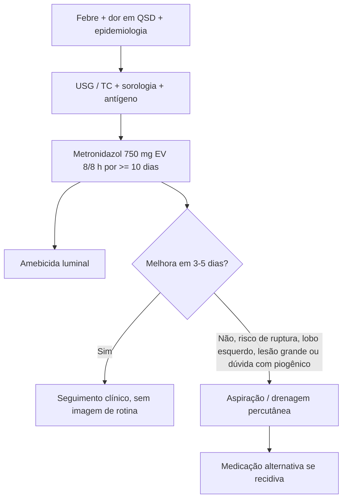

# Abscesso Hepático Amebiano

> Resumo em palavras próprias do Whitebook (Condutas Cirúrgicas > Cirurgia Geral e do Aparelho Digestivo), sem fisiopatologia, autoria e referências. Confira detalhes e doses na fonte: https://whitebook.pebmed.com.br/conteudo/?id=23688&categoryId=207&subcategoryId=211

**Definição:** manifestação extraintestinal mais comum da amebíase (*Entamoeba histolytica*). Trofozoítos atravessam a mucosa intestinal e chegam ao fígado pela circulação portal.

## Epidemiologia
- Mundial, com zonas endêmicas nos trópicos (Índia, África, México, América Central e do Sul); risco maior com saneamento precário.
- Adultos de 18–50 anos; frequência ~10× maior em homens; transmissão fecal-oral (água/alimentos), também contato sexual oral-anal.
- 2–5% dos pacientes com amebíase intestinal desenvolvem abscesso hepático (incidência < 1% da amebíase em algumas estimativas do texto).

## Quadro clínico
- Sintomas surgem 8–20 semanas após o contato (média 12); em 85% iniciam em < 2 semanas.
- Dor em QSD (pode ser em epigástrio, tórax e ombro direitos, às vezes pleurítica), febre por 1–2 semanas, tosse, perda de peso, hiporexia; diarreia em < 1/3. Idosos: evolução subaguda (média 6 meses) com perda de peso e hepatomegalia.
- Exame: hepatomegalia dolorosa (até 50%), **sinal de Torres-Homem** (percussão dolorosa da loja hepática), icterícia (até 10%), massa abdominal (ameboma). Pode romper para tórax, mediastino ou peritônio.
- **Fatores de mau prognóstico:** corticoide, imunossupressão, desnutrição, álcool, idade > 40, bilirrubina > 3,5 mg/dL, albumina < 2 g/dL, abscesso > 10 cm, múltiplos, PCR/VHS altos, encefalopatia, sinais de ruptura.

## Diagnóstico
- Suspeita: febre, dor em QSD ou no espaço intercostal direito (típico), epidemiologia.
- **Laboratório:** leucocitose > 10.000 sem eosinofilia; anemia normocítica; FA alta em até 80%; transaminases podem subir.
- **Sorologia:** anticorpos em até 95% após 7 dias (hemaglutinação indireta); 35% dos residentes em áreas endêmicas têm sorologia positiva por infecção prévia, então é útil sobretudo para excluir; pedir antígeno de *E. histolytica* por ELISA no soro ou nas fezes.
- **Imagem:** lesões em segmentos posteriores do lobo direito; 70–80% únicas. USG (sensibilidade 90–95%): cavidade hipoecoica, redonda, bem definida. TC: massa hipodensa com realce periférico, septos ou níveis. RM: hipo em T1, hiper em T2.
- **Aspiração (radiologia intervencionista):** indicada se risco iminente de ruptura (sobretudo lobo esquerdo), deterioração ou falta de resposta ao tratamento empírico. Líquido achocolatado (“pasta de anchova”) de hepatócitos necróticos; trofozoítos em < 20%; nested multiplex-PCR (sensibilidade 75–100%); cultura bacteriana (infecção secundária). Diagnóstico definitivo: parasita nas fezes ou no aspirado, ou sorologia positiva.

### Diferencial com abscesso piogênico
| | Amebiano | Piogênico |
|---|---|---|
| Idade | 20–40 anos | > 50 anos |
| Razão M:F | 10:1 | 1:1 |
| Lesões | Única | Múltiplas |
| Local | Lobo direito | Sem preferência |
| Viagem a área endêmica | Sim | Não |
| Hemocultura positiva | Não | Sim |
| Etilismo | Favorece | Não |
| TGP elevada | Rara | Comum |
| FA elevada | Comum | Comum |

Outros diferenciais: hidatidose, carcinoma hepatocelular, doença policística, cisto simples, cistadenoma, HNF, adenoma, hemangioma, Fitz-Hugh-Curtis, colangite, abscesso fúngico.

## Complicações
- **Ruptura torácica** (20–30%): derrame estéril, empiema, fístula broncopleural direita (mais indicativa de amebiano), fístula hepatobrônquica com tosse produtiva e material necrótico.
- **Ruptura peritoneal:** ~2/3 vão para o peritônio (abdome agudo), ~1/3 para o tórax; ruptura do lobo esquerdo para o pericárdio pode causar tamponamento; ruptura para porta, via biliar ou TGI é rara.
- Disseminação a cérebro, baço, coração, útero, pulmões, vagina, pele.

## Tratamento
- Iniciar empiricamente se epidemiologia, quadro e imagem compatíveis. **Nitroimidazol** seguido de **amebicida luminal** (mesmo com pesquisa fecal negativa).
- **Metronidazol 750 mg EV 8/8 h, mínimo 10 dias.** Outras opções: nitazoxanida, tinidazol, cloroquina.
- **Luminal:** paromomicina 30 mg/kg/dia por 7 dias (não usar junto com metronidazol — diarreia; não aprovada/comercializada no Brasil pela ANVISA).
- **Drenagem/punção** é exceção: excluir piogênico; sem resposta em 3–5 dias; risco iminente de ruptura; prevenir ruptura do lobo esquerdo para o pericárdio; lesão grande sem resposta. Recidiva em 5%: medicação alternativa + aspiração.
- **Seguimento:** remissão dos sintomas em 90% em até 72 h; maioria ambulatorial; internar quem tem comorbidades, mau prognóstico ou indicação de drenagem; **não acompanhar por imagem** (cura radiológica pode levar > 2 anos); avaliar resposta clínica.

## Fluxograma (refeito, a partir do texto; o texto original não traz uma figura)

