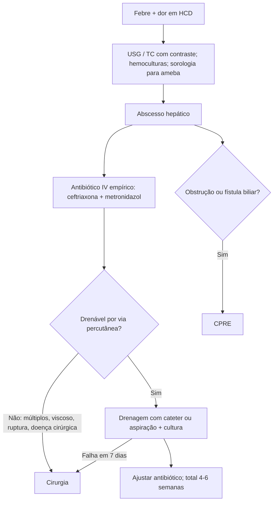

# Abscesso Hepático Piogênico

> Resumo em palavras próprias do Whitebook (Condutas Cirúrgicas > Cirurgia Geral e do Aparelho Digestivo), sem fisiopatologia, autoria e referências. Confira detalhes e doses na fonte: https://whitebook.pebmed.com.br/conteudo/?id=23690&categoryId=207&subcategoryId=211

**Definição:** coleção supurativa encapsulada por invasão e proliferação de bactérias no parênquima hepático.

## Origem e agentes
- **Vias:** biliar (mais comum; colangite ascendente por cálculo, estenose, tumor); portal (apendicite, diverticulite, DII); arterial (endocardite, osteomielite); extensão direta (colecistite, abscesso subfrênico); trauma/iatrogenia; criptogênica (10–40%).
- **Agentes:** em geral polimicrobiano (*E. coli* é a mais isolada); também *Klebsiella pneumoniae*, *S. aureus*, *Streptococcus*, anaeróbios; fúngico (*Candida*, *Aspergillus*) em imunossuprimidos; amebiano (ver Abscesso Hepático Amebiano).

## Epidemiologia
Incidência em alta (idade, diabetes, neoplasias, procedimentos invasivos); no Ocidente a causa bacteriana responde por 60–80%; mortalidade 2–15% (maior com diagnóstico tardio, múltiplos, sepse, falha de drenagem); mais comum em homens e idosos.

## Clínica
- Dor no QSD e febre (90%); náusea, vômito, anorexia, calafrios, sudorese noturna, emagrecimento, mal-estar; icterícia se obstrução biliar; viagem a área endêmica sugere amebiano.
- **Fatores de risco:** sexo masculino, idade, diabetes (múltiplos), desnutrição, imunossupressão, cirrose, doença hepatobiliopancreática ou policística, procedimentos endoscópicos/cirúrgicos, DII, diverticulite, trauma, transplante, neoplasia colorretal (*K. pneumoniae*), uso de IBP. *K. pneumoniae* invasiva: embolia séptica (ocular/neurológica) em até 12%.
- **Exame:** febre, dor em HCD, hepatomegalia (50%), peritonismo (ruptura), icterícia (pior prognóstico; sugere colangite com abscessos múltiplos).

## Diagnóstico
- **Laboratório:** leucocitose com desvio, provas inflamatórias e enzimas hepáticas elevadas, colestase com bilirrubina direta se obstrução. **Sorologia para *E. histolytica*** (positiva em 95% do abscesso amebiano após 7 dias; antígeno fecal se contato prévio). RX de tórax: elevação da hemicúpula direita, infiltrado basal, derrame.
- **USG** (lesões ≥ 2 cm: coleção com halo, sinal do alvo, loculações) e **TC** (padrão-ouro, sensibilidade > 90%, detecta coleções de 0,5 cm; trifásica é melhor): pré-supurativo — heterogêneo, mal delimitado, pode simular tumor; supurativo — hipodenso, multiloculado, cápsula espessa, sinal do anel, **gás intralesional** (quase patognomônico). Nenhum diferencia piogênico de amebiano. **RM:** pequenos, múltiplos ou lesões biliares. **Colonoscopia:** se foco GI; depois para rastrear neoplasia, sobretudo com *Klebsiella* ou origem criptogênica.
- **Microbiologia:** aspirado/dreno para bacterioscopia, cultura e antibiograma (± microscopia direta e PCR para ameba); **2 pares de hemoculturas** (positivas em 30–60%). Culturas de drenos previamente colocados podem ser contaminadas.
- **Diferenciais:** colecistite, colangite, abscesso amebiano, hidatidose/equinococose, metástases, CHC, doença policística, biloma, síndrome de Fitz-Hugh-Curtis.

| Característica | Amebiano | Piogênico |
|---|---|---|
| Idade | 20–40 | > 50 |
| Homem:mulher | 10:1 | 1:1 |
| Lesões | Única | Múltiplas |
| Local | Lobo direito | Qualquer |
| Viagem a área endêmica | Sim | Não |
| Hemocultura positiva | Não | Sim |
| Alcoolismo | Favorece | Não |
| TGP elevada | Raro | Comum |
| FA elevada | Comum | Comum |

## Tratamento
- **Antibiótico IV empírico** o mais cedo possível, após hemoculturas e idealmente antes da drenagem: cefalosporina de 3ª geração (ceftriaxona 1–2 g IV a cada 12–24 h) + metronidazol 500 mg IV 8/8 h; se grave ou resistência: adicionar aminoglicosídeo, ou carbapenêmico, ou piperacilina-tazobactam. Ajustar pela cultura. **Duração total 4–6 semanas**, IV por 2–4 semanas (ou até afebril e melhora), depois VO. Abscessos pequenos (< 3 cm) com boa resposta podem receber só antibiótico, mas a drenagem é preferível na maioria.
- **Drenagem percutânea** (TC/USG; 1ª linha na maioria): dreno pigtail 8–14 Fr ou agulha 16–18 G; cateter ou aspiração por agulha; manter o dreno até débito mínimo (~7 dias); se sem dreno, nova aspiração em ≥ metade dos casos. Falha em 15–36% (múltiplos, grandes, multiloculados, pus espesso, tecido necrótico, hipoalbuminemia). Múltiplos/multiloculados: decisão multidisciplinar (percutânea, laparoscopia ou aberta). Complicações: sepse, derrame pleural, reintervenção, perfuração, deslocamento, hemorragia, fístula biliar; drenagem biliar no pus exige investigar doença/obstrução biliar.
- **CPRE:** se obstrução biliar ou fístula biliar (descomprime e retira cálculos).
- **Cirurgia:** abscessos múltiplos/complexos inacessíveis, grandes com conteúdo muito viscoso, doença de base cirúrgica (obstrução biliar, apendicite), falha da drenagem (em até 7 dias), ruptura/peritonite, abscessos malignos. Opções: fenestração e limpeza (periféricos), drenagem guiada por USG ou ressecção limitada (profundos).
- **Alta:** afebril, dor controlada, leucocitose e inflamatórios controlados, débito mínimo ou sem dreno → antibiótico VO em casa. Alterações de imagem podem levar 16–22 semanas para resolver.

## Prevenção e prognóstico
Controlar diabetes, descomprimir via biliar, tratar infecções intra-abdominais, drenar cedo coleções, desbridar lesões traumáticas e usar profilaxia antes de instrumentar a via biliar. **Pior prognóstico:** idade, múltiplos, > 5 cm, sepse/choque, comorbidades (diabetes, IRC, câncer), *K. pneumoniae* invasiva, atraso. **Complicações:** ruptura (~6%) para peritônio/pleura/pericárdio, sepse, embolia séptica, fístula biliar, trombose portal, insuficiência hepática.

## Fluxograma (refeito, a partir do texto; o original traz imagens de TC)

