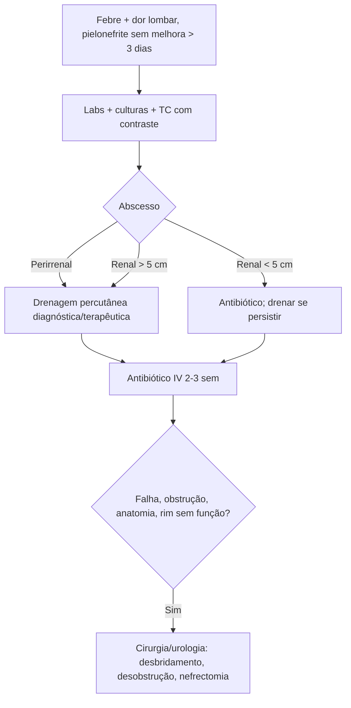

# Abscesso Perinéfrico/Renal

> Resumo em palavras próprias do Whitebook (Condutas Cirúrgicas > Cirurgia Urológica), sem fisiopatologia, autoria e referências. Confira detalhes e doses na fonte: https://whitebook.pebmed.com.br/conteudo/?id=48343&categoryId=207&subcategoryId=214

**Definição:** coleção purulenta no rim (abscesso renal, cavidade definida) ou ao redor dele (perirrenal/perinéfrico, entre cápsula renal e fáscia de Gerota, frequentemente septado), de apresentação insidiosa. Surge por infecção urinária ascendente (pielonefrite com anomalia do trato urinário) ou por disseminação hematogênica (córtex renal, em geral *S. aureus*); o perinéfrico também por ruptura de abscesso renal ou por contiguidade (fígado, vesícula, pâncreas, delgado/Crohn, apêndice retrocecal, osteomielite vertebral).

**Agentes:** bacilos Gram-negativos (E. coli, Proteus, Klebsiella, Enterobacter, Pseudomonas, Serratia, Citrobacter), *S. aureus*, Enterococcus; anaeróbios (Clostridium, Bacteroides, Actinomyces) nos de cultura negativa; raramente Candida e *M. tuberculosis*.

## Clínica
- Quadro insidioso de 1–2 semanas ou mais: febre, calafrios, dor lombar/flanco/abdominal, disúria, polaciúria, hiporexia, perda de peso, letargia, palidez; às vezes dor pleurítica ou referida. Pode parecer pielonefrite aguda que não melhora após > 3 dias de antibiótico adequado.
- Exame: Giordano positivo, massa palpável (nem sempre), sinais inflamatórios na pele em perinéfrico.
- **Fatores de risco:** diabetes, cirurgia urológica (inclusive transplante renal), gestação, bexiga neurogênica, refluxo vesicoureteral, obstrução vesical, necrose papilar, litíase (sobretudo coraliforme), doença cística, tuberculose geniturinária, trauma (biópsia renal), imunossupressão, drogas injetáveis, antibioticoterapia prolongada.
- **Complicações:** fístulas (estômago, delgado, pulmão, cólon, pele), abscesso subfrênico, empiema, pneumonia, atelectasia, ruptura peritoneal, perfuração diafragmática, sepse.

## Diagnóstico
- Hemograma (leucocitose), coagulograma, PCR e VHS elevados, ureia/creatinina, hemoculturas (positivas se hematogênico), urina e urocultura (normais se o abscesso não comunica com o sistema coletor; piúria intensa, proteinúria moderada e bacteriúria se comunica).
- RX: escoliose côncava para a lesão, massa, rim aumentado de limites imprecisos, perda do contorno do psoas, cálculo; tórax: derrame pleural, atelectasia, pneumonia, diafragma elevado. USG: cavidade de paredes espessas com líquido. **TC com contraste é o método de escolha** (extensão); RM alternativa.
- **Diferenciais:** pielonefrite não complicada, pionefrose, necrose papilar, malacoplaquia, pielonefrite enfisematosa, litíase, carcinoma de células claras, pielonefrite xantogranulomatosa.

## Tratamento
- Pilar: **drenagem**, de preferência percutânea (guiada por TC ou USG); desobstruir a via urinária quando necessário. Antibiótico é adjuvante. Desbridamento aberto com drenos se a percutânea falhar; nefrectomia (aberta ou laparoscópica) em rim sem função ou gravemente infectado.
- **Internação:** todo abscesso perinéfrico. Abscesso renal cortical ou fístula entérica: cirurgia imediata. Alta com estabilidade clínica/hemodinâmica/laboratorial e antibiótico adequado.
- **Antibiótico empírico IV (após culturas; cobrir *S. aureus* e Gram-negativos):** piperacilina-tazobactam 4,5 g 6/6 h; cefepime 1 g 8/8 h ou 2 g 12/12 h; meropeném 1 g 8/8 h; imipeném 500 mg 6/6 h ou 1 g 8/8 h. Ajustar pela cultura; duração ~2–3 semanas conforme extensão e resposta.
- **Drenagem por tamanho:** < 5 cm → antibiótico isolado (drenar se persistirem sintomas/imagem após alguns dias); > 5 cm → drenagem percutânea + antibiótico. Perirrenal/paranéfrico: drenar independente do tamanho (diagnóstico; urocultura pode ser negativa), idealmente antes do antibiótico empírico. Dreno até débito mínimo (geralmente até 7 dias).
- **Cirurgia/urologia:** obstrução urinária, anomalia anatômica, abscesso grande demais ou não drenável por via percutânea, parênquima atrófico e sem função (nefrectomia).
- **Seguimento:** clínica, curva térmica, dor, hemograma e marcadores inflamatórios; repetir imagem se não melhorar. Maior internação: idade avançada, diabetes, tamanho do abscesso.

## Fluxograma (refeito, a partir do texto; o original não traz algoritmo)

