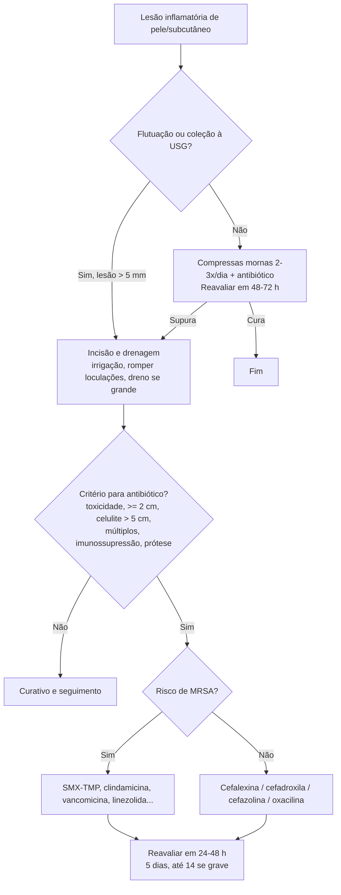

# Abscessos Cutâneos

> Resumo em palavras próprias do Whitebook (Condutas Cirúrgicas > Cirurgia Geral e do Aparelho Digestivo), sem fisiopatologia, autoria e referências. Confira detalhes e doses na fonte: https://whitebook.pebmed.com.br/conteudo/?id=22566&categoryId=207&subcategoryId=211

**Definição:** coleção purulenta na derme/subcutâneo após quebra da barreira cutânea e contaminação bacteriana (necrose de liquefação com loculação). Em geral polimicrobiano, com *S. aureus* predominante e crescente CA-MRSA.

## Formas clínicas
- **Simples:** trauma/maceração ou infecção de fâneros: foliculite (superficial, pústula com halo), furúnculo (nódulo com pústula e pelo), carbúnculo (furúnculos coalescentes com vários orifícios).
- **Cisto epidermoide infectado:** ruptura de folículo pilossebáceo; dorso, face, pescoço, escroto, retroauricular.
- **Hidradenite supurativa:** crônica e recorrente em glândulas apócrinas axilares e pubianas; ligada ao tabagismo.
- **Abscesso mamário por mastite:** pós-parto (2–6 semanas), mas 90% fora do puerpério; profundo ou periareolar; geralmente não contraindica amamentar.
- **Bartholinite:** cisto de retenção da glândula de Bartholin infectado (polimicrobiano; gonococo e clamídia); dor e abaulamento nos grandes lábios.
- **Cisto pilonidal:** região sacrococcígea, mais em homens; anaeróbios e enterobactérias.
- **Glúteo e perianal:** glúteo (foliculite, sem envolver o ânus); perianal origina-se das criptas e se associa a fístula (exame anorretal imperativo).

## Exame e diagnóstico
- Massa flutuante ou enduração, edema, eritema, dor, às vezes celulite e drenagem espontânea; lesões satélites.
- Diagnóstico clínico. **USG:** lesão anecoica ± loculações; útil em abscessos profundos, dimensão, profundidade, vasos, guia de punção.
- **Punção aspirativa:** diagnóstica (VPP alto; se negativa não exclui); como terapia, cura < 25%.
- **Diferenciais:** fascite necrosante, IST (LGV, cancroide), gangrena gasosa, eritema migrans, herpes-zóster, artrite/bursite séptica, osteomielite, aneurisma micótico, gota, dermatite de contato, reação a droga, vasculite, picada de inseto, paniculite, TVP, reação vacinal, miíase, esporotricose, arranhadura de gato.

## Tratamento
**Incisão e drenagem (I&D)** é o padrão (cura ~**85%** ou mais); procedimento muito doloroso.
- Indicada com lesão > 5 mm, acessível, com flutuação palpável ou visível à USG. Sem supuração: compressas mornas úmidas 2–3×/dia + antibiótico; em 48–72 h cura ou supura (drenar).
- Técnica: posição confortável, EPI, antissepsia, anestesia/analgesia; incisão profunda com lâmina 15 ou 11 seguindo as linhas de força; drenar (cultura se indicado); romper loculações com pinça romba; irrigar com SF até clarear; dreno (Penrose) em abscessos grandes; curativo estéril com cicatrização por segunda intenção.
- Abscessos grandes, complexos ou em face (lábio superior, nariz: trígono perigoso, risco de tromboflebite do seio cavernoso) → especialista.
- **Packing:** pode reduzir acúmulo, mas sem evidência de menos falha/recorrência/fístula; mais dor, trocas e custo; pode omitir em abscessos pequenos com drenagem completa e bom seguimento.

**Antibiótico adjuvante** quando: toxicidade sistêmica (febre, taquicardia, hipotensão); abscesso único **≥ 2 cm**; celulite extensa (> 5 cm além das bordas); múltiplos; próteses osteoarticulares/vasculares ou marca-passo; resposta inadequada à I&D; comorbidades/imunossupressão; alto risco de endocardite; alto risco de transmissão de *S. aureus* (atletas, militares).
- Reavaliar em 24–48 h; duração habitual **5 dias** (inclusive MRSA com resposta); até **14 dias** em casos graves, resposta lenta ou imunossupressão; parenteral por 5–14 dias, passando para oral com melhora. Falha pode indicar resistência, má adesão ou infecção profunda.
- **Via oral:** leve a moderado. **IV:** toxicidade (febre > 38 °C, hipotensão, taquicardia), eritema rápido, progressão em 48 h, intolerância oral, proximidade de dispositivos implantados, imunossupressão (neutropenia, transplante, AIDS).
- **MSSA:** cefalexina 500 mg VO 6/6 h; cefadroxila 500 mg VO 12/12 h; cefazolina 1 g EV 6/6 h; oxacilina 1 g EV 6/6 h.
- **MRSA:** SMX-TMP 800/160 mg 1–2 comp. VO 12/12 h; clindamicina 300–600 mg VO 8/8 h; vancomicina 500 mg EV 6/6 h ou 1 g 12/12 h ou 15 mg/kg 12/12 h; linezolida 600 mg EV 12/12 h (10 mg/kg 8/8 h); tigeciclina 100 mg dose única e 50 mg 12/12 h; daptomicina 4–6 mg/kg/dia.
- **MRSA + *S. pyogenes*** (abscesso vs celulite indefinidos): SMX-TMP + cefalexina 500 mg 6/6 h; ou clindamicina 300 mg 8/8 h; vancomicina; linezolida; drenar se formar abscesso.
- **Risco de MRSA:** < 2 anos, atletas de contato, usuários de drogas injetáveis, prisões/militares/institucionalizados, HIV, contato com animais, pneumonia grave/pós-influenza, outra infecção de partes moles, infecção/colonização prévia por CA-MRSA, antibiótico no último ano (quinolonas/macrolídeos).

**Profilaxia pré-drenagem (AHA 2007)** em cardiopatias graves: valva protética, valvopatia após transplante cardíaco, endocardite prévia, cardiopatia congênita (corrigida com material protético nos 6 primeiros meses; residual junto a material protético/shunts; cianótica ou com dispositivos). Cobertura para *S. aureus* e estreptococo do grupo A:
- cefazolina 1 g (50 mg/kg) IM/EV 30 min antes; clindamicina 600 mg (20 mg/kg) IM/EV 30 min; azitromicina 500 mg (15 mg/kg) VO 30 min; amoxicilina 2 g (50 mg/kg) VO 60 min; cefalexina 2 g (50 mg/kg) VO 60 min.

## Abscessos complexos
- **Cisto epidermoide infectado:** I&D e excisão completa com cápsula após a inflamação (I&D isolada recorre muito).
- **Bartholin:** I&D pela face medial do vestíbulo, com ou sem cateter de Word por 4–6 semanas + banhos de assento; alternativas: marsupialização ou extirpação.
- **Pilonidal:** I&D e depois excisão definitiva.
- **Perianal/perirretal:** I&D de urgência (idealmente por especialista, em centro cirúrgico) + antibiótico; sem drenagem pode progredir.
- **Usuários de drogas injetáveis:** fonte do próprio paciente ou do material; excluir corpo estranho (RX/USG); Doppler para complicações vasculares; pesquisar HIV e hepatites; cobertura polimicrobiana incluindo MRSA; persistência de inflamação → investigar endocardite.

## Recorrência
Drenar e cultivar; se recorrente desde a infância, investigar imunidade celular; no mesmo local, pensar em pilonidal, hidradenite, corpo estranho.
- Medidas: não compartilhar itens pessoais; banho diário com clorexidina 4% por 5 dias (exceto face, feridas abertas e mucosas; sem cremes/sabonetes depois); mupirocina 2% nasal 2×/dia por 5 dias; antibiótico anti-MRSA VO por 10 dias para o caso-índice; lavar roupas com água sanitária diluída.

## Fluxograma (refeito; o original "Piodermites na Emergência" está como imagem na fonte)

