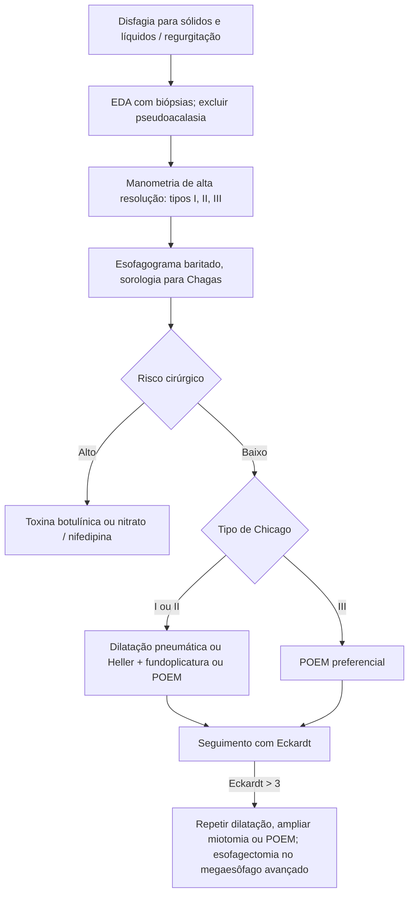

# Acalasia de Esôfago

> Resumo em palavras próprias do Whitebook (Condutas Cirúrgicas > Cirurgia Geral e do Aparelho Digestivo), sem fisiopatologia, autoria e referências. Confira detalhes e doses na fonte: https://whitebook.pebmed.com.br/conteudo/?id=48863&categoryId=207&subcategoryId=211

**Definição:** distúrbio motor primário com ausência de peristalse do corpo esofágico e de relaxamento do EEI após a deglutição.

## Epidemiologia
- 25–60 anos (mediana ao diagnóstico 59), sem predileção de sexo ou etnia; idiopática 7–13/100.000. A acalasia chagásica é a mais relevante no Brasil (7–10% dos infectados por *T. cruzi*).
- Risco de neoplasia de esôfago 16–28× maior, mas o risco absoluto é baixo (~0,34%/ano).

## Quadro clínico
Evolução lenta; muitos são tratados por anos como DRGE.
- Disfagia para sólidos e líquidos (85–91%), regurgitação de alimento não digerido (76–91%), pirose em 75% (fermentação do alimento retido).
- Dor retroesternal em até 60% (mais em jovens, tende a diminuir).
- Perda de peso em geral leve; perda rápida e acentuada sugere **pseudoacalasia** maligna. Obesidade é cada vez mais frequente.
- Soluços, halitose, tosse noturna, microaspiração, pneumonia aspirativa, dificuldade de eructar, globus (incomum).

**Escore de Eckardt** (0–12): disfagia, regurgitação, dor torácica (0 ausente; 1 ocasional; 2 diária; 3 em todas as refeições) e perda de peso (1 < 5 kg; 2 5–10 kg; 3 > 10 kg). Estágios: 0–1 = 0; 2–3 = I; 4–6 = II; > 6 = III.

## Diagnóstico
- Suspeitar com disfagia para sólidos e líquidos, pirose refratária a IBP, restos alimentares na EDA, resistência à passagem pela JEG.
- Essenciais: **EDA** (afastar neoplasia; sempre) e **manometria de alta resolução**. Fazer biópsias seriadas mesmo com EDA normal (esofagite eosinofílica pode coexistir ou mimetizar). **USE ± PAAF** se sinais de malignidade: sintomas < 6 meses, disfagia após os 60 anos, perda de peso acentuada, achados endoscópicos atípicos.
- **Manometria de alta resolução (padrão-ouro):** IRP mediana > 15 mmHg e ausência de peristalse normal.
  - **Tipo I (clássica):** relaxamento incompleto, aperistalse (DCI < 100) sem pressurização (20–40%).
  - **Tipo II:** como o I mais pressurização pan-esofágica > 30 mmHg em ≥ 20% das deglutições (50–70%).
  - **Tipo III (espástica):** contrações prematuras (latência distal < 4,5 s), DCI ≥ 450 em ≥ 20% das deglutições (5%).
  - Opioides se associam ao tipo III: suspender ≥ 24 h antes. Diagnóstico inconclusivo (I/II com IRP no limite): esofagograma baritado ajuda.
- **Manometria convencional** (se não houver HR): aperistalse dos 2/3 inferiores ou ondas simultâneas < 40 mmHg, relaxamento incompleto do EEI, pressão de repouso do EEI > 45 mmHg; “acalasia vigorosa” tem ondas simultâneas > 40 mmHg.
- **Esofagograma baritado:** megaesôfago, morfologia, esvaziamento. Clássico: afunilamento distal em “bico de pássaro”, dilatação proximal com níveis, retardo do esvaziamento, ausência de bolha gástrica; avançado: aspecto sigmoide. Coluna de bário **> 5 cm em 1 min e > 2 cm em 5 min** sugere acalasia (útil em recidiva).
- **Classificação de Rezende (Chagas):** I < 4 cm, hipotônico, com bolha gástrica; II 4–7 cm, ondas terciárias; III 7–10 cm, bico de pássaro; IV > 10 cm, dolicomegaesôfago acinético.
- **EDA:** esôfago dilatado, atônico, tortuoso com resíduos; EEI normal ou anel espessado em roseta; mucosa normal ou com eritema, úlceras por estase, candidíase. **Escore CARS** (conteúdo, anatomia, resistência, estase; 0–2 cada) ≥ 4: sensibilidade 68%, especificidade 99%.
- **Laboratório:** sorologia para Chagas (2 métodos), hemograma, albumina, coagulograma, TSH.
- **Diferenciais:** DRGE, hipersensibilidade ao refluxo, pirose/disfagia funcionais, **pseudoacalasia** (adenocarcinoma da JEG, câncer de esôfago/pulmão/pâncreas, linfoma; diferenciar por EDA e USE), espasmo distal, jackhammer, amiloidose, esclerose sistêmica/CREST, EoE, neurofibromatose, Zenker, sarcoidose, corpo estranho.

## Tratamento
Nenhum é curativo; a eficácia cai com o tempo. Objetivo: reduzir a pressão do EEI, aliviar sintomas, prevenir dilatação e complicações. Individualizar (subtipo de Chicago, condição clínica, comorbidades, idade, preferência, recursos locais).
- **Tipos I e II:** melhor prognóstico (dilatação pneumática e miotomias). **Tipo III:** pior prognóstico; POEM tende a ser melhor (miotomia mais longa).
- **Baixo risco cirúrgico:** dilatação pneumática gradual, miotomia de Heller laparoscópica, POEM. **Alto risco:** toxina botulínica no EEI; nitratos (menos eficazes).
- **Dilatação pneumática:** sucesso inicial até 90%; recidiva até 60% em 5 anos. Melhor em > 40–45 anos, mulheres, sem grande dilatação do esôfago, tipo II. Pior em < 40 anos, homens, dilatação única, dor torácica basal, EEI > 30 mmHg. Perfuração 1–2%; refluxo diário ~20%.
- **Heller + fundoplicatura parcial (Dor ou Toupet):** indicada se persistirem sintomas após 3 dilatações ou recorrência frequente; alguns consensos a põem como 1ª linha; melhor em < 40 anos e tipos I/II. Riscos: perfuração, pneumotórax, sangramento, lesão vagal, infecção; DRGE baixo com fundoplicatura.
- **POEM:** túnel submucoso do esôfago médio até a cárdia com miotomia circular; sucesso 95% (I), 97% (II), 93% (III); alternativa a Heller e resgate após falha dela; maior risco de DRGE; complicação específica: *blown-out myotomy*.
- **Esofagectomia:** último recurso (megaesôfago tortuoso > 6 cm com sintomas graves refratários); morbidade 19–50% (pneumonia, fístula), mortalidade 0–5,4%.
- **Fármacos:** nifedipina 10–30 mg 30–45 min antes das refeições; dinitrato de isossorbida 5 mg SL 10–15 min antes; sildenafil 50 mg/dia. Para quem não pode ser submetido a procedimentos ou falhou com botox.

## Seguimento
Eckardt: **> 3** sugere falha. Recorrência tardia: EDA, esofagograma, manometria e pHmetria. Recidiva: dilatação pneumática ou ampliar a miotomia (cirurgia ou POEM). Taxas de recidiva: 10–31% após dilatação, 5–35% após Heller, até 60% após POEM. IBP contínuo se esofagite > grau A de Los Angeles. Vigilância endoscópica periódica não é rotina (apenas com sintomas novos); Chagas com > 10–15 anos de doença: alguns serviços fazem EDA a cada 3 anos.

## Fluxograma (refeito, a partir do texto; o texto original traz figuras ilustrativas das técnicas)

