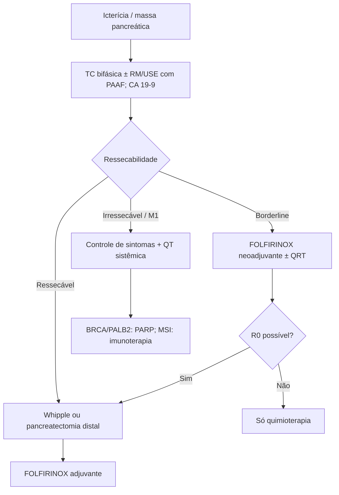

# Adenocarcinoma de Pâncreas

> Resumo em palavras próprias do Whitebook (Condutas Cirúrgicas > Cirurgia Oncológica), sem fisiopatologia, autoria e referências. Confira detalhes e doses na fonte: https://whitebook.pebmed.com.br/conteudo/?id=53699&categoryId=207&subcategoryId=212

**Definição:** neoplasia maligna primária do pâncreas exócrino (carcinoma ductal pancreático). 85–90% dos tumores pancreáticos; principal tumor periampular e o de pior prognóstico; ~2% dos cânceres no Brasil; incidência cresce após 50 anos (pico 70–75). 60–70% na cabeça, 20–25% corpo/cauda, o restante difuso. Principal fator de risco: tabagismo; depois obesidade. Assintomático no início; só 15–20% elegíveis à cirurgia curativa; sobrevida em 5 anos até 30% com R0 e linfonodos negativos, 10% com linfonodos positivos.

## Aspectos gerais
- 80–90% esporádicos; < 10% hereditários (BRCA2, p16, ATM, STK11, PRSS1/2, SPINK1, PALB2, reparo de DNA). Precursores: PanIN (< 5 mm), IPMN, neoplasia cística mucinosa. Mutações em sequência: KRAS → p53/SMAD4 → genes de reparo. Reação desmoplásica intensa (resistência à QT). Variantes: adenoescamoso, mucinoso/coloide, anaplásico, células em anel de sinete, medular, hepatoide.
- **Fatores de risco:** > 55 anos; masculino; afrodescendente; dieta rica em gordura e carne vermelha e pobre em frutas; história familiar; pancreatite crônica; gastrectomia ou colecistectomia prévia; tabaco; álcool; exposição ocupacional (nitrosaminas, organoclorados, cádmio, níquel, cromo, sílica, radiação, asbesto); HIV; hepatites B e C; *H. pylori*; resistência insulínica (IMC > 30, sedentarismo, adiposidade central, síndrome metabólica, DM1 e DM2); grupo sanguíneo não O; síndromes hereditárias (pancreatite hereditária, fibrose cística, Peutz-Jeghers, Lynch, Li-Fraumeni, ataxia-telangiectasia); neoplasias mucinosas (NCM, IPMN). **Proteção:** controle glicêmico, folato, grupo O, frutas.
- **Anatomia:** cabeça — à direita da borda esquerda da VMS (inclui processo uncinado); corpo — entre as bordas esquerdas da VMS e da aorta; cauda — da aorta ao hilo esplênico. Linfonodos da cabeça: colédoco, hepática comum, porta, pilóricos/infrapilóricos, mesentéricos proximais, celíacos, vasos pancreaticoduodenais, VMS e lateral direita da AMS; corpo/cauda: hepática, tronco celíaco, esplênica, hilo, retroperitoneais e aórticos laterais.

## Clínica
Precoces por efeito de massa: síndrome colestática (icterícia, colúria, acolia). Tardios: perda de peso, dor em abdome superior irradiada para as costas (lombar intensa em doença avançada), consumptiva, pancreatite inexplicada, obstrução alta, diabetes de início súbito, náusea/vômito, diarreia/esteatorreia, ascite, adenomegalias, paniculite, depressão, tromboflebite migratória. **Exame:** icterícia, queda do estado geral, Courvoisier-Terrier (30%), massa, ascite, Sister Mary Joseph (umbilical), Virchow-Troisier (supraclavicular esquerdo), prateleira de Blumer (fundo de saco).

## Diagnóstico
- Icterícia → USG (dilatação das vias biliares, lesão hipoecoica; sensível em tumores > 3 cm).
- **Laboratório:** hemograma/ferritina, bilirrubinas (colestática), transaminases e enzimas canaliculares. **CA 19-9** > 200 (ref. 37 ng/mL): especificidade 95% em suspeita periampular; falso-positivo em icterícia; útil no seguimento e na recidiva; não diagnóstico nem rastreio.
- **TC** (preferencial, com angiotomografia bifásica: arterial 40–50 s e portal 65–70 s): lesão hipoatenuante de margens mal definidas, ± cisto, dilatação, adenomegalia, nódulos; avalia vasos e ressecabilidade e metástases. **Colangiorressonância:** equivalente à CPRE sem invasão. **RM:** mais sensível para tumores pequenos e para resposta à neoadjuvância; não é rotina de estadiamento.
- **CPRE:** morbidade extra sem informação adicional em cabeça; papel terapêutico (drenagem). **USE:** lesões de 2–3 mm, alto VPN, PAAF transgástrica/transduodenal (indicações: irressecável ou más condições, neoadjuvância, dúvida diagnóstica; limitada em infiltração difusa, pancreatite crônica, pancreatite aguda < 4 semanas, pâncreas divisum; complicações: pancreatite, infecção, perfuração, sangramento, disseminação 2,2%); elastografia e contraste (hipocaptante); N com acurácia 41–86% (redondo, > 1 cm, margens definidas, hipoecoico); auxilia neurólise do celíaco, RT guiada e drenagem.
- **Laparoscopia** (dúvida no estadiamento tomográfico; ± USG hepática intraoperatória, em ressecáveis/borderline). **Histologia** (biópsia/PAAF do primário ou de metástase) sempre antes de tratamento sistêmico; se cirúrgico, pode ser na peça.
- **Diferenciais:** câncer de vesícula, colangiocarcinoma, tumor duodenal ou de papila, pancreatite crônica pseudotumoral, colangite.
- **TNM UICC 8ª ed.:** T1 ≤ 2 cm (T1a ≤ 0,5; T1b > 0,5 e < 1; T1c 1–2); T2 > 2 e ≤ 4; T3 > 4; T4 envolve plexo celíaco, AMS e/ou AHC. N1 1–3 linfonodos; N2 > 4 (o texto grafa assim). Estágios: IA T1; IB T2; IIA T3; IIB N1; III N2 ou T4; IV M1.

## Ressecabilidade
Classificação em ressecável, borderline e irressecável (VPP > 90% para irressecabilidade); considerar equipe, estrutura e paciente. Arterial (AMS, tronco celíaco, AHC): contato < 180° sem deformação; > 180° sem deformação; > 180° com deformação/“em gota”. Venoso (VMS e VP): invasão, trombo, atenuação da gordura.
- **Ressecável:** sem contato arterial, sem contato com VMS/VP ou < 180° sem distorção. Cirurgia imediata.
- **Borderline — cabeça/uncinado:** AHC sem extensão ao celíaco/bifurcação (ressecção e reconstrução seguras); AMS ≤ 180°; variante anatômica (ex.: hepática direita); contato com VCI; VMS/VP > 180° ou ≤ 180° com irregularidade/trombose, com segmentos proximal e distal viáveis. **Corpo/cauda:** celíaco ≤ 180°, ou > 180° sem aorta e com gastroduodenal íntegra. Alta probabilidade de R1 → neoadjuvância.
- **Irressecável:** metástase; cabeça — AMS ou celíaco > 180°, primeiro ramo jejunal da AMS, ramo jejunal proximal de drenagem para VMS, VMS/VP sem possibilidade de reconstrução; corpo/cauda — AMS e celíaco, celíaco e aorta, VMS/VP não reconstruível.

## Tratamento
- **Doença localizada:** cirurgia é a única curativa; só ~20% são ressecáveis. Encaminhar só com alta chance de R0. **Cabeça:** duodenopancreatectomia (Whipple: duodeno, jejuno proximal, colecistectomia com colédoco, gastrectomia parcial; anastomoses pancreática, biliar e gastrojejunal). **Corpo/cauda:** pancreatectomia distal ± esplenectomia, dissecando a hemicircunferência esquerda da AMS até a esquerda do celíaco. Ressecção venosa (VMS/porta) com reconstrução é possível para R0; arterial é mais mórbida e não recomendada. Congelação das margens pancreática e do colédoco; R1 = tumor a ≤ 1 mm. Cirurgia aberta é padrão-ouro (minimamente invasiva: impacto oncológico discutível); centros de alto volume; idade isolada não contraindica. **Linfadenectomia:** ≥ 12 linfonodos (idealmente ≥ 15), não extensa — Whipple: estações 5, 6, 8a, 12b, 12c, 13a, 13b, 14a, 14b, 17a, 17b; pancreatectomia distal: 10, 11 e margem inferior.
- **Drenagem biliar pré-operatória:** não de rotina; só em colangite ativa, cirurgia que não ocorra em 2 semanas, ou bilirrubina > 250 µmol/L (~14,6 mg/dL; o texto escreve “<”, conferir); usar endopróteses plásticas (as metálicas aumentam morbidade).
- **Adjuvância:** a cirurgia sozinha tem resultado pobre; QT adjuvante aumenta a sobrevida — preferencialmente **FOLFIRINOX** (5-FU, oxaliplatina, irinotecano); frágeis (> 70 anos, ECOG 2) ou contraindicação: gencitabina e/ou capecitabina. RT adjuvante: não padronizada, evidência fraca.
- **Borderline:** neoadjuvância (QT de indução com FOLFIRINOX ± QRT) seguida de cirurgia e QT adjuvante; se R0 inviável, só QT; incluir em ensaios.
- **Doença avançada:** individualizar (ECOG, comorbidades, preferência, sintomas, toxicidade). Antes, controlar sintomas: obstrução biliar (endoprótese metálica endoscópica, drenagem percutânea, derivação biliodigestiva); obstrução intestinal (stent metálico, derivação); dor (equipe de dor, analgésicos, bloqueio do plexo celíaco). Sistêmico: FOLFIRINOX (maior sobrevida, tóxico); gencitabina + nab-paclitaxel; gencitabina ou fluoropirimidina isoladas. Mutação germinativa de BRCA ou PALB2 → manutenção com inibidor de PARP após platina sem progressão; instabilidade de microssatélites → imunoterapia; na progressão, usar esquemas ainda não empregados.
- **Prognóstico pior:** metástase, linfonodos, CA 19-9, performance status, morbidade perioperatória, ausência de adjuvância, margem R1/R2.

## Fluxograma (refeito, a partir do texto; o original não traz algoritmo)

