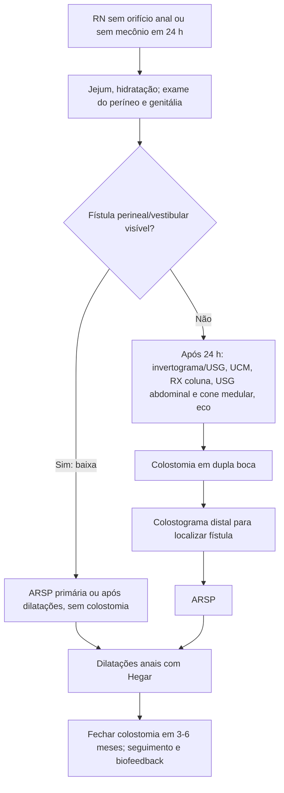

# Anomalia Anorretal

> Resumo em palavras próprias do Whitebook (Condutas Cirúrgicas > Cirurgia Pediátrica), sem fisiopatologia detalhada, autoria e referências. Confira detalhes e doses na fonte: https://whitebook.pebmed.com.br/conteudo/?id=47070&categoryId=207&subcategoryId=826

**Definição:** grupo de malformações do reto e/ou canal anal, com ou sem fístula para o períneo ou trato geniturinário (ânus imperfurado). Causa desconhecida (genética; FIV, talidomida, diabetes). Falha da separação da cloaca (septo anorretal, ~7ª semana).

## Epidemiologia
- 1:4.000–5.000 nascidos vivos; leve predomínio masculino (1,2:1); anomalias altas mais em meninos e baixas em meninas.
- **Meninos:** fístulas retouretral e perineal. **Meninas:** fístulas retovestibular e perineal; terceira mais frequente é a cloaca.
- Down: reto em fundo cego sem fístula em 95% (vs 5% da população geral).
- Anomalias associadas em > 60%: geniturinárias até 50% (RVU, agenesia renal, criptorquidia, vagina/útero septados; mais quanto mais alta a anomalia); lombossacrais ~30% (sacro em borboleta, hemivértebras, disrafismo; sinais cutâneos dorsais); cardíacas (Fallot, CIV); traqueoesofágicas ~10%; **tríade de Currarino** (anomalia anorretal + defeito sacral + massa pré-sacral); síndrome do olho de gato; regressão caudal e sirenomelia.

## Clínica
O exame do RN costuma revelar a imperfuração; se não, distensão e ausência de mecônio em 24 h exigem reexame. Observar: forma do períneo (arredondado com sulco ou plano), ânus/fístula, limites do esfíncter, trajetos (rafe do períneo/escroto, vestíbulo, vagina), calibre, genitália (hipospadia, escroto bífido, fusão labial), mecônio pela uretra, fenda perineal. Meninas: **1 orifício = cloaca; 2 = fístula vaginal (rara); 3 = fístula perineal/vestibular**.

## Diagnóstico
Pré-natal pouco revelador (polidrâmnio, cistos, hidronefrose/hidrocolpo). Laboratório: hemograma, tipagem, eletrólitos; urina para fístula retourinária.
- **Invertograma** (lateral em prona com quadris elevados) após as primeiras **24 h**, se sem fístula e sem mecônio visível; RX de abdome; **RX lombossacra sempre**; **UCM** (fístula retourinária, RVU); USG do coto retal/períneo (sem fístula); **USG do cone medular** (neonatos/lactentes, examinador experiente); **USG abdominal em todos**; RM (não rotina, exige sedação); DMSA se alteração urinária; **ecocardiograma**; genitografia/endoscopia do seio urogenital/cistoscopia na cloaca; **colostograma distal** (boca distal da colostomia) ou "colossonografia" (USG com contraste, sem radiação, emergente).

## Classificação de Peña
**Meninos:** fístula perineal; retouretral (bulbar ou prostática); retovesical; ânus imperfurado sem fístula; atresia retal. **Meninas:** fístula perineal; vestibular; cloaca; imperfurado sem fístula; atresia retal.

## Tratamento
- **Inicial:** jejum, hidratação IV, tratar ameaças à vida; antibiótico de amplo espectro se suspeita de fístula urinária (anaeróbios não necessários nas primeiras 48 h).
- **Cirurgia padrão: anorretoplastia sagital posterior (ARSP).**
  - Anomalias baixas (fístula perineal/vestibular): ARSP primária ou após dilatações, **sem colostomia**.
  - Anomalias altas (ex.: fístula retovesical): dois tempos; **colostomia em dupla boca** no sigmoide distal (separando as bocas), que facilita preparo, permite colostograma, previne prolapso e protege a ARSP; depois ARSP após estudo completo.
- **Complicações:** infecção de ferida, deiscência, prolapso/estenose da anoplastia, fístulas geniturinárias, posicionamento incorreto no complexo muscular, lesão de vagina/uretra/ducto deferente.
- **Pós-operatório:** **dilatações anais** com velas de Hegar, aumentando o calibre semanalmente; investigar anomalias associadas; profilaxia antibiótica se RVU/lesão renal/fístula retourinária; fechar a colostomia 3–6 meses depois; incontinência: manejo clínico, nova cirurgia se preciso; biofeedback e fisioterapia pélvica.
- **Prognóstico:** ligado à continência fecal (tipo de anomalia, sacro, inervação medular); pior nas altas, com alteração sacral e medular; seguimento multidisciplinar.

## Fluxograma (refeito, a partir do texto; o original traz figuras de classificação)

