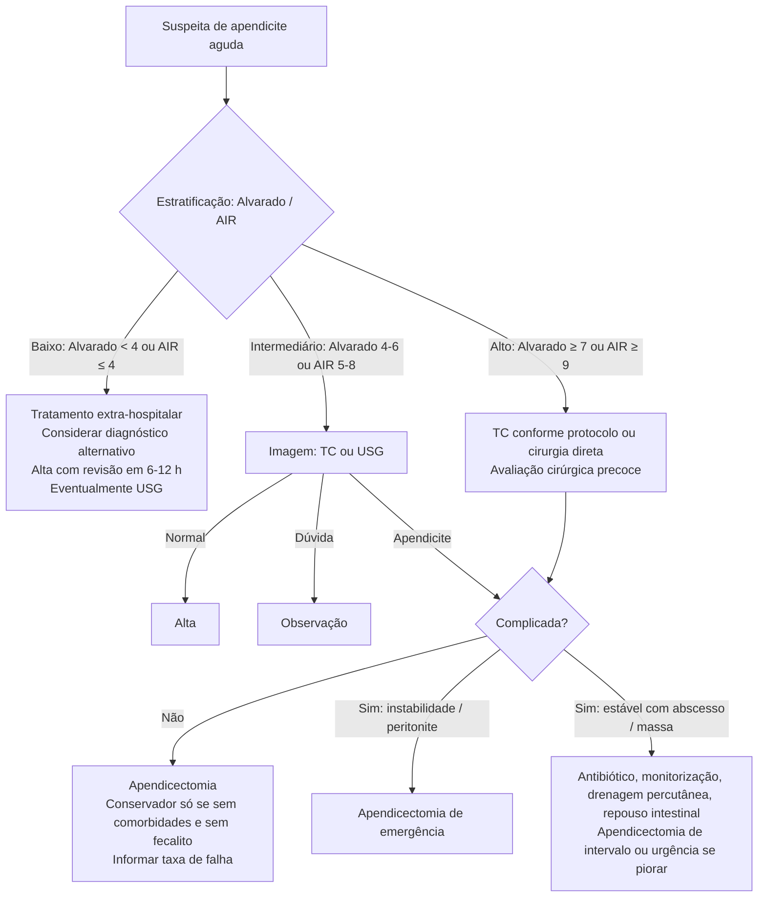

# Apendicite Aguda

> Resumo em palavras próprias do Whitebook (Condutas Cirúrgicas > Cirurgia Geral e do Aparelho Digestivo), sem fisiopatologia, autoria e referências. Confira detalhes e doses na fonte: https://whitebook.pebmed.com.br/conteudo/?id=22568&categoryId=207&subcategoryId=211

**Definição:** inflamação do apêndice cecal por obstrução súbita da luz. Causas da obstrução: fecalitos, hiperplasia linfoide (crianças), neoplasias (carcinoide, adenocarcinoma, cistoadenoma mucinoso, mucocele), parasitas, corpo estranho. Flora polimicrobiana (*E. coli*, *Bacteroides*).

## Epidemiologia
- Causa mais comum de abdome agudo e emergência cirúrgica abdominal mais prevalente; 100–200 casos/100.000/ano no Ocidente; pico na 2ª e 3ª décadas; leve predomínio masculino (risco vitalício 8,6% homens, 6,7% mulheres).
- Emergência cirúrgica não obstétrica mais comum na gestação. Risco 3× maior com história familiar. Malignidade associada ~1%.

## Quadro clínico
- **Anamnese:** dor mal localizada em mesogastro que migra para a FID; anorexia (sinal mais precoce), náuseas/vômitos, febre, queda do estado geral. A posição variável do apêndice muda a dor (lombar, hipocôndrio direito, hipogástrica).
- **Exame físico:** dor em McBurney; Blumberg (descompressão dolorosa); Rovsing (dor na FID ao palpar a FIE); Lenander (temperatura retal > axilar em > 1 °C); Dunphy (dor piora com tosse); Aaron (dor epigástrica ao palpar McBurney); iliopsoas e Lapinsky (apêndice retrocecal); obturador (apêndice pélvico); peritonite difusa/abdome em tábua nos casos avançados; massa/plastrão sugere abscesso; ruídos reduzidos ou ausentes.

## Diagnóstico
O diagnóstico é clínico; exames complementam.
- **Laboratório:** leucocitose ± desvio, PCR elevada, piúria. **β-hCG** em mulheres em idade fértil.
- **USG:** primeira escolha em gestantes e crianças; sensibilidade **86%**, especificidade **81%**; não exclui. Achados: sinal do alvo, líquido pélvico livre, estrutura tubular não compressível **> 7 mm**. Limitada por operador, obesidade e distensão de alças.
- **TC de abdome** (sem contraste inicialmente; com contraste em dúvida): dúvida diagnóstica (crianças, idosos, mulheres férteis, DM, obesidade, imunossupressão) e risco intermediário; diagnóstico alternativo em ~**15%**. Em crianças só após a USG. Achados: diâmetro **> 7 mm** com lúmen ocluído, parede **> 2 mm**, densificação da gordura, apendicolito (~25%).
- **RM:** alternativa em gestantes e crianças; menos evidência.
- **Alvarado modificado** (máx. 9): anorexia (1), náusea/vômito (1), dor migratória (1), dor em FID (2), defesa à descompressão (1), temperatura **> 37,5 °C** (1), leucocitose **> 10.000** (2). O original inclui desvio à esquerda (+1, total 10).
  - **0–3 baixo risco** (apendicite 3,7% adultos, 1,9% crianças): orientar retorno e procurar outras causas.
  - **4–6 risco moderado** (45% adultos, 12% crianças): observar e reavaliar; se igual em 12 h, cirurgia; mulheres, considerar TC.
  - **≥ 7 alto risco** (87% adultos, 67% crianças): homem, apendicectomia; mulher não gestante, laparoscopia diagnóstica ou TC.
  - Limites: ignora comorbidades/imunossupressão; boa sensibilidade (sobretudo em homens), baixa especificidade.
- **Escore AIR:** vômitos 1; dor em FID 1; descompressão dolorosa leve 1/moderada 2/forte 3; temperatura **≥ 38,5 °C** 1; leucócitos 10.000–14.900 = 1, **≥ 15.000** = 2; PMN 70–84% = 1, **≥ 85%** = 2; PCR 10–49 g/L = 1, **≥ 50** = 2. **0–4 baixo** (≈5%): ambulatório; **5–8 indeterminado** (≈50%): observação, exames seriados, imagem ou laparoscopia; **9–12 alto** (≈88%): exploração cirúrgica. Parece superar o Alvarado.

**Classificação:** congestão/pus; gangrena (iminência de perfuração); perfuração (13–20%, mais em homens e idosos); abscessos pélvicos/abdominais. As duas últimas elevam o risco pós-operatório.

**Diferenciais:** apendagite epiploica (QIE, TC, tratamento conservador); apendicite crônica (14–30%, sintomas ≥ 3 semanas, apendicectomia); linfadenite mesentérica, diverticulite direita, divertículo de Meckel, Crohn, ileíte, urolitíase, causas ginecológicas (abscesso tubo-ovariano, DIP, cisto roto, Mittelschmerz, torção, endometriose, ectópica), urológicas.

**Complicações:** infecção de sítio cirúrgico (a mais comum), perfuração, peritonite fecal, coleções, abscesso hepático, retroperitoneal, pileflebite, obstrução, fístulas, apendicite de coto, sepse, óbito.

## Tratamento
**Geral:** sinais vitais, hidratação, correção hidroeletrolítica; analgesia (dipirona, paracetamol, AINE, opioides) não atrapalha o diagnóstico nem aumenta intervenção tardia.

**Conservador (antibiótico isolado)** em apendicite simples selecionada: cobertura de aeróbios e anaeróbios, IV por ≥ 1–3 dias e depois oral, total **7–10 dias**, observação hospitalar. Resposta inicial em ~**90%** (10% precisam de cirurgia); **20–40%** operam no 1º ano. Melhor candidato: PCR **< 60 mg/L**, leucócitos **< 12.000**, idade **< 60**. **Apendicolito** eleva o risco de falha (até 40% de associação com complicada). Menos indicado em idosos, imunossuprimidos e comorbidades. Malignidade em ~1,2% dos tratados clinicamente: colonoscopia se abscesso tratado clinicamente com ≥ 40 anos ou suspeita de neoplasia.

**Não complicada:** apendicectomia aberta ou laparoscópica. Risco de perfuração: idade avançada, ≥ 3 comorbidades, sexo masculino, atraso. Antibiótico no diagnóstico (30 min antes da incisão): amoxicilina-sulbactam ou ciprofloxacino/levofloxacino/gentamicina + clindamicina/metronidazol; metronidazol + cefalosporina 3ª geração ou piperacilina-tazobactam se suspeita de complicada. **Não manter além de 24 h** nos quadros simples; **3–5 dias IV** nos complicados/perfurados.
- Laparoscopia: menos ISC, menos dor, menor internação, menos aderências. Aberta: menos abscessos intra-abdominais, menor custo, melhor nos casos complexos. Preferir laparoscopia em dúvida diagnóstica, obesos, idosos. Técnicas em estudo: incisão única, NOTES, transvaginal/transgástrica, por colonoscopia.
- Pós-operatório: dieta leve precoce, suspender antibiótico se não complicada, mobilização precoce.

**Complicada** (20% já nas primeiras 24 h)
- Peritonite difusa/fecal, sepse: reanimar e apendicectomia de emergência com drenagem e toalete; dreno controverso.
- Estável com abscesso/flegmão: preferir antibiótico IV, repouso intestinal e drenagem percutânea guiada por imagem, com monitorização. Antibióticos: ertapenem; piperacilina-tazobactam; ceftriaxona/cefuroxima/cipro/levofloxacino + metronidazol. Cirurgia imediata aumenta morbidade (RR 3,3) e ressecção ileocecal desnecessária.
- **Falha do conservador** (obstrução, sepse, dor persistente, febre, leucocitose): apendicectomia. Recorrência **7,4%**.
- **> 40 anos:** colonoscopia e TC após o quadro agudo e apendicectomia de intervalo, para excluir neoplasia de cólon/apêndice.

**Técnica aberta:** anestesia geral, decúbito dorsal; incisão de McBurney, Rockey-Davis ou mediana infraumbilical; abertura por planos até o peritônio; inventário (coleções, peritonite, pus, aspecto do apêndice, lesões suspeitas, cultura); isolar o apêndice até a base; ligar a artéria apendicular e seccionar o mesoapêndice; ligadura (em geral dupla) e secção da base; bolsa de tabaco opcional; lavagem, hemostasia, síntese por planos, curativo.
**Técnica laparoscópica:** pneumoperitônio (Hasson ou Veress); trocartes (umbilical 10–12 mm + 2 em triangulação, em geral suprapúbico e FIE); inventário; isolar e ligar a artéria; seccionar com grampeador linear, clipes, Hem-o-lock ou ligadura; retirar o apêndice protegido pelo trocarte; lavagem, hemostasia, dreno se aplicável, retirar trocartes sob visão, sintetizar aponeurose e pele.

## Gestante
- Patologia cirúrgica mais comum na gestação; apresentação atípica (o apêndice sobe com o útero, podendo ficar no QSD). Leucocitose fisiológica (16.900 a 29.000 no parto).
- Imagem: USG; RM se USG inconclusiva/negativa em alto risco; TC possível, sobretudo após o 1º trimestre, quando a RM não está disponível (melhor que retardar o diagnóstico).
- **Conduta sempre cirúrgica** (ruptura frequente, sobretudo no 3º trimestre). Laparoscopia tem menos trabalho de parto prematuro, mas a técnica depende da experiência, sem atrasar. Cuidados: leve decúbito lateral esquerdo na 2ª metade, evitar instrumentos perto da cérvice, entrada aberta (Hasson) ou trocartes sob visão, pressão intra-abdominal **≤ 12 mmHg**.

## Fluxograma (algoritmo de decisão — refeito)

