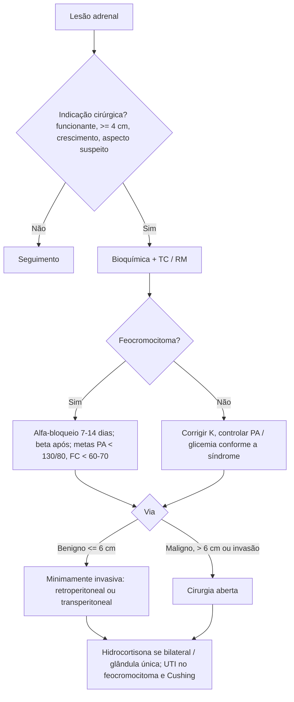

# Aspectos Peroperatórios em Adrenalectomia

> Resumo em palavras próprias do Whitebook (Condutas Cirúrgicas > Cirurgia Geral e do Aparelho Digestivo), sem fisiopatologia, autoria e referências. Confira detalhes e doses na fonte: https://whitebook.pebmed.com.br/conteudo/?id=23699&categoryId=207&subcategoryId=211

A abordagem das lesões adrenais suspeitas segue algoritmos específicos (não reproduzidos no texto extraído).

## Indicações cirúrgicas
- Adenomas benignos produtores de cortisol (Cushing), aldosterona (Conn) e, menos comumente, androgênios; feocromocitoma; carcinoma suprarrenal.
- Tumores **≥ 4 cm** ou crescimento **≥ 0,3 cm em 3–12 meses**; características suspeitas na TC (bordas irregulares, heterogeneidade, necrose central, hipervascularização); cistos com aspirado hemorrágico.
- Hiperplasia micronodular bilateral (Cushing ACTH-independente); metástases adrenais (pulmão, rim, mama, melanoma, TGI) em doença oligometastática selecionada; feocromocitoma bilateral; hipercortisolismo ACTH-dependente após falha pituitária.
- Experiência: cirurgiões experientes > 4 casos/ano; centros de alto volume > 14 casos/ano.

## Preparo pré-operatório
- Hiperaldosteronismo causa hipocalemia refratária e arritmias — corrigir antes.
- **Bioquímica:** feocromocitoma — metanefrinas plasmáticas ou urinárias; hiperaldosteronismo — aldosterona/renina, confirmação e lateralização por cateterismo de veias adrenais (AVS); hipercortisolismo — supressão com dexametasona, cortisol, ACTH.
- **Imagem:** TC com contraste (fase venosa); RM em feocromocitoma/paraganglioma, dúvida ou contraindicação a iodo.
- Aldosteronismo: corrigir K e controlar PA com espironolactona/eplerenona. Cushing: controle glicêmico, manejo da coagulação, preparo para insuficiência adrenal.
- **Feocromocitoma:** tratar HAS, evitar paroxismos, corrigir hipovolemia (riscos: hipertensão grave e choque após a ressecção). Anti-hipertensivo 10–14 dias antes (1ª escolha: bloqueador de canal de cálcio; se refratário ao bloqueio alfa, associar outras classes). Alvos: **PA < 130/80 mmHg** (inclusive sentado) e **FC < 60–70 bpm**. Cristaloide se hipotensão postural e hematócrito alto; dieta rica em sódio (500 mg/dia — conforme o texto) e 2,5 L/dia de líquidos. Bloqueio alfa até 7 dias antes: doxazosina 1 mg/dia (até 10 mg 2×/dia) ou prazosin; suspender fenoxibenzamina 48 h antes e prazosin 8 h antes. Betabloqueio só após bloqueio alfa eficaz (controverso; início 72 h antes reduz taquiarritmias graves; evitar em cardiomegalia/cardiopatia).
- Antibiótico: cefalosporina de 1ª geração na indução, ≤ 24 h. Tromboprofilaxia: risco moderado a alto, maior no Cushing.

## Vias cirúrgicas
**Minimamente invasiva** — padrão para tumores benignos funcionantes ou não (inclusive feocromocitoma) **≤ 6 cm / < 100 g** e metástases pequenas isoladas. Contraindicações: > 6 cm, suspeita de malignidade/invasão, aderências extensas (transabdominal), coagulopatia, alto risco cardiopulmonar, obesidade (relativa). Vantagens: menor sangramento, dor, internação, infecção e íleo.
- **Retroperitoneal:** ideal em obesos, bilaterais e reoperações; sem reposicionar na manipulação bilateral; menos íleo; evita lesão de órgãos intra-abdominais; menor espaço de trabalho; não indicada para tumores > 7–8 cm, pouca distância entre rebordo e crista ilíaca/obesidade, ou necessidade de procedimento abdominal; não permite conversão imediata; risco ao nervo subcostal (T12).
- **Transperitoneal lateral:** via universal para tumores únicos > 5 cm; anatomia usual, mais espaço; reposicionar no bilateral; ideal com outro procedimento abdominal (nefrectomia), adrenal ectópica, nefrectomia ipsilateral prévia.
- **Robótica:** resultados semelhantes à laparoscópica (tempo, conversão, complicações); maior custo e curva de aprendizado.

**Aberta** — malignidade primária de qualquer tamanho, massas invadindo fígado/rim/VCI, suspeita de malignidade (> 6–10 cm, margens irregulares, hemorragia/necrose, hipervascular), benignas bilaterais não acessíveis, cirurgias abdominais/retroperitoneais associadas que impeçam laparoscopia; retroperitoneal posterior aberta é alternativa em Cushing terminal com adrenalectomias bilaterais. Permite ressecção em bloco, margens amplas, melhor linfadenectomia e menor risco de ruptura. Acessos: transperitoneal (mediana, subcostal, transversa), extraperitoneal (lateral, posterior), toracoabdominal. Desvantagens: íleo, lesão neuromuscular, dor, laxidão, ISC.

**Fatores na escolha:** aderências, comorbidades cardiopulmonares, obesidade mórbida, doença bilateral/hereditária (retroperitoneal), tamanho, localização (hilo renal é difícil), invasão local, funcionalidade, experiência.

## Cuidados intraoperatórios
- **Insuficiência adrenal:** hidrocortisona IV 50–100 mg após remover a glândula; reposição oral quando voltar a dieta.
- **Sangramento:** tumores que invadem a VCI (e friabilidade no hipercortisolismo) → acesso subcostal direito estendido, aberto.
- **Feocromocitoma:** ligar a veia adrenal antes das artérias; arritmias, hipertensão grave, hipotensão e hipoglicemia; picos de catecolaminas na laringoscopia, posicionamento, incisão/insuflação e manipulação; hipotensão/hipoglicemia após ligar a veia; controle da PA com fentolamina, nitroprussiato ou nicardipina; FC com esmolol; evitar droperidol, halotano, metoclopramida e liberadores de histamina; repor esteroide se bilateral ou glândula única; vigiar glicemia.
- **Ruptura tumoral:** manter a cápsula íntegra. **Conversão:** invasão, hemorragia, características malignas, tamanho, feocromocitoma, obesidade.

## Pós-operatório
Internação de 1–2 dias (minimamente invasiva) ou 3–5 dias (aberta).
- **Feocromocitoma:** UTI ≥ 48 h; tratar hipotensão após ligadura venosa; sonolência nas primeiras 48 h; glicemia seriada em 24–48 h (risco de hipoglicemia, solução com glicose se necessário); esteroides se bilateral.
- **Cushing:** cortisol antes e 6, 12, 24, 36 e 48 h depois; UTI 48–72 h; prevenir TEV; corticoide se sinais de insuficiência ou cortisol indetectável (< 5 µg/dL): prednisona VO e reavaliar em 10–12 dias.

## Complicações
Baixa taxa; maior morbidade na aberta e nas bilaterais: lesão de rim, fígado, baço, pâncreas e cólon; pseudocisto/fístula pancreática; perfuração colônica ou diafragmática; hemoperitônio; crise hipertensiva/hipotensiva (IAM, AVC); ISC, TEV e cicatrização ruim (Cushing); enfisema subcutâneo; lesão do nervo subcostal; sangramento; embolia gasosa; hérnia incisional.

## Fluxograma (refeito, a partir do texto; o texto original cita algoritmos que não vêm no texto extraído)

