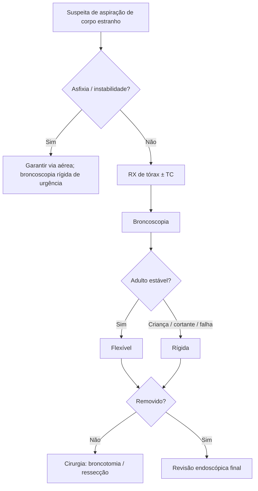

# Aspiração de Corpos Estranhos

> Resumo em palavras próprias do Whitebook (Condutas Cirúrgicas > Cirurgia Torácica), sem fisiopatologia detalhada, autoria e referências. Confira detalhes e doses na fonte: https://whitebook.pebmed.com.br/conteudo/?id=39176&categoryId=207&subcategoryId=215

**Definição:** substância ou objeto estranho na árvore traqueobrônquica, causando obstrução parcial ou total; quadro potencialmente fatal.

## Epidemiologia e fisiopatologia
- Predomina em crianças (75% < 3 anos; 95% < 5 anos); adultos 0,2–0,33% dos casos; homens 1,5:1; impactação mais comum à direita (em crianças a predileção é menor). Itens frequentes: alimentos, moedas, brinquedos, balões.
- Causas: falha/imaturidade do fechamento glótico, passagem facilitada em traqueostomizados. Natureza, tamanho, forma, local e tempo definem a reação: inorgânicos geram pouca reação (exceto oxidação); vegetais irritam (óleos, alergia); quanto menor a via aérea, maior o risco de obstrução completa.

## Clínica
- **Não asfixiante:** muitos não lembram do evento; diagnóstico retardado por meses a anos (às vezes achado na broncoscopia); "zona de silêncio" após o quadro agudo; manifestações crônicas: tosse, engasgo, hemoptise, infecções recorrentes ou de resolução lenta, dispneia, febre, broncoespasmo recorrente.
- **Asfixiante:** tosse, cianose, dispneia; vômito, insuficiência respiratória aguda, rouquidão.
- **Fatores de risco:** extremos de idade (< 3 e > 50 anos), sedativos, doenças neurológicas/psiquiátricas, demência, trauma com perda de consciência, procedimentos odontológicos, etilismo, manipulação de cânula de traqueostomia, disfagia, competições gastronômicas, costureiros/marceneiros (objetos entre os lábios).
- **Tipos:** orgânicos (ossos, espinha de peixe, sementes, amendoim, vegetais) e inorgânicos (parafusos, pregos, alfinetes, moedas, plástico, pedra, bateria, ímã, dentes, projéteis, vidro); endógenos (broncólitos, rolhas de secreção, coágulos, tumores, dentes) × exógenos; iatrogênicos.

## Diagnóstico
- Anamnese: evento precipitante, engasgo súbito, tempo, tipo de objeto, gravidade, comorbidades, complicações. Exame: taquipneia, cianose, sibilância localizada, ↓ murmúrio, roncos, estridor, rebaixamento de consciência.
- **RX de tórax** (PA e perfil; primeiro exame): ~20% normais; melhor para radiopacos; expiração mostra hipertransparência; atelectasia (obstrução total), hiperinsuflação (parcial), pneumomediastino/pneumotórax/enfisema subcutâneo, derrame, consolidação, desvio mediastinal; crônicos: consolidações recorrentes, bronquiectasia, empiema, abscesso, estenose.
- **TC:** planeja a técnica; melhor resolução; reconstruções 3D; adenopatia reativa, espessamento brônquico; vê corpos não metálicos; contraste mostra proximidade de vasos.
- **Broncoscopia:** padrão-ouro diagnóstico e terapêutico (localiza o objeto, lesões de mucosa, tecido de granulação); por via oral/nasal, máscara laríngea ou tubo, com broncoscópio rígido, laringoscopia de suspensão ou radioscopia; às vezes o corpo estranho foi expelido ou dissolvido.
- **Diferenciais:** pneumonia, DPOC, asma, tumor endoluminal (carcinoide, CEC, hamartoma, adenoide cístico), compressão extrínseca.

## Tratamento
Em risco de vida: garantir via aérea e oxigenação; antibiótico se pneumonia.
- **Se o objeto foi ingerido (conduta digestiva):** EDA de emergência (até 2 h) se bateria, objeto pontiagudo, sintomas respiratórios ou obstrução esofágica; pontiagudo ≥ 5 cm: como esofágico; assintomático com objeto não pontiagudo ≤ 5 cm: expectante; sintomático: EDA de urgência; radiopaco: RX seriado; radiolucente: pesquisar nas fezes; sintomático/complicado: cirurgia.
- **Broncoscopia flexível:** preferência em adultos; remove quase qualquer corpo estranho; sucesso 79,1–98%; jejum mínimo; sedação e anestesia local ou geral; pinça com dente, jacaré, *basket*, balão de Fogarty, alça de polipectomia, crioprobe; evitar manipulação excessiva (intervalo mínimo de 3 dias se difícil; corticoide, AINE e antibiótico para reduzir inflamação); sangramento: aspiração, soro gelado/adrenalina, argônio, laser Nd:YAG/YAP; fluoroscopia para objetos distais; revisão endoscópica ao final. Vantagens: disponível, sem anestesia geral, avaliação completa, por tubo orotraqueal, trauma cervicofacial/retrognatia; limites: não garante via aérea nem protege contra cortantes na passagem pela glote.
- **Broncoscopia rígida (ainda o padrão):** via aérea impossível de manter, crianças (anestesia geral), falha da flexível; contraindicada em instabilidade cervical/anquilose, microstomia/micrognatia, instabilidade hemodinâmica, arritmia ou insuficiência respiratória grave; controla a via aérea, ventila, aspira, protege a glote em cortantes, evita tosse; limite: lobos superiores e brônquios distais, exige treinamento.
- **Cirurgia:** broncotomia com fechamento brônquico, ou ressecção segmentar/lobar se perda parenquimatosa irreversível; indicada se não removível por endoscopia, risco de lesão de parede brônquica/vasos, abscesso ou pneumonite crônica.
- **ECMO** (veno-venosa; veno-arterial se acidemia grave) como suporte em insuficiência respiratória grave e instabilidade.
- **Complicações:** insuficiência respiratória, infecção recorrente, bronquiectasia, destruição pulmonar, hemoptise, abscesso, edema pós-obstrutivo, fístula broncopleural/traqueoesofágica, pneumotórax, pneumomediastino, enfisema subcutâneo, granulação, estenose, mediastinite.

## Fluxograma (refeito, a partir do texto; o original não traz algoritmo)

