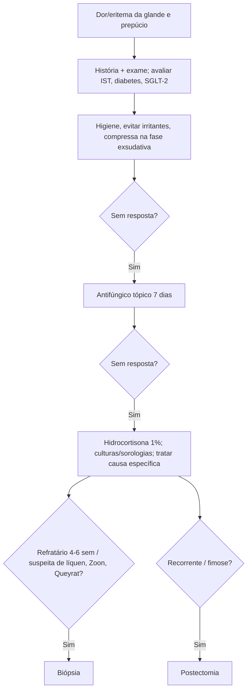

# Balanite e Balanopostite

> Resumo em palavras próprias do Whitebook (Condutas Cirúrgicas > Cirurgia Urológica), sem fisiopatologia, autoria e referências. Confira detalhes e doses na fonte: https://whitebook.pebmed.com.br/conteudo/?id=51249&categoryId=207&subcategoryId=214

**Conceito:** inflamação da glande (balanite) ± prepúcio (balanopostite). Ambiente subprepucial úmido e oclusivo favorece bactérias e fungos. Representa ~11% das consultas urológicas nos EUA; ~3% dos não circuncidados; maior risco: não circuncidados e meninos < 4 anos; candidíase é a mais comum; diabéticos e imunodeprimidos têm quadros mais exuberantes. Higiene inadequada com prepúcio tenso e esmegma mantém o ciclo e pode levar a câncer de pênis.

## Etiologia
Candidíase (*C. albicans*; diabéticos, não circuncidados, parceiras com candidíase recorrente); ISTs (tricomonas, HSV, HPV, sífilis, escabiose, *M. genitalium*); bactérias (estreptococo do grupo A, *S. aureus*, anaeróbios); dermatológicas (psoríase, eczema, líquen plano, líquen escleroso/balanite xerótica obliterante, Zoon, dermatites); pré-malignas (papulomatose bowenoide, doença de Bowen, eritroplasia de Queyrat); artrite reativa (balanite circinada); farmacodermia (tetraciclinas, salicilatos, fenacetina, fenolftaleína, hipnóticos); irritante/alérgica; **inibidores de SGLT-2** (glicosúria favorece fungos).

## Clínica
- Dor, ardência, prurido, edema, secreção subprepucial, descamação, feridas, mau odor; evolução em 3–7 dias; corrimento uretral em ISTs; sintomas sistêmicos em doenças com repercussão (artralgia, dermatite, úlceras orais, adenopatia).
- **Fatores de risco:** diabetes, obesidade, imunodeficiência (quimio, transplante, corticoide, HIV), antibióticos recentes, trauma (zíper), condições edematosas, fimose sem postectomia, ISTs, parceira com candidíase, múltiplos parceiros, sexo desprotegido, lavagem excessiva, irritantes (sabão, látex, espermicida, lubrificante), gotejamento/incontinência.
- **Padrões:** candidíase — eritema, prurido, “coalhada”, pápulas com erosão; bacteriana/anaeróbica — secreção fétida, edema, erosões, linfadenopatia inguinal; psoríase — placas escamosas; eczema; líquen plano — placas bem delimitadas com estrias brancas; **líquen escleroso** — eritema, fissuras, esclerose, aderências, fimose, estenose do meato, malignização em 12,5–15%; **Zoon** — eritema vermelho-alaranjado simétrico com pontilhado “pimenta caiena” (benigna; diferencial de pré-malignas); bowenoide — pápulas/placas agrupadas ou pigmentadas; **eritroplasia de Queyrat** — placa vermelho-aveludada, induração/manchas brancas sugerem carcinoma; artrite reativa — úlceras rasas indolores; farmacodermia — placas arredondadas em 30 min–8 h.

## Diagnóstico
Clínico; avaliar mobilidade do prepúcio (fimose, parafimose), meato e manifestações extragenitais (erupção, úlcera oral, adenopatia, artrite, conjuntivite). Exames: swab/cultura se exsudato purulento, sorologias de IST, teste para estreptococo A, pesquisa de HPV, glicosúria/cetonúria. **Biópsia:** refratários após 4–6 semanas de tratamento; suspeita de líquen escleroso, Zoon ou eritroplasia de Queyrat. Casos atípicos/refratários: considerar HIV.

## Tratamento
- **Geral (inespecífica):** lavar glande e subprepúcio 2×/dia e retrair após secar; evitar sabão/irritantes; compressas úmidas adstringentes (sulfato de cobre ou zinco) na fase exsudativa; se não responder a salina: empírico para *Candida* com clotrimazol 1% ou miconazol 2% 2×/dia por 7 dias; sem resposta: hidrocortisona 1% 2×/dia por 7 dias. **Postectomia** em balanopostite de repetição ou fimose secundária (reduz até 68%).
- **Candidíase:** clotrimazol 1%/miconazol 2% 2×/dia por 1–3 semanas; nistatina creme (100.000 U/g) em alérgicos a imidazólicos; grave: fluconazol 150 mg dose única ou imidazólico + hidrocortisona 1% 2×/dia; alertar sobre falha do preservativo (óleos/antifúngicos enfraquecem o látex); testar/tratar parceiros.
- **Estreptococo/estafilococo:** mupirocina creme 3×/dia por 7–14 dias; grave: cefalexina 500 mg 4×/dia por 7 dias. **Anaeróbios:** metronidazol tópico 0,75% 2×/dia por 7 dias; grave: metronidazol 400 mg VO 2×/dia por 7 dias; alternativas: amoxicilina-clavulanato ou clindamicina tópica; postectomia se recorrente.
- **HPV (condiloma):** fluoruracila tópico 1–2×/semana por 3–8 dias; podofilina 0,5% 2×/dia por 3 dias consecutivos (máx. 4 semanas); reavaliar em 1 mês; crioterapia, excisão, curetagem. **HSV:** aciclovir 400 mg 3×/dia ou 200 mg 5×/dia por 7–10 dias; valaciclovir 500 mg 2×/dia por 7–10 dias.
- **Dermatoses:** corticoide tópico potente; refratários: ciclosporina, inibidor de calcineurina ou postectomia. **Líquen escleroso:** clobetasol ou betametasona 1×/dia até remissão com desmame (manutenção semanal); postectomia (fimose), meatoplastia (estenose do meato); acitretina em refratários (muitos efeitos colaterais); histopatologia do prepúcio (lesão pré-maligna em adultos; pode envolver o meato e exigir reconstrução). **Pré-malignas:** biópsia; bowenoide: imiquimode 5% ou laser; carcinoma in situ: excisão, laser, quimioterapia tópica, Mohs. **Farmacodermia:** suspender o fármaco, hidrocortisona 1% 2×/dia, anti-histamínico oral, corticoide sistêmico se grave. **Irritativa/alérgica:** evitar irritantes, emolientes, hidrocortisona 1–2×/dia.
- Pediatria: balanopostite persistente/recorrente é indicação de circuncisão. Histopatologia em quem não responde.
- **Complicações:** fimose (principal), parafimose, estenose do meato, retenção urinária, bacteremia, malignização. **Prevenção:** higiene, postectomia, tratar parceiro, preservativo, evitar irritantes.

## Fluxograma (refeito, a partir do texto; o original não traz algoritmo)

