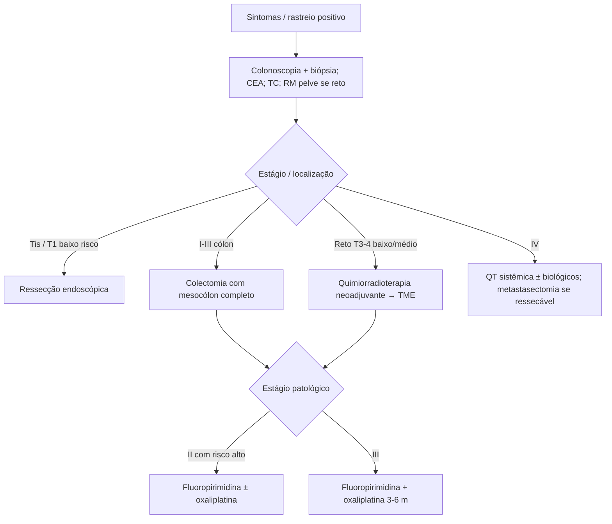

# Câncer Colorretal

> Resumo em palavras próprias do Whitebook (Condutas Cirúrgicas > Cirurgia Oncológica), sem fisiopatologia, autoria e referências. Confira detalhes e doses na fonte: https://whitebook.pebmed.com.br/conteudo/?id=22617&categoryId=207&subcategoryId=212

**Definição:** neoplasia maligna do cólon e/ou reto, a partir da mucosa intestinal. Sinônimos: neoplasia colorretal, câncer do cólon e do reto.

## Epidemiologia
3ª neoplasia mais incidente em homens e 2ª em mulheres no mundo; 3ª em ambos no Brasil. 3ª causa de morte por câncer em homens, 4ª em mulheres. Risco INCA 2023–2025: 21,10/100.000. 60–70% são de cólon. Incidência e mortalidade globais caem, mas **aumenta em < 50 anos**. Idade média ao diagnóstico: ~60 anos. A maioria nasce de pólipo (progressão em ~10 anos); adenocarcinoma ≈ 90%. Duas vias: adenoma-carcinoma (instabilidade cromossômica, 70–90%; APC → RAS/TP53) e serrilhada (10–20%; KRAS/BRAF + metilação). Perfil molecular difere entre cólon direito, esquerdo e reto.

## Fatores de risco e de proteção
- **Risco:** sexo masculino; > 50 anos; DII longa; síndromes (Lynch, PAF); história familiar; CCR ou adenoma avançado prévio (≥ 1 cm, displasia de alto grau ou componente viloso); carne vermelha/processada; poucos vegetais/frutas; sedentarismo; obesidade; DM e resistência insulínica; tabagismo; etilismo; *Fusobacterium nucleatum* e *Bacteroides fragilis*.
- **Proteção:** AAS/AINEs (reduzem adenomas e progressão; uso preventivo na população geral não recomendado; considerar individualizado em alto risco); possivelmente estatinas e terapia hormonal da menopausa; atividade física; dieta rica em grãos, fibras e laticínios; cálcio; vitaminas B9, B6, D e C.

## Rastreamento
- Reduz mortalidade. Perguntar: CCR/pólipo prévio, DII, RT abdominal, familiares afetados (quantos, idade, grau).
- **Risco habitual:** 50 a 75 anos (ACS e SBCO sugerem iniciar aos 45); individualizar 75–85; não rastrear > 85 ou expectativa < 10 anos. Opções: colonoscopia a cada 10 anos; colonografia por TC a cada 5; sangue oculto anual; retossigmoidoscopia a cada 5; DNA fecal multialvo a cada 3.
- **Alto risco:** familiares — dois parentes de 1º grau com CCR/adenoma avançado em qualquer idade, ou um < 60 anos → colonoscopia a cada 5 anos a partir de 10 anos antes do diagnóstico do parente mais jovem ou aos 40 anos (o que vier primeiro); parente de 1º grau ≥ 60 anos → colonoscopia aos 40. Também: CCR ou pólipo adenomatoso/serrilhado prévio; síndromes (Lynch, PAF, MUTYH, polipose juvenil, Cowden, Li-Fraumeni, PAF atenuada, Peutz-Jeghers, polipose serrilhada); DII colônica; RT abdominal prévia.

## Clínica
- Mudança do hábito intestinal, sangue/muco, dor antes da evacuação, astenia, anemia, perda de peso. **Cólon direito:** anemia e diarreia; **esquerdo:** fezes em fita e escurecidas com sangue/muco; **reto:** tenesmo e sangue vivo. Urgências (doença avançada): obstrução (parada de gases/fezes, dor e distensão) ou perfuração (dor súbita intensa, distensão).
- **Exame:** geralmente normal; emagrecimento; massa palpável (mais no direito); linfonodos inguinais/supraclaviculares; toque retal é fundamental no reto; obstrução — abdome distendido, timpânico; perfuração — peritonite.

## Diagnóstico
- Hemograma (anemia microcítica por deficiência de ferro), função renal, eletrólitos, função hepática, enzimas canaliculares. **CEA** ao diagnóstico e no seguimento (basal alto = pior prognóstico; sobe antes dos sintomas na recidiva; monitora QT na doença metastática).
- **Imagem:** TC para metástases, extensão extramural, complicações (pneumoperitônio, distensão a montante). **RM de pelve:** melhor para estadiamento locorregional do reto; RM de abdome para fígado; **USE** para profundidade e linfonodos do reto; PET discutível.
- **Colonoscopia:** diagnóstica e terapêutica (pólipos), avalia lesões sincrônicas, biópsia antes de ressecar.
- **TNM (AJCC 2018):** Tis; T1 submucosa; T2 muscular própria; T3 tecidos pericolorretais; T4a peritônio visceral; T4b outros órgãos. N1a (1 linfonodo), N1b (2–3), N1c (depósitos tumorais sem linfonodo), N2a (4–6), N2b (≥ 7). M1a um órgão; M1b mais de um órgão; M1c peritônio. **Estágios:** 0 Tis; I T1–2 N0; IIA T3 N0; IIB T4a N0; IIC T4b N0; IIIA T1–2 N1/N1c ou T1 N2a; IIIB T3–4a N1/N1c, T2–3 N2a, T1–2 N2b; IIIC T4a N2a, T3–4a N2b, T4b N1–2; IVA M1a; IVB M1b; IVC M1c.
- **Diferenciais:** retocolite, Crohn, hemorroidas, doença diverticular, poliposes.

## Tratamento
- **Urgência:** anemia grave com transfusão; obstrução ou perfuração → cirurgia de urgência. Estáveis → eletiva.
- **Estágio I:** ressecção, sem adjuvância se confirmado.
- **Endoscópico:** Tis e T1 selecionados (peça única, baixo risco de linfonodo); técnicas de mucosectomia em bloco, dissecção submucosa ou espessura total; só em centros especializados; colonoscopia de controle em 3 meses e depois em 1 ano. Ressecção cirúrgica adjuvante se a peça tiver: histologia pouco diferenciada, invasão linfovascular/perineural, *budding*, margem comprometida ou submucosa ≥ 1 mm.
- **Cirurgia (curativa):** excisão completa do mesocólon (planos embrionários); laparoscopia é a via padrão; extensão por localização (colectomia direita/esquerda/total, sigmoidectomia, ileocolectomia, proctocolectomia, abdominoperineal, amputação de reto); no reto, excisão total do mesorreto; urgência: ressecção primária com ou sem anastomose (Hartmann); linfadenectomia com ligadura vascular central.
- **Neoadjuvância (reto T3–4 baixo/médio, abaixo da reflexão peritoneal):** quimiorradioterapia; reduz o tumor, aumenta margens negativas, trata micrometástases, melhora adesão; intervalo até a cirurgia ~8–10 semanas.
- **Adjuvância:** **estágio II** — conforme risco: T4, perfuração/obstrução, invasão linfovascular/perineural, pouco diferenciado, < 12 linfonodos, ausência de MSI → 3 a 6 meses de fluoropirimidina ± oxaliplatina (discutir). **Estágio III:** sempre, 3 a 6 meses de fluoropirimidina + oxaliplatina. Sem risco alto ou com MSI: não. Controvérsia após neoadjuvância.
- **Estágio IV:** avaliar ressecabilidade das metástases; tratamento ainda pode ser curativo. Fígado/pulmão: ressecção, radioablação ou SBRT; peritônio selecionado: citorredução + HIPEC (papel controverso); cérebro: prognóstico reservado. Metástases ressecáveis: QT sistêmica com avaliação precoce, depois metastasectomia + primário + QT; doença extensa: QT sistêmica (oxaliplatina, 5-FU, irinotecano ± anticorpos). Anti-VEGF (bevacizumabe, aflibercepte, ramucirumabe); cólon esquerdo RAS/BRAF selvagem: anti-EGFR (cetuximabe, panitumumabe) — RAS mutado não responde; linhas tardias: regorafenibe, trifluridina/tipiracila; MSI/dMMR → imunoterapia (checkpoint).

## Seguimento e prognóstico
Pós-intenção curativa: exame físico e CEA a cada 3–4 meses por 2 anos, depois semestral; TC de tórax/abdome/pelve a cada 3–6 meses por 2 anos, depois anual ou semestral por mais 3; colonoscopia em 1 ano, depois 3 anos e a cada 5. Prognóstico: TNM principal; cólon melhor que reto; indiferenciado e ulcerado pior.

## Fluxograma (refeito, a partir do texto; o original não traz algoritmo)

