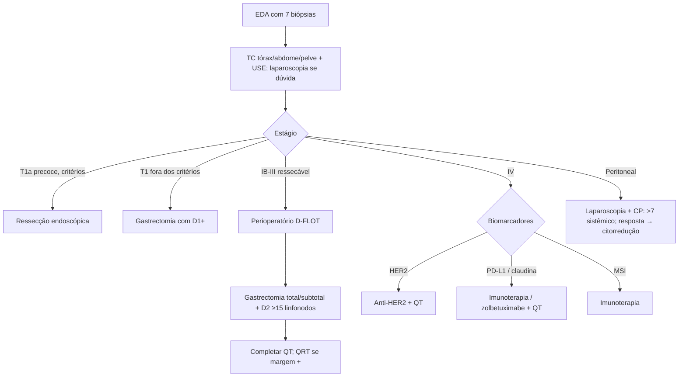

# Câncer Gástrico

> Resumo em palavras próprias do Whitebook (Condutas Cirúrgicas > Cirurgia Oncológica), sem fisiopatologia, autoria e referências. Confira detalhes e doses na fonte: https://whitebook.pebmed.com.br/conteudo/?id=22570&categoryId=207&subcategoryId=212

## Epidemiologia e patologia
- 5º tumor mais incidente no mundo (e no Brasil, exceto pele não melanoma); 4ª causa de morte por câncer; risco estimado no Brasil (INCA 2023–2025): 9,94/100.000. Maioria sintomática e avançada ao diagnóstico (63%). *H. pylori* é o principal fator nos esporádicos; predisposição genética 1–3%, casos familiares ~10%. Síndromes: Lynch, polipose adenomatosa familiar, câncer gástrico difuso hereditário, GAPPS, Peutz-Jeghers, câncer gástrico intestinal familiar.
- Adenocarcinoma 95%. **Lauren:** *intestinal* — ambiental, precursores atrofia e metaplasia, mais em homens e idosos, glandular bem diferenciado, disseminação hematogênica (tubular, papilífero); *difuso* — familiar, mulheres = homens, mais jovem, grupo A, pouco diferenciado com anel de sinete, disseminação linfática e transmural.
- **Moleculares (TCGA):** EBV+ 9%; instabilidade de microssatélites 22%; genomicamente estáveis 20%; instabilidade cromossômica 50%; HER-2 (ERBB2) positivo/negativo.
- **Borrmann:** I polipoide; II ulcerada de bordas elevadas e delimitada; III ulcerada infiltrativa; IV difusamente infiltrativa (sem limite).

## Clínica
- Perda de peso, anorexia, dor persistente, dispepsia, náusea/vômito, saciedade precoce, disfagia, sangramento oculto/anemia ferropriva, hematêmese ou melena (< 20%), linite plástica. Distal/antral: *H. pylori*, álcool, sódio, carne processada, pouca fruta/verdura (Ásia). Cárdia/JEG: obesidade, DRGE, Barrett (países ocidentais).
- **Exame:** desnutrição, massa palpável (doença avançada); linfonodos de Virchow (supraclavicular E), Sister Mary Joseph (umbilical), Irish (axilar E); Krukenberg (ovário); prateleira de Blumer; ascite; icterícia/hepatomegalia.
- **Paraneoplásicas:** Leser-Trélat, acantose nigricans, Trousseau, anemia hemolítica microangiopática, nefropatia membranosa, poliarterite nodosa.

## Diagnóstico e estadiamento
- **EDA** com biópsia (indicações: dispepsia com alarme — vômitos repetidos, perda de peso, anemia, icterícia, HDA —, suspeita neoplásica ou sintomas refratários a ≥ 12 semanas de IBP). **7 biópsias** da borda/base da úlcera (sensibilidade 98%); ~5% das úlceras malignas simulam benignas; linite pode dar falso-negativo (infiltração submucosa/muscular). Úlcera benigna: bordas regulares, base plana exsudativa; maligna: friável, bordas espessas, pregas, irregular.
- **TC de tórax, abdome e pelve:** estadiamento obrigatório (M: fígado, peritônio, ascite); inadequada para profundidade e N; linfonodo perigástrico suspeito (eixo < 6–8 mm, arredondado, necrose, realce alto/heterogêneo); não detecta < 0,8 cm; perde metástases < 5 mm; 20–30% dos TC negativos têm doença intraperitoneal.
- **USE:** recomendada em M0; método não cirúrgico mais confiável para T (principalmente T1) e extensão; define endoscopia vs. cirurgia up front vs. QT perioperatória; menos útil no antro; PAAF melhora N; linfonodo suspeito: hipoecoico, redondo, > 1 cm, margem nítida.
- **PET-CT:** não rotineiro; pouco acrescenta à TC; menos útil em tumores mucinosos/difusos.
- **Marcadores** (CEA, CA-125, CA 19-9, CA 72-4): não diagnósticos; queda pode refletir resposta; AFP alta associa-se a mau prognóstico.
- **Laparoscopia diagnóstica:** indicação não padronizada — dúvida de estadiamento (> T1, T4 não confirmado, N ou M duvidosos), sobretudo antes de neoadjuvância; permite lavado para citologia; 20–30% dos > T1 na USE com TC negativa têm metástase peritoneal.
- **HER-2:** receptor da família EGFR; prognóstico controverso.

## TNM (AJCC 8ª ed.)
- **T:** Tis; T1a (lâmina própria/muscular da mucosa); T1b (submucosa); T2 (muscular própria); T3 (subserosa); T4a (perfura serosa); T4b (estruturas adjacentes: baço, cólon transverso, fígado, diafragma, pâncreas, parede, adrenais, rins, delgado, retroperitônio, ou extensão intramural ao duodeno/esôfago). **N:** N1 1–2; N2 3–6; N3a 7–15; N3b ≥ 16. **M1:** inclui peritônio, citologia positiva, tumor omental não contínuo.
- JEG com epicentro nos 2 cm proximais da cárdia (Siewert I/II) → estadiar como esôfago; > 2 cm → gástrico. Acrescentar “y” após neoadjuvância.
- **Estágios (patológico/clínico conforme o texto):** 0 Tis; IA T1N0; IB T1N1 ou T2N0; IIA T1N2, T2N1, T3N0; IIB T1N3a, T2N2, T3N1, T4aN0; IIIA T2N3a, T3N2, T4aN1–2, T4bN0; IIIB T1–2N3b, T3–4aN3a, T4bN1–2; IIIC T3–4aN3b, T4bN3; IV M1. (O texto também lista um esquema clínico simplificado: I T1–2N0; IIA T1–2N+; IIB T3–4aN0; III T3–4aN+; IVA T4b; IVB M1.)

## Tratamento do câncer precoce
Classificação macroscópica (Paris/japonesa): tipo I polipoide; II plano (IIa elevado, IIb ao nível, IIc deprimido); III ulcerado; IV disseminação lateral; mistos IIc+IIa e IIa+IIc.
- **Ressecção endoscópica** (mucosa ou submucosa; submucosa preferida — margem profunda, em bloco): só T1a sem linfonodo. Mucosa para lesões ≤ 10–15 mm de baixa probabilidade de histologia avançada (Paris 0-IIa). **Critérios clássicos:** T1a, intestinal bem diferenciado, sem invasão linfovascular, ≤ 2 cm sem ulceração, em bloco provável, < 10 mm se IIb/IIc. **Expandidos:** mucosa de qualquer tamanho sem ulceração; mucosa < 30 mm com ulceração; submucosa < 30 mm limitada aos 0,5 mm superiores, sem invasão linfovascular. Seguimento endoscópico frequente.
- **Gastrectomia** para quem não atende (ressecção em bloco improvável, submucoso > 30 mm ou ulcerado, invasão linfovascular, linfonodo suspeito, margens comprometidas); linfadenectomia menos extensa em T1 (D1+).
- Linfonodo positivo → adjuvância.

## Câncer invasivo
- Estágios I–III potencialmente curáveis; ≥ T2 ou N suspeito → discussão multidisciplinar; IV geralmente paliativo.
- **Cirurgia** (único curativo; estágios IB–III): total para terço superior, grandes lesões do médio ou linite; subtotal para terços distais (margem proximal 4–5 cm da JEG; 8 cm no difuso); proximais sem JEG: total ou subtotal proximal, preferindo total. Reconstrução em Y de Roux. Esplenectomia só com extensão direta (artéria esplênica distal); adenopatia volumosa na cabeça do pâncreas pode exigir Whipple.
- **Linfadenectomia:** D1 (cadeias 1–7); D1+ (D1 + 8a, 9, 11p); **D2** (cadeias 1–12; ideal para cirurgia curativa); D3 (1–16; sem benefício). Mínimo de 15 linfonodos (UICC/AJCC).
- **Irressecabilidade (curativa):** metástase a distância; invasão de vaso maior (aorta, oclusão da hepática/plexo celíaco/esplênica proximal); linfonodos retropancreáticos, aortocavais, mediastinais, porta-hepáticos; linite (5%). Relativa: adenopatia volumosa na cabeça do pâncreas (risco de doença oculta; considerar laparoscopia ou QT inicial).
- **Via:** aberta ainda predominante; laparoscopia em precoce; faltam provas em invasivo com D2.
- **Perioperatório:** estágio ≥ IB ressecável (T3, T4 ou N+); aumenta ressecabilidade e R0 e reduz recidiva. Regime atual: **D-FLOT** (durvalumabe + docetaxel + oxaliplatina + leucovorina + 5-FU) — 2 ciclos pré e 2 pós-operatórios, com imunoterapia nos 2 primeiros ciclos e, depois, total de 10 ciclos a cada 28 dias.
- **Adjuvância:** ≥ IB operados up front ou margens comprometidas; inferior ao perioperatório; QRT ou QT. 5-FU/leucovorina + RT 45 Gy em 25 frações de 1,8 Gy (5/semana), preferencialmente concomitante; alvo: loja gástrica, anastomoses e drenagem linfonodal.
- **Doença estágio IV — alvos moleculares (paliativos):** HER2 (20%): trastuzumabe, trastuzumabe-deruxtecano; PD-L1 CPS (40%): pembrolizumabe, nivolumabe + QT; claudina 18.2 (40%): zolbetuximabe + QT; MSI (< 5%): imunoterapia isolada.
- **Metastasectomia:** em geral sem benefício; séries selecionadas (fígado, pulmão, Krukenberg).
- **Metástase peritoneal (Consenso de Chicago 2025):** laparoscopia com lavado e índice de carcinomatose peritoneal (CP); CP > 7 → sistêmico paliativo; CP menor ou citologia positiva sem carcinomatose → QT e reestadiamento (imagem ± nova laparoscopia); boa resposta com citorredução completa possível → cirurgia (± HIPEC), D2, extensão da gastrectomia conforme o sítio; progressão ou mau estado → outras linhas ou suporte (desobstrução, via alimentar, hemostasia).
- **Complicado:** sangramento — endoscopia (1ª), angioembolização, cirurgia limitada ou RT hemostática; obstrução — dilatação/endoprótese, gastrojejunostomia, gastrectomia paliativa; perfuração — fechamento difícil, patch omental ou gastrectomia.

## Prognóstico
Fatores: TNM, HER2, margem R0/R1/R2, localização (cárdia vs distal), histologia, invasão vascular, idade, extensão da ressecção e qualidade da linfadenectomia. Sobrevida em 5 anos < 25% geral; 24–57% após ressecção potencialmente curativa; até 80% no precoce. Recidiva 40–80% após gastrectomia, a maioria em 3 anos e locorregional (anastomose, loja, linfonodos, fígado, pulmões, ossos).

## Fluxograma (refeito, a partir do texto; o original traz uma figura “Cirurgia ou QT antes?”)

