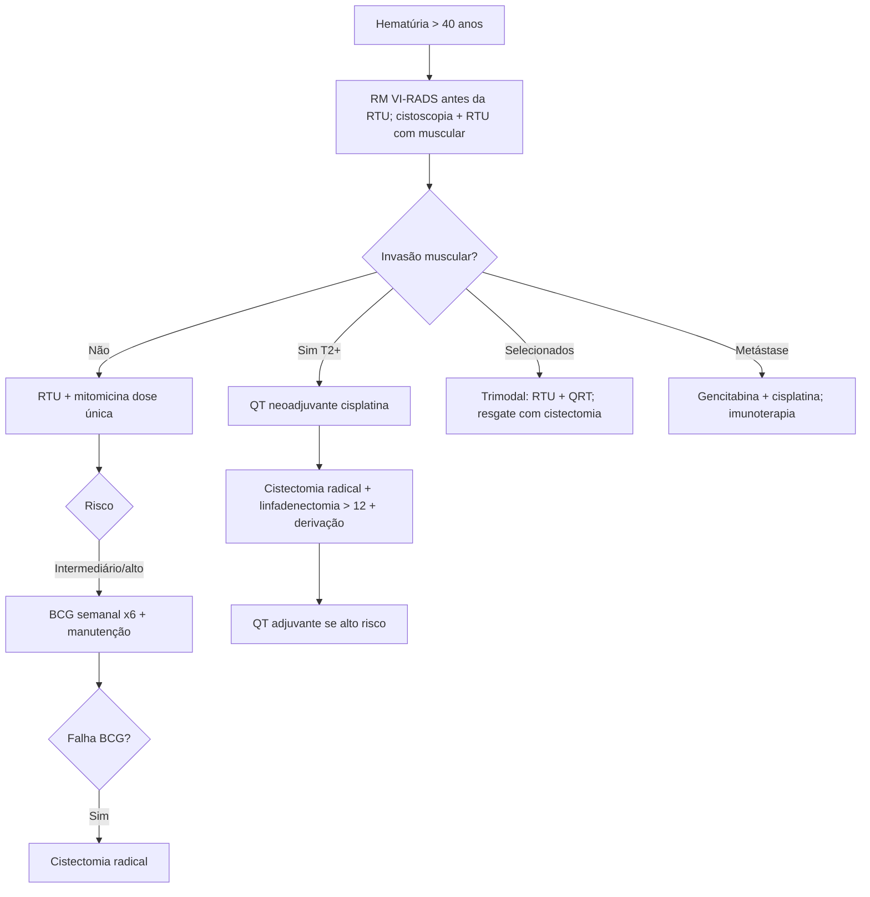

# Câncer de Bexiga

> Resumo em palavras próprias do Whitebook (Condutas Cirúrgicas > Cirurgia Oncológica), sem fisiopatologia, autoria e referências. Confira detalhes e doses na fonte: https://whitebook.pebmed.com.br/conteudo/?id=22607&categoryId=207&subcategoryId=212

**Definição:** tumor maligno mais comum do sistema urinário (sinônimos: neoplasia vesical, carcinoma urotelial/de células transicionais da bexiga). Histologia: urotelial 90%, escamoso 5%, adenocarcinoma 2% (tipos podem coexistir; outros epiteliais: pequenas células; não epiteliais: sarcoma, melanoma, linfoma, carcinossarcoma, sarcomatoide, paraganglioma — ver “Cânceres de Bexiga Não Carcinoma Urotelial”). 90% dos uroteliais têm sítio primário na bexiga. Formas clínicas: não musculoinvasivo (superficial), musculoinvasivo, metastático.

## Epidemiologia e fatores de risco
- EUA: ~75.000 casos e 16.000 mortes/ano; Brasil (INCA): cerca de 10.645 casos (o texto escreve “10.6450”) e 4.595 mortes/ano. Mais em homens, 6ª–7ª décadas, média 73 anos. ~75% são não musculoinvasivos (metade de baixo grau). Sem rastreamento populacional estabelecido.
- **Risco:** tabagismo (4×, principal); aminas aromáticas (corantes, explosivos, sabões); infecção urinária crônica (*S. haematobium*); ciclofosfamida e fenacetina; síndrome de Lynch; TP53; RT pélvica; citostáticos.

## Clínica
- **Hematúria:** mais comum e precoce; intermitente, indolor, macro ou microscópica; início da micção sugere uretra; terminal sugere colo/uretra prostática; total pode vir de qualquer ponto. 
- **Dor** (doença avançada): lombar/flanco por obstrução ureteral (como cólica); suprapúbica (invasão perivesical ou obstrução de saída); hipogástrica/retal/perineal (fossa obturadora, gordura perirrenal, nervos pré-sacrais, diafragma urogenital); quadrante superior direito (linfonodos ou fígado); óssea; cefaleia/disfunção cognitiva (SNC).
- **Irritativos** (≈ 1/3; típicos de CIS): poliúria, urgência, disúria, incontinência; a tríade disúria + frequência + urgência sugere CIS.
- Constitucionais: fadiga, perda de peso, anorexia (mau prognóstico; ou IR por obstrução ureteral bilateral). Também: anemia aguda, obstrução por coágulos, sintomas metastáticos.
- **Exame:** geralmente normal; toque retal (homens) e bimanual (mulheres); massa pélvica, próstata endurecida, adenopatia inguinal (incomum), nódulo periumbilical (úraco), anemia, caquexia, derrame pleural.

## Diagnóstico e estadiamento clínico
- Hematúria sem causa em > 40 anos = malignidade até prova em contrário → avaliação urológica completa (exceto hemorragia glomerular evidente).
- **Cistoscopia com RTU** do tumor com biópsia incluindo muscular (padrão-ouro). Citologia positiva sem tumor visível → biópsias de urotélio normal, uretra prostática e cateterismo seletivo dos ureteres/pelve (citologia do trato superior). Luz azul/protoporfirina aumenta a detecção.
- **RM com VI-RADS** deve ser feita **antes** da RTU (evita artefato inflamatório): 1 invasão muscular muito improvável; 2 improvável; 3 incerta; 4 provável; 5 além do músculo (gordura perivesical/órgãos adjacentes). Avaliar também vias superiores (urotélio multifocal).
- **Exames:** hemograma, eletrólitos, função renal/hepática, urina (> 3 hemácias/campo, dismorfismo, citologia). **TC** de tórax/abdome/pelve contrastada: extensão extravesical, linfonodos, metástases, obstrução; pode perder < 1 cm (trígono/cúpula), não define profundidade; baixa sensibilidade para linfonodo (confirmar por biópsia). **Uro-TC/urografia:** vias superiores. **USG:** pouco útil (hidronefrose, cálculo). **RM:** melhor em base/cúpula, múltiplos tumores, invasão de órgãos; alternativa na alergia a contraste iodado; RM de crânio se sintomas. **Cintilografia óssea:** doença invasiva/avançada, sintomas ou FA alta. PET: considerar em musculoinvasivo.
- **Grau/risco (não musculoinvasivo):** baixo ou alto grau (invasivo quase sempre alto grau). Progressão: baixo 0–4% (Ta G1 solitário primário < 3 cm; 50% dos pacientes), intermediário 10–15% (multifocal/recorrente Ta ou T1, G1/2; 35%), alto 30–40% (CIS, qualquer G3; 15%).
- **TNM (AJCC 8ª):** Ta papilar não invasivo; Tis CIS; T1 tecido subepitelial; T2a músculo superficial (metade interna); T2b profundo; T3a perivesical microscópico; T3b macroscópico; T4a estroma prostático, vesículas, útero, vagina; T4b parede pélvica/abdominal. N1 um linfonodo pélvico; N2 vários pélvicos; N3 ilíacos comuns (ressecar > 12 linfonodos). M1a linfonodo não regional; M1b outros. **Estágios:** 0a Ta; 0is Tis; I T1; II T2; IIIA T3–4a N0 ou N1; IIIB N2–3; IVA T4b ou M1a; IVB M1b. Estadiamento patológico completo exige cistectomia.

## Tratamento — não musculoinvasivo
- **RTU + dose única de quimioterapia intravesical** (mitomicina C) nas primeiras horas, ainda na sala, permanência ~1 h. Cistoscopia após a primeira RTU (re-RTU de áreas de alto grau); biópsias adjacentes para CIS.
- **BCG intravesical:** tratamento de escolha em alto risco (Ta alto grau, Tis, T1); semanal por 6 semanas, iniciando 2–3 semanas após ressecção; indicado em risco intermediário e alto (múltiplas recorrências em < 1 ano, multicêntrico, > 3 cm, CIS, T1, alto grau, localização desfavorável). Manutenção por até 3 anos. Falha: recorrência em até 6 meses após o último BCG, doença de alto grau aos 6 meses, CIS persistente/recidiva após 12 meses livre, progressão a T1 → cistectomia radical.
- Alternativas e refratários: mitomicina C, gencitabina; em T1, dose única de MMC ou gencitabina em até 24 h após RTU. Sempre considerar cistectomia em pacientes aptos e refratários. RTU que revele T2 → QT neoadjuvante + cistectomia.
- **Cistectomia precoce/paliativa:** sintomáticos refratários; indicações precoces: T1 com invasão linfática, três tumores T1 incompletamente ressecados, CIS de ducto prostático/ácinos, CIS de uretra; linfadenectomia estendida junto.

## Tratamento — musculoinvasivo
- **Cistectomia radical** com linfadenectomia pélvica bilateral (> 12 linfonodos; obturadores, ilíacos externos, internos, comuns; acima da bifurcação da aorta é controverso): remove bexiga, órgãos adjacentes (próstata, vesículas, útero, ovários, parede anterior da vagina) e linfonodos; geralmente aberta, com derivação urinária. Cistectomia parcial em casos selecionados.
- **QT neoadjuvante** (cisplatina) melhora sobrevida global. **Adjuvante** até 8–12 semanas, até 4 ciclos, no alto risco: pT3–4/N+, pT2b, invasão linfovascular, margem positiva, estágios II (com fatores), III, IV.
- **Derivação:** não continente (conduto ileal com estoma e coletor) ou continente (neobexiga ortotópica ligada à uretra; melhor percepção urinária e autoimagem).
- **Trimodal poupador:** RTU completa + quimiorradioterapia concomitante, em selecionados que desejam preservar a bexiga: urotelial convencional, T2 pouco invasivo, ressecção completa, sem invasão linfovascular, sem hidronefrose; opção para idosos (> 75) ou inelegíveis; cistoscopia de acompanhamento essencial; cistectomia de resgate em recidiva ou resposta parcial.

## Doença metastática ou recidivante
Sobrevida média ≤ 3 anos, curas raras. Recorrência local isolada → discutir cirurgia de resgate. 1ª linha: gencitabina + cisplatina ou paclitaxel + gencitabina + cisplatina até progressão/toxicidade. Imunoterapia: pembrolizumabe 200 mg EV a cada 3 semanas, nivolumabe 3 mg/kg a cada 2 semanas, atezolizumabe 1.200 mg a cada 3 semanas, até progressão ou toxicidade. Sem acesso: vinflunina, gencitabina, paclitaxel, docetaxel etc.

## Seguimento
- Não musculoinvasivo: ~70% terão novas lesões e ~15% progridem a musculoinvasivo em 5 anos; cistoscopia + citologia seriadas a partir de 3 meses; vigilar todo o urotélio.
- Pós-cistectomia: consultas (e exames) trimestrais no 1º ano, semestrais nos anos 2–3, anuais nos anos 4–5, depois conforme clínica; imagem (conforme o texto, semestral nos 3 primeiros anos e anual até 5); com linfonodo positivo, imagem a cada 3–6 meses, sem linfonodo a cada 6–12 meses. Bexiga preservada: cistoscopia + citologia a cada 3–6 meses nos 2 primeiros anos.

## Fluxograma (refeito, a partir do texto; o original não traz algoritmo)

