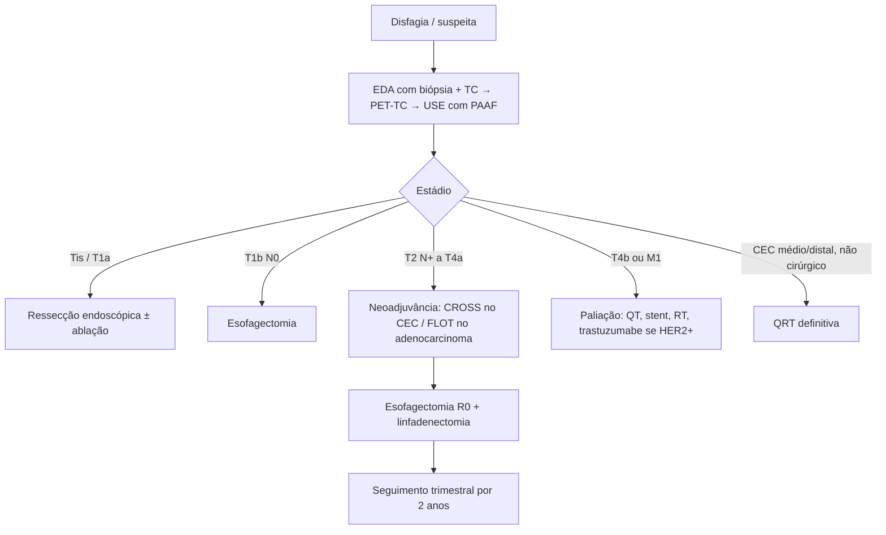

# Câncer de Esôfago

> Resumo em palavras próprias do Whitebook (Condutas Cirúrgicas > Cirurgia Oncológica), sem fisiopatologia, autoria e referências. Confira detalhes e doses na fonte: https://whitebook.pebmed.com.br/conteudo/?id=39175&categoryId=207&subcategoryId=212

## Epidemiologia e anatomia
- Brasil: 13º câncer mais frequente (sem pele não melanoma); INCA estima 10.990 casos/ano em 2023–2025 (8.200 homens, 2.790 mulheres; risco 7,76/100 mil homens e 2,49/100 mil mulheres), mais no Sul. Letalidade ~90%; 6ª causa de morte por câncer; 60–70 anos; 3,3 homens:1 mulher; nível socioeconômico baixo. Adenocarcinoma predomina nos países desenvolvidos; escamoso é o mais comum no mundo (88%).
- **Divisão:** cervical (da cricoide a ~18 cm dos incisivos); torácico proximal (até a carina, ~24 cm), médio (até metade do caminho à JEG, ~32 cm), distal/abdominal (~8 cm, ~40 cm dos incisivos). Drenagem: cervical esquerda, torácico direita, abdominal esquerda. Estações linfonodais: peritraqueais, traqueobrônquicas, mediastinais posteriores, diafragmáticas, gástrica esquerda, tronco celíaco, esplênica, hepática (supraclaviculares não entram).
- **Histologia:** escamoso e adenocarcinoma ~95%; também neuroendócrino, GIST, melanoma, sarcoma, linfoma, adenoescamoso, pequenas células, indiferenciado, mucoepidermoide, adenoide cístico. Aspecto circunferencial, plano, exofítico ou infiltrativo; metástase linfática precoce (submucosa rica, sem serosa), *skip metastasis*; metástases: fígado, pulmão, ossos, adrenal.
- **Escamoso:** 20% proximal, 50% médio, 30% distal; raramente invade o estômago; semelhante ao de cabeça e pescoço; disseminação linear pela submucosa; variantes verrucoso, basaloide, sarcomatoide; associado a cirrose, DPOC, aterosclerose, outros cânceres aerodigestivos; álcool e tabaco; mais agressivo.
- **Adenocarcinoma:** 97% nos terços médio e distal; invade o estômago; disseminação transmural; Barrett com metaplasia intestinal, obesidade, tabagismo.

## Fatores de risco
- **Escamoso:** dieta pobre em vitaminas A e C, riboflavina e proteínas; poucas frutas e vegetais; nitrosaminas e nitratos; bebidas quentes; aflatoxina; tabaco (25%; 2–4×); álcool; HPV; câncer de cabeça e pescoço; acalasia (30×); estenose cáustica; divertículo de Zenker; Plummer-Vinson; radiação; tilose e distúrbios familiares do tecido conjuntivo.
- **Adenocarcinoma:** Barrett (transformação 0,5–1%/ano; risco 125×); obesidade central (2º fator); DRGE/refluxo biliar; tabaco; sexo masculino; carne vermelha; poucas frutas e vegetais.
- **Exame:** caquexia, sialorreia, adenomegalia cervical/supraclavicular, massa abdominal, Claude-Bernard-Horner.

## Diagnóstico
- **Rastreamento:** sem programa populacional (baixa prevalência, invasividade da EDA); considerar em DRGE > 5 anos com múltiplos episódios (≥ 2–3) e outros fatores (masculino, caucasiano, obesidade central, tabagismo), ajustando pela história familiar; métodos em estudo: endoscopia transnasal, cápsula, citoesponja.
- **Avaliação nutricional** (risco nutricional/desnutrição frequentes): apetite, sintomas, edema, massa muscular, % e tempo de perda de peso, IMC, NRS-2002, ASG; capacidade funcional por ECOG/Karnofsky.
- **EDA** (padrão-ouro): biópsias múltiplas (Barrett ≥ 6–8 fragmentos); localização por distância dos incisivos e da JEG; nódulos e pré-malignas; extensão e obstrução; pode permitir sonda nasoenteral; cromoendoscopia com Lugol e banda estreita no escamoso precoce. Histologia OMS (adenocarcinoma, CEC, indiferenciado, raro); imuno-histoquímica: adenocarcinoma PAS+, CK7+, CK20+; CEC CK5+, CK6+, p63+. **HER2** em suspeita de doença avançada não curável (trastuzumabe).
- **Imagem:** esofagograma (altura/extensão, fístula traqueoesofágica; lesões > 8–10 cm geralmente irressecáveis); **TC** tórax e abdome com contraste (metástases hepáticas e pulmonares; avalia mal N; ângulo de Picus — contato com aorta < 45° exclui invasão, 45–90° indeterminado, > 90° sugere invasão); RM limitada (T4 selecionados); **PET-TC** acha até 15% de metástases ocultas após TC negativa e avalia resposta neoadjuvante em adenocarcinoma (queda < 35% do FDG após 2 semanas de QT com platina-fluoropirimidina = pior sobrevida); **ecoendoscopia** (T: sens. 81–92%, esp. 94–97%; N melhora com PAAF — sens. 85%, esp. 97%; limitada por experiência, tumores obstrutivos/superficiais/> 5 cm, perto da JEG); **broncoscopia** em tumores proximais/médios acima da carina, CEC em tabagista/etilista (sincrônicos), disfonia recente; **laparoscopia** em ≥ cT3 ou cN+ na JEG com infiltração da cárdia (peritônio oculto). Estratégia: TC → PET-TC → USE com PAAF.
- **Estadiamento AJCC 8ª ed.** (carcinomas, inclusive JEG; epicentro até 2 cm da JEG ou cárdia proximal entra no esofágico): T1a lâmina própria/muscular da mucosa; T1b submucosa; T2 muscular própria; T3 adventícia; T4a pleura, pericárdio, ázigos, diafragma, peritônio; T4b aorta, vértebra, traqueia. N1 1–2 linfonodos; N2 3–6; N3 ≥ 7 (o texto grafa “N1” por engano). M1.
- **Estágios — adenocarcinoma (clínico):** 0 Tis; I T1N0; IIA T1N1; IIB T2N0; III T2N1 ou T3–T4aN0–1; IVA T1–T4a N2, T4b ou N3; IVB M1. **Patológico:** IA T1a; IB T1b; IIA T2N0; IIB T1N1 ou T3N0; IIIA T1N2 ou T2N1; IIIB T2N2, T3N1–2 ou T4aN0–1; IVA T4aN2, T4b ou N3; IVB M1. **Escamoso (clínico):** I T1N0–1; II T2N0–1 ou T3N0; III T1–2N2 ou T3N1–2; IVA T4 ou N3; IVB M1. Patológico escamoso igual ao do adenocarcinoma patológico.

## Tratamento
Decisão por preferência, estágio, localização, profundidade, histologia, N/M, capacidade funcional, nutrição e comorbidades; poucos são elegíveis à cirurgia.

### Endoscópico
Melhor estabelecido em Barrett e adenocarcinoma (CEC com evidência menor).
- **Indicações:** Barrett com displasia de alto grau; adenocarcinoma até a muscular da mucosa (T1a) sem linfonodo/metástase; relativas — T1b N0 M0 inoperável com bom prognóstico (submucosa ≤ 500 µm, bem diferenciado, sem invasão linfovascular); neoplasia intraepitelial de alto grau (M1–M2 sem infiltração linfovascular); CEC com submucosa < 200 µm (M3, SM1). **Contraindicam:** além da submucosa superficial, lesão irressecável, pouca diferenciação. Centros de alto volume.
- **Mucosectomia:** lesões < 2 cm e < 2/3 da circunferência; complicações perfuração 1%, sangramento 1%, estenose 49,7%. **Dissecção da submucosa (ESD):** em bloco qualquer tamanho; mais difícil e demorada; perfuração 1,5–4,6%, sangramento 1,5–1,8%, estenose 6,5–11,6%. **Ressecção por tunelização** (tumores submucosos): enfisema/pneumomediastino 14,8%, pneumotórax 6,1%, pneumoperitônio 6,8%, derrame 16,9%, lesão mucosa 5,6%, fístula e divertículo. Sucesso: ressecção completa, G1–G2, sem invasão angiolinfática; senão, considerar cirurgia.
- **Ablação:** radiofrequência (padrão em lesões sésseis; estenose, dor, sangramento, perfuração); terapia fotodinâmica (fotossensibilidade, dor, estenose; pouco usada); crioterapia (mais profunda que a RFA, menos complicações); plasma de argônio (estenose). Seguimento endoscópico regular e histologia acurada.

### Cirurgia
Pilar curativo em bom estado clínico/nutricional, sem doença a distância nem invasão de estruturas vitais; objetivo R0. Estádios I–III (T1b–T4 N1–3 M0); padrão-ouro no I; II–III com tumor torácico > 5 cm do cricofaríngeo, com ou sem neoadjuvância. Morbidade 20–80%.
- **Ressecável:** T1–T3 (mesmo N+) e T4a. **Irressecável:** T4b (traqueia, coluna, laringe, grandes vasos, coração, pulmões, fígado, baço, pâncreas); linfonodos extensos/multi-estação (considerar idade, função, resposta); M+ (inclui linfonodo não regional); JEG com linfonodo supraclavicular.
- **Preparo:** parar de fumar; fisioterapia respiratória; corrigir nutrição (sonda, NPT, dilatação, gastro/jejunostomia prévia); avaliação cardiopulmonar (ECG, eco, espirometria; mínimos: CV 70%, VEF1 50%, VVM 50%).
- **Planejamento:** localização, via, local e tipo da anastomose (manual/mecânica), conduto (estômago, delgado, cólon), trajeto (retroesternal, mediastinal, transesofágico), risco de refluxo biliar, experiência do cirurgião.
- **Técnicas:** esofagectomia com preservação vagal (displasia de alto grau e T1a, após ressecção endoscópica confirmatória); Ivor-Lewis (laparotomia + toracotomia direita); McKeown (toracotomia direita + laparotomia + anastomose cervical); versões minimamente invasivas; trans-hiatal (laparotomia + anastomose cervical); robótica; transtorácica esquerda ou toracoabdominal. Minimamente invasivas: mesma sobrevida, menos complicações pulmonares, retorno mais rápido, melhor saúde global e menos dor após 1 ano. Margens: 5 cm proximal, 4 cm distal, ressecção em bloco R0.
  - *Trans-hiatal:* menos dor e complicação cardiopulmonar, menos mediastinite, mais rápida, linfadenectomia menor; mas esôfago médio/proximal mal avaliado, mais fístula, estenose e lesão do laríngeo recorrente, mais complicação cardíaca. *Transtorácica:* mais completa e melhor linfadenectomia; mais complicação cardiopulmonar, dor, mediastinite. Número ideal de linfonodos após neoadjuvância não estabelecido. Anastomose cervical: mais fístula e lesão do laríngeo; torácica: fístula com mediastinite.
- **Condutos:** *estômago* — suprimento confiável, menos anastomoses, mais fácil; perde o reservatório, peristalse fraca, refluxo ácido (Barrett, laringite), segmento proximal afetado por QT/RT. *Cólon* — isoperistáltico, preserva o estômago, menos refluxo e fístula; cirurgia maior, 3 anastomoses, vascularização menos segura (angiografia e colonoscopia pré-operatórias), hérnia interna, tortuosidade/dilatação, regurgitação e halitose; não usar se neoplasia colônica ou diverticulose extensa.
- **Drenagem do piloro:** sem consenso; denervação vagal altera o esvaziamento; ajuda nos sintomas precoces sem mais complicações (piloroplastia, piloromiotomia, toxina botulínica, balão).
- **Pós-operatório:** UTI; analgesia peridural/bloqueios/parenteral; fisioterapia precoce; drenagem pleural fechada (retirar com reexpansão, sem fuga aérea por ≥ 24 h — 48 h se intubado —, débito < 100–200 mL/dia); Penrose cervical (retirar sem fístula; tracionar 2–3 cm/dia a partir do 8º PO); RX seriado; broncodilatadores 4–6×/dia, aspirar secreções, sem VNI precoce, mobilizar cedo, cabeceira 45°. Dieta preferencialmente enteral por sonda posicionada na cirurgia ou jejunostomia (ou parenteral); alguns exigem trânsito contrastado antes da via oral; fístula = suspender a via oral. Complicações: pneumonia, atelectasia, IR; IAM, FA; lesão do laríngeo; mediastinite; empiema/derrame; deiscência.

### Quimio e radioterapia
- **Neoadjuvância** (QT ou QRT): ≥ T2 ou qualquer T N+ de esôfago médio/distal. **Adjuvância (QT):** T3–T4 ressecados sem neoadjuvância; margem positiva sem neoadjuvância; ressecção/linfadenectomia insuficiente. **Definitiva (QRT):** alternativa no CEC médio/distal (não é padrão); adenocarcinoma que não tolera ou recusa cirurgia (sobrevida equivalente, mais recidiva local sem cirurgia).
- Objetivos: reduzir volume, ↑R0, tratar micrometástases, reduzir recidiva sistêmica tardia, melhorar disfagia/nutrição. N0 T2 de baixo risco (< 2 cm, bem diferenciado): só esofagectomia (ou QRT exclusiva no CEC). CEC é mais radiossensível; no adenocarcinoma, em geral operar após neoadjuvância se não houver metástase nem contraindicação.
- Benefício de sobrevida global em 5 anos da neoadjuvância: 5,9%. **CEC:** padrão CROSS (carboplatina + paclitaxel + RT). **Adenocarcinoma:** após o ESOPEC (2025), apenas QT perioperatória tipo FLOT (5-FU, leucovorina, oxaliplatina, docetaxel), sem RT.

### Paliação
Estádio IV ou inoperáveis; objetivo é prolongar sobrevida preservando qualidade. QT com platina + fluoropirimidina (sobrevida mediana < 1 ano); trastuzumabe no adenocarcinoma HER2+ (30%); RT para disfagia (sem acometimento traqueobrônquico) e sangramento não volumoso; endoscópico — stents (disfagia grave ou fístula traqueoesofágica), eletrocoagulação, laser, alcoolização, terapia fotodinâmica; cirurgia — esofagectomia trans-hiatal paliativa (preferencial), tunelização, bypass (Postlethwait), gastro/jejunostomia.

## Seguimento e prognóstico
Exame físico e laboratório trimestrais por 2 anos, depois semestrais por 3 anos; imagem/EDA opcionais, em visitas alternadas; PET-TC se suspeita de recidiva; atenção ao estado nutricional. Fatores prognósticos principais: penetração mural e metástase linfonodal.

## Fluxograma (refeito, a partir do texto; o original está na fonte)

