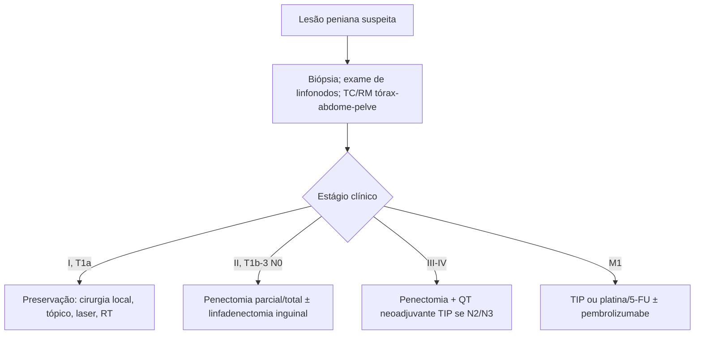

# Câncer de Pênis

> Resumo em palavras próprias do Whitebook (Condutas Cirúrgicas > Cirurgia Oncológica), sem fisiopatologia, autoria e referências. Confira detalhes e doses na fonte: https://whitebook.pebmed.com.br/conteudo/?id=44547&categoryId=207&subcategoryId=212

**Definição:** neoplasia rara em países desenvolvidos, mais comum em regiões de baixo nível socioeconômico (partes da África, Ásia e América do Sul). Sinônimos: neoplasia peniana, câncer peniano. ~95% são carcinoma de células escamosas (CCE); outros: melanoma, Kaposi, basocelular, mesenquimais, linfomas. Metástases a partir do pênis são raras.

## Epidemiologia e risco
- 0,4–3% das neoplasias masculinas nos EUA/Europa; até 20% em partes da América do Sul, Ásia e África. Pico na 6ª década.
- Mais em não circuncidados, sobretudo com **fimose** e higiene inadequada. HPV (6, 16, 18) em 30–50%. Obesidade e tabagismo também. Circuncisão e boa higiene protegem.
- Lesão exofítica, superficial ou ulcerada, que se torna invasiva; mais na glande e no prepúcio (também haste e escroto); invasão uretral só em casos avançados. Dissemina por via linfática (inguinais, pélvicos, periaórticos). Evolução lenta; sem tratamento, morte por infecção inguinal, necrose e erosão dos vasos femorais.

## Clínica
- Úlcera ou nódulo progressivo, geralmente indolor; lesão fétida, exsudativa, resistente ao tratamento local. Linfonodomegalia inguinal em 30–60%; 70–80% restritos ao pênis. Cadeias: inguinais → pélvicas → retroperitoneais. O fator prognóstico isolado mais importante é o acometimento linfonodal e sua extensão.
- **Marcadores de gravidade:** sintomas metastáticos, hipercalcemia, obstrução urinária (coágulos/massa), infecção tumoral com sepse.
- **Exame:** úlcera/massa, linfonodomegalia; rash, sangramento, balanite; avançado: conglomerados inguinais ulcerados, anemia, hipercalcemia (desorientação, sonolência), caquexia, derrame pleural.

## Diagnóstico e estadiamento
- Documentar tamanho, localização, linfonodos inguinais. Até 25% sem adenopatia têm doença microscópica. RM é a mais sensível para linfonodos, mas USG e TC são mais usadas. TC de tórax/abdome/pelve (ou RM) para metástases e planejamento.
- Laboratório básico (hemograma, eletrólitos, função renal e hepática). Cintilografia óssea ou RM de crânio só se sintomas; PET-CT se suspeita de envolvimento linfonodal. Linfonodo suspeito → PAAF ou biópsia excisional; sem adenopatia, mas risco alto/intermediário (graus 3–4, invasão linfovascular, T2–4) → estadiamento patológico.
- **TNM:** Tis; Ta CCE não invasivo; T1a (tecido conjuntivo subepitelial sem invasão linfovascular e sem alto grau); T1b (com invasão linfovascular ou alto grau); T2 corpo esponjoso (± uretra); T3 corpo cavernoso (± uretra); T4 outras estruturas. cN1 um linfonodo inguinal móvel unilateral; cN2 ≥ 2 móveis ou bilaterais; cN3 fixos ou pélvicos. **Estágios:** 0 Tis/Ta N0; I T1a N0; IIA T1b–2 N0; IIB T3 N0; IIIA T1–3 N1; IIIB T1–3 N2; IV qualquer T N3, T4 ou M1.
- **Jackson:** I glande/prepúcio; II corpo do pênis; III linfonodos inguinais operáveis; IV estruturas adjacentes, linfonodos inoperáveis ou metástases. **Grau:** G1 bem, G2 moderadamente, G3–4 pouco/indiferenciado.
- **Seguimento:** exame físico, laboratório, radiografia de tórax, USG de abdome (e inguinal se suspeito; TC se USG suspeita; cintilografia se dor óssea). A cada 4 meses nos anos 1–2, a cada 6 meses nos anos 2–5, depois anual.

## Tratamento
- **Baixo risco (I, T1a):** preservar o órgão: cirurgia local, 5-FU ou imiquimode tópicos, laser, radioterapia.
- **Alto risco (II, T1b–3 N0):** penectomia parcial ou total; avaliar linfadenectomia inguinal bilateral.
- **III/IV (localmente avançado/irressecável):** penectomia parcial (sobretudo T2–T3, mantendo haste ≥ 4 cm) ou total. N2/N3 ou lesões avançadas → QT neoadjuvante com **TIP** (paclitaxel, ifosfamida, cisplatina) × 4 ciclos. Poucas evidências para QT adjuvante; RT adjuvante precisa de mais estudos.
- **Metastático:** TIP; alternativas: cisplatina/5-FU, cisplatina/5-FU + pembrolizumabe (manutenção com pembrolizumabe), carboplatina/5-FU + pembrolizumabe (idem).
- Estratégias de preservação ganham espaço, mas exigem seleção criteriosa para evitar recidivas incuráveis.

## Fluxograma (refeito, a partir do texto; o original não traz algoritmo)

