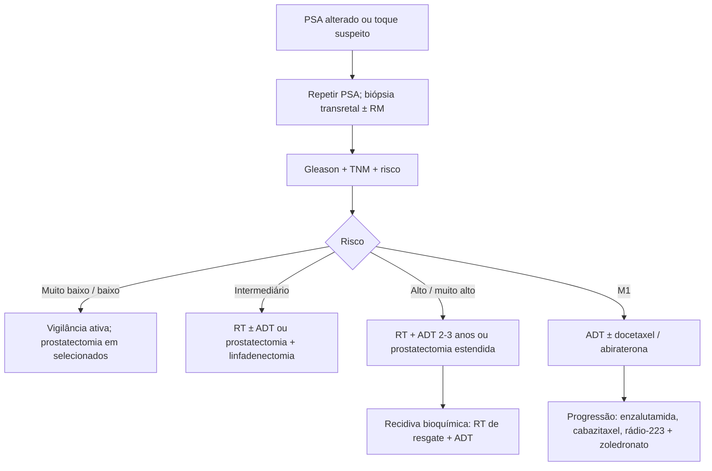

# Câncer de Próstata

> Resumo em palavras próprias do Whitebook (Condutas Cirúrgicas > Cirurgia Oncológica), sem fisiopatologia, autoria e referências. Confira detalhes e doses na fonte: https://whitebook.pebmed.com.br/conteudo/?id=22571&categoryId=207&subcategoryId=212

## Introdução
Segundo câncer mais comum no Brasil (sem pele não melanoma); estimativa INCA 2023–2025: 71.730 casos (67,86/100.000 homens). Doença da terceira idade (diagnóstico após 65 anos); incidência subiu com o PSA e a melhora da imagem. ~80% dos diagnósticos vêm de biópsia por PSA suspeito; ~20% têm nódulo ao toque. Adenocarcinoma ≈ 99% (raros: neuroendócrino, pequenas células, urotelial). Espectro de bem diferenciado indolente a indiferenciado agressivo.

## Clínica
- Precoce: em geral assintomático. Sintomas urinários (frequência, urgência, noctúria, hesitação); hematúria e hematospermia (incomuns, atenção em idosos); dor óssea e hipercalcemia (doença metastática); síndrome consumptiva, uremia pós-renal e compressão medular (doença avançada).
- **Risco:** idade (principal), etnia negra, história familiar (parente de 1º grau < 65 anos), genética (BRCA2); dieta e obesidade sem associação clara.
- **Toque retal:** assimetria, endurecimento, nódulo ou superfície irregular sugerem câncer; aumento simétrico firme sugere HPB. Sensibilidade limitada: 25–35% estão em áreas não palpáveis ou são T1.

## Rastreamento
- Controverso; o Ministério da Saúde não recomenda para homens assintomáticos (danos de excesso de diagnóstico/tratamento tendem a superar os benefícios) — decisão compartilhada. Se feito: 50–70 anos, expectativa de vida ≥ 10 anos, com consentimento e orientação.
- **PSA:** específico do órgão, mas não da doença (HPB, câncer, prostatite); não é diagnóstico; repetir antes da biópsia (1/3 normalizam em 1 mês). < 4 ng/mL: anual/bienal; 4–7: repetir em poucos meses e biopsiar se persistir > 4; ≥ 7: biópsia.
- **Refinamentos:** limites por idade (AUA): 2,5 (40 anos), 3,5 (50), 4,5 (60), 6,5 (70); densidade do PSA > 0,15 ng/mL/g; fração livre > 25% favorável e < 15–20% sugere câncer; velocidade: com PSA 2,5–4, > 0,35 ng/mL/ano; com PSA > 4, > 0,75 ng/mL/ano (não usar isoladamente).
- **Indicações de biópsia:** toque alterado (independe do PSA); PSA > 4; PSA > 2,5 em jovens (≤ 55 anos); densidade > 0,15; velocidade > 0,75/ano; aumento > 0,35 com PSA 2,5–4. Transretal guiada por USG (ou RM); a USTR não detecta boa parte dos tumores, então a biópsia não depende dela. Metástase: biopsiar o sítio mais acessível.
- **PET-PSMA:** estadiamento de alto risco, recidiva bioquímica, CPRC não metastático e seleção para terapia com lutécio-177.

## Estadiamento
- Laboratório: hemograma, função renal, eletrólitos/cálcio, função hepática, FA, PSA. Risco muito baixo/baixo: RM de próstata (demais exames só se sintomas); intermediário: RM + cintilografia óssea + TC de abdome; alto/muito alto: RM + cintilografia + TC de tórax e abdome.
- **Risco:** muito baixo — T1c, Gleason ≤ 6, PSA < 10, < 3 fragmentos positivos com ≤ 50% cada, densidade < 0,15; baixo — ≤ T2a, Gleason ≤ 6, PSA < 10; intermediário — T2b/T2c ou Gleason 7 ou PSA 10–20; alto — ≥ T3a ou Gleason 8–10 ou PSA > 20; muito alto — T3b/T4, Gleason primário 5 ou > 4 fragmentos com Gleason 8–10.
- **TNM (UICC/AJCC 9ª ed., 2025; só adenocarcinoma):** T1a ≤ 5% do tecido ressecado; T1b > 5%; T1c por biópsia (PSA); T2a ≤ metade de um lobo; T2b > metade de um lobo; T2c dois lobos (invasão do ápice/cápsula sem extensão extraprostática = T2); T3a extracapsular (incl. colo vesical microscópico); T3b vesículas seminais; T4 fixo ou invade esfíncter externo, reto, elevadores, parede pélvica. N1; pNmi ≤ 0,2 cm. M1a linfonodos não regionais; M1b osso; M1c outros. **Estágios:** I T1/T2a N0; II T2b–c N0; III T3–4 N0; IV N1 ou M1.
- **Gleason / grupos:** graus 1–5 nos dois padrões predominantes, soma de 6 a 10. Grupo 1 ≤ 6 (3+3); 2 = 3+4; 3 = 4+3; 4 = 8 (4+4, 3+5, 5+3); 5 = 9–10.

## Seguimento
PSA indetectável após cirurgia → PSA e toque a cada 3–6 meses. PSA não indetectável ou que volta a subir → doença residual/recorrente; investigar metástase e tratar conforme.

## Tratamento
Estratificar por toque (examinador experiente), PSA, Gleason, nº de fragmentos positivos; imagem conforme risco. Patologia adversa (Gleason alto, extensão extracapsular, vesículas, linfonodos) → adjuvância.
- **Muito baixo risco:** vigilância ativa (expectativa de vida < 20 anos); com maior expectativa, mesmas opções do baixo risco. Sem condição de tratar mas sintomático → apenas bloqueio hormonal.
- **Baixo risco:** vigilância ativa (PSA a cada 6 meses, biópsia a cada 12), tratando se progredir; casos selecionados (volume alto, densidade alta, história familiar) → prostatectomia.
- **Intermediário:** RT ± bloqueio hormonal (ADT) concomitante, ou prostatectomia radical com linfadenectomia pélvica (patologia adversa → RT adjuvante). Vigilância ativa só se expectativa limitada.
- **Alto risco:** RT + ADT por 2–3 anos; ou prostatectomia radical com linfadenectomia pélvica estendida se sem invasão de órgãos adjacentes (margem positiva, extracapsular ou vesícula → RT adjuvante e/ou ADT; linfonodo positivo → bloqueio hormonal ou orquiectomia ± RT). Inelegível mas sintomático: bloqueio ou orquiectomia bilateral. **Recidiva bioquímica:** após cirurgia — RT de resgate + bloqueio; após RT — bloqueio ou orquiectomia em alto risco e tempo de duplicação curto (considerar intermitente).
- **Muito alto risco / T3b–T4:** RT + ADT; ou prostatectomia com linfadenectomia estendida. Linfonodo positivo = estágio IV; com N+ sem M1: RT + ADT.
- **Metastático (M1) ou PSA em alta em quem não faz ADT:** castração medicamentosa (GnRH) ou orquiectomia bilateral; primeira linha é sempre supressão de testosterona. Sintomático de alto volume: associar docetaxel (ou abiraterona + prednisona). Progressão: manter castração e adicionar abiraterona (se não usada), enzalutamida, cetoconazol, dietilestilbestrol etc.; sintomático: docetaxel ou cabazitaxel, rádio-223 (só metástase óssea), novas linhas hormonais; RT antiálgica localizada; inibidores de osteólise (ácido zoledrônico) em metástase óssea e doença resistente à castração.
- **Sequência sistêmica:** castração cirúrgica quando houver urgência (compressão medular, obstrução urinária) ou problema de custo/adesão. Cetoconazol 200–400 mg a cada 8 h (inibe síntese de androgênios); glicocorticoides (prednisona, dexametasona, hidrocortisona) reduzem ACTH; estrógenos inibem GnRH; novos quimioterápicos em estudo.

## Fluxograma (refeito, a partir do texto; o original não traz algoritmo)

