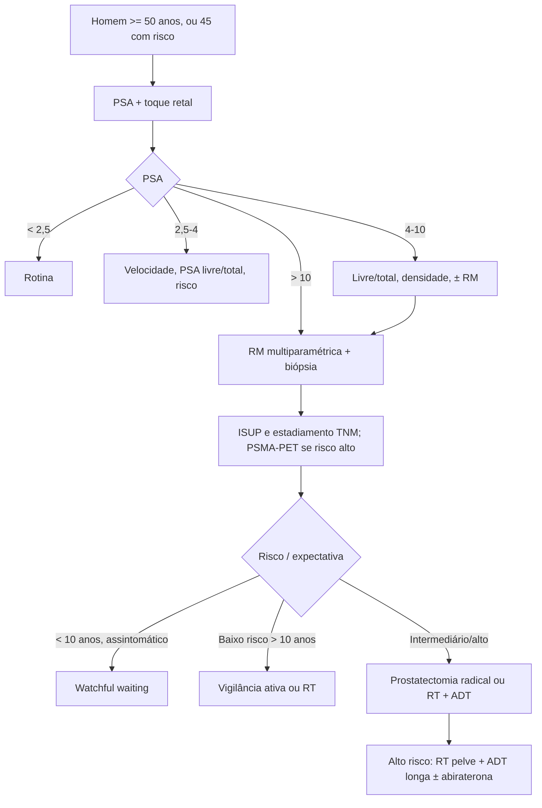

# Câncer de Próstata Localizado

> Resumo em palavras próprias do Whitebook (Condutas Cirúrgicas > Cirurgia Urológica), sem fisiopatologia, autoria e referências. Confira detalhes e doses na fonte: https://whitebook.pebmed.com.br/conteudo/?id=64415&categoryId=207&subcategoryId=214

**Definição:** neoplasia maligna restrita à próstata, sem extensão extraprostática, invasão de estruturas vizinhas, linfonodos regionais ou metástases à distância.

## Clínica
- **Anamnese:** sintomas urinários baixos e constitucionais (doença avançada); hematúria e hematospermia (menos frequentes). Fatores de risco: idade avançada, raça negra, história familiar, genética, dieta e obesidade.
- **Toque retal:** nódulo, endurecimento, assimetria, aumento localizado, perda do sulco mediano, consistência irregular ou pétrea. Aumento isolado, sem esses achados, sugere HPB.

## Diagnóstico
- **Quando iniciar:** a partir dos 50 anos, ou 45 anos com fator de risco (parente de 1º grau, raça negra). Se expectativa de vida < 15 anos, não há benefício no diagnóstico precoce.
- **PSA + toque retal:** < 2,5 ng/mL: rotina; 2,5–4: avaliar velocidade de elevação, fatores de risco e relação PSA livre/total; 4–10: relação livre/total, densidade do PSA e considerar RM multiparamétrica; > 10: RM multiparamétrica e avaliar biópsia.
- **PI-RADS:** 1–2 baixa probabilidade de câncer clinicamente significativo; 3 indeterminado; 4–5 alta probabilidade.
- **Grupos ISUP/Gleason:** ISUP 1 (3+3=6) baixo risco; ISUP 2/3 (3+4 ou 4+3=7) risco intermediário; ISUP 4/5 (Gleason 8–10) alto risco.
- **TNM:** T1a (achado incidental ≤ 5% do tecido ressecado), T1b (> 5%), T1c (biópsia por PSA elevado); T2a (≤ metade de um lobo), T2b (> metade de um lobo), T2c (ambos os lobos); T3a (extensão extracapsular, inclui microinvasão do colo vesical), T3b (vesículas seminais); T4 (fixo/invade colo vesical, esfíncter externo, reto, levantadores do ânus ou parede pélvica); N0/N1 (linfonodos pélvicos regionais); M1a (linfonodos não regionais), M1b (ossos), M1c (outras vísceras).
- **PET-CT com PSMA:** alta sensibilidade e especificidade para estadiar (linfonodos e ossos) em risco intermediário desfavorável ou alto risco; também usado na recorrência bioquímica.
- **Diferenciais:** HPB, prostatite.

## Tratamento
- **Watchful waiting:** assintomáticos com expectativa de vida < 10 anos.
- **Vigilância ativa:** baixo risco com expectativa > 10 anos; em casos selecionados de risco intermediário (ISUP 2/Gleason 3+4, baixo volume, até 3 fragmentos positivos). ISUP 3 é excluído.
- **Prostatectomia radical:** padrão para risco intermediário ou alto com expectativa > 10 anos; atentar para a indicação de linfadenectomia.
- **Radioterapia:** baixo risco — definitiva, sem ADT; risco intermediário — escalonamento de dose ou hipofracionamento moderado + ADT curta (4–6 meses); alto risco — + ADT longa (2–3 anos).
- **Braquiterapia:** opção em risco intermediário com boa função urinária.
- Doença de alto risco/linfonodal: radioterapia no tumor primário e nos linfonodos pélvicos + ADT longa, com abiraterona por 2 anos se elegível.

## Fluxograma (refeito, a partir do texto; o original não traz algoritmo)

