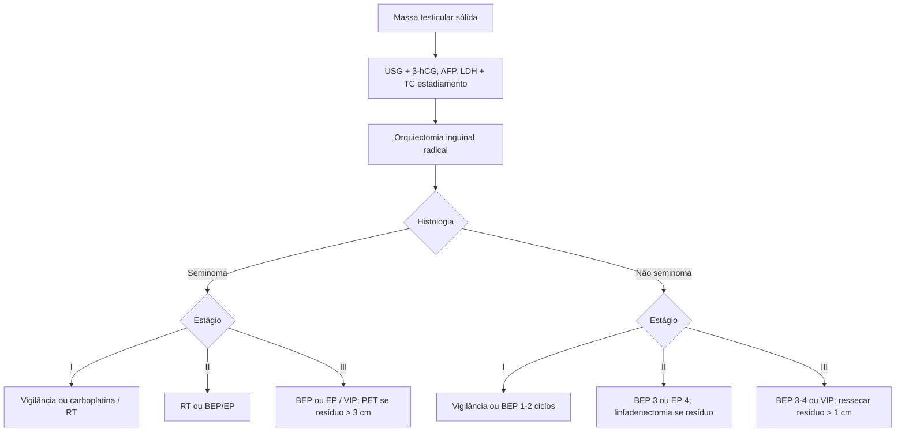

# Câncer de Testículo

> Resumo em palavras próprias do Whitebook (Condutas Cirúrgicas > Cirurgia Oncológica), sem fisiopatologia, autoria e referências. Confira detalhes e doses na fonte: https://whitebook.pebmed.com.br/conteudo/?id=114&categoryId=207&subcategoryId=212

**Definição e epidemiologia:** ~5% dos cânceres masculinos, mais frequente aos 15–40 anos; neoplasia sólida mais comum em jovens, com incidência em alta; rara antes dos 13 anos. ~95% são de células germinativas, puros ou mistos. **Seminomatosos:** ~50%, 30–40 anos, AFP não elevada. **Não seminomatosos:** 20–30 anos, 30–60% com metástase ao diagnóstico. Alto potencial de cura (sobrevida em 5 anos 95%; mortalidade 0,1%). Por faixa etária: crianças — teratoma e saco vitelínico; adolescentes pós-puberais — carcinoma embrionário; idosos — seminoma e linfoma (> 60).
- Marco genético: anomalias do 12p. Drenagem: testículo direito → cadeias pericaval e interaortocaval; esquerdo → para-aórtica esquerda, depois ambos os lados; cirurgia prévia inguinal/pélvica torna a disseminação imprevisível. Metástases a distância: pulmão, fígado, cérebro, ossos, rins, adrenal; coriocarcinoma dissemina cedo por via hematogênica.
- **Classificação:** células germinativas (neoplasia intratubular in situ; puros — seminoma, seminoma anaplásico, espermatocítico, carcinoma embrionário, saco vitelino; trofoblásticos — coriocarcinoma etc.; teratoma maduro/imaturo/maligno; mistos); cordão espermático/estroma (Leydig, Sertoli, células da granulosa, da teca); misto germinativo-estromal (gonadoblastoma); sarcoma, carcinoide, mesotelioma; linfomas; ducto e rete testis; metástases.

## Fatores de risco
Criptorquidia (5×), hipospadia, caucasianos, história familiar (4× pai, 8× irmão), infertilidade, genética (> 40%), tumor contralateral. Microlitíase, trauma, hérnia, vasectomia e tabagismo: dados conflitantes.

## Clínica
- Nódulo ou aumento indolor unilateral; aumento de testículo atrófico; peso/dor difusa baixa, perianal ou escrotal (30–40%); dor aguda só em 10%.
- Doença metastática (~10%): sintomas constitucionais, hemoptise/tosse/dispneia, massa abdominal, lombalgia (retroperitônio no psoas/raízes), dor óssea, massa cervical (supraclavicular), náusea/vômito/HDA (retroduodenal), edema de membros (trombose ilíaca/cava), neuropatia ou sintomas do SNC.
- Paraneoplásicos: ginecomastia, hipertireoidismo (hCG), impotência/perda de libido, encefalite límbica (anti-Ma2).
- **Exame:** palpação bimanual começando pelo lado normal (tamanho, consistência, contorno, epidídimo, mobilidade; cordão, pele; hidrocele possível); linfonodos incluindo supraclaviculares; abdome; ginecomastia. Sem rastreio populacional; quem teve tumor contralateral deve se autopalpar e ser examinado (alguns centros fazem USG anual).

## Diagnóstico
- Toda massa sólida é maligna até prova em contrário. Biópsia transescrotal do tumor é desencorajada (disseminação). Marcadores: β-hCG (meia-vida 24–36 h), AFP (5–7 dias), LDH; β-hCG/AFP elevados em 80–85% dos não seminomatosos, mesmo sem metástase; seminoma puro sem AFP elevada e β-hCG em < 20%; falso-positivos: hepatocarcinoma, câncer gástrico, diferenciação trofoblástica de pulmão. Marcadores não bastam sem histologia (exceção: paciente debilitado em que a biópsia não é viável).
- **USG escrotal bilateral** (exame inicial; lesões de 1–2 mm): seminoma — hipoecoico homogêneo sem cistos; não seminomatoso — heterogêneo, calcificações, cistos, margens indistintas; cisto/líquido raramente é maligno. **TC de tórax, abdome e pelve** para estadiamento (linfonodo patológico: eixo menor > 10 mm; falso-negativo por micrometástases); RM só se sintomas/alto risco (ex.: coriocarcinoma) ou suspeita cerebral; PET: pouco no estadiamento inicial, útil nas massas residuais pós-QT; cintilografia óssea raramente.
- **Histologia:** orquiectomia inguinal radical (gônada e todo o cordão) dá diagnóstico e controle local; muitos centros biopsiam o contralateral (neoplasia in situ em 2–5%); em lesões pequenas distantes do hilo, congelação pode evitar radicalização (principalmente em orquiectomia contralateral prévia). **Linfadenectomia retroperitoneal** é o método mais acurado para micrometástases e para estadiamento retroperitoneal (linfonodos para-aórticos mais comuns); considerar em T1–T3, N0–2, M0 selecionados; excepcionalmente em grandes massas sem marcadores ou doença atípica. Imuno-histoquímica: OCT4 (embrionário e seminoma), KIT (+ seminoma), β-hCG (coriocarcinoma), AFP (saco vitelínico).
- **Diferenciais:** torção, orquiepididimite, hidrocele, varicocele, hérnia inguinoescrotal, espermatocele, hematoma, goma sifilítica.

## Estadiamento (AJCC/UICC 2017)
- **cT:** x, 0, is, 4 (invade escroto); extensão do primário pela orquiectomia. **cN:** N1 ≤ 2 cm ou vários ≤ 2 cm; N2 > 2 e < 5 cm; N3 > 5 cm.
- **pT:** pT1 limitado ao testículo/rete testis sem invasão linfovascular (T1a < 3 cm; T1b ≥ 3 cm); pT2 com invasão linfovascular ou tecidos moles hilares, epidídimo, albugínea; pT3 cordão espermático; pT4 escroto. pN como cN.
- **M:** M1a linfonodo não regional ou pulmão; M1b outras.
- **S:** S1 LDH < 1,5× LSN e β-hCG < 5.000 mUI/mL e AFP < 1.000 ng/mL; S2 LDH 1,5–10× ou β-hCG 5.000–50.000 ou AFP 1.000–10.000; S3 LDH > 10× ou β-hCG > 50.000 ou AFP > 10.000.
- **Estágios:** 0 pTis; IA pT1 N0 M0 S0; IB pT2–4 N0 S0; IS qualquer pT N0 S1–3; IIA N1 S0–1; IIB N2 S0–1; IIC N3 S0–1; IIIA M1a S0–1; IIIB N1–3 S2 ou M1a S2; IIIC S3 ou M1b.

## Tratamento — seminoma
Orquiectomia inguinal radical é o tratamento inicial.
- **Estágio I:** orquiectomia cura 85%; sobrevida em 5 anos 95%. Cuidados: biópsia contralateral em azoospérmicos/oligospérmicos, contralateral atrófico (< 12 mL), criptorquidia corrigida ou má adesão; não abrir a túnica vaginal; informar impacto de RT/QT/linfadenectomia sobre ejaculação e espermatogênese; preservar fertilidade; prótese testicular permitida. **Vigilância** (ideal): ano 1 — marcadores e consulta a cada 3 meses, TC abdome/pelve a cada 6; anos 2–3 — a cada 6 meses, TC a cada 6–12; anos 4–5 — anual. **Adjuvância** (se não puder vigiar): RT para-aórtica 20 Gy ou 1 ciclo de carboplatina AUC 7.
- **Estágio II:** RT para-aórtica e ilíaca ipsilateral (IIA ou IIB não bulky); QT com 3 ciclos de BEP ou 4 de EP em IIB bulky e IIC.
- **Estágio III:** bom prognóstico (metástases só em pulmão/linfonodos) — 3 BEP ou 4 EP; intermediário (outros sítios) — 4 BEP ou 4 VIP. TC 6 semanas após; massa > 3 cm → PET-CT: negativo, seguir; positivo, ressecar (tumor viável → nova QT; irressecável → observar e QT de 2ª linha se crescer).
- **Refratário/residual:** QT de segunda linha (TIP, altas doses com transplante autólogo; ensaio clínico se possível). Seminomas respondem bem; ~95% do residual é necrose, raramente ressecar; PET-CT em dúvida (falso-positivo ~15% por inflamação), repetir antes de operar.

## Tratamento — não seminomatoso
- **Estágio I:** orquiectomia cura 75%. Vigilância (sem fatores de risco, aderente): ano 1 — marcadores e consulta a cada 2 meses, TC e RX de tórax a cada 4; ano 2 — a cada 3 meses, imagem a cada 6; anos 3–5 — consulta a cada 6, imagem anual. QT adjuvante (1–2 ciclos de BEP) com ou sem fatores de risco; linfadenectomia se massas persistirem.
- **Estágio II:** RT, QT ou linfadenectomia; em geral QT adjuvante 3 BEP ou 4 EP; sem resposta completa na TC mas com resposta de marcador → linfadenectomia (possível teratoma).
- **Estágio III:** bom risco (primário testicular/retroperitoneal, só pulmão/linfonodos, AFP < 1.000, β-hCG < 5.000, LDH < 1,5× LSN) — 3 BEP ou 4 EP; intermediário (AFP 1.000–10.000, β-hCG 5.000–50.000, LDH 1,5–10×) e ruim (mediastinal, outras metástases, AFP > 10.000, β-hCG > 50.000 ou LDH > 10×) — 4 BEP ou 4 VIP. TC aos 6 semanas; resíduo em tórax e abdome → ressecar primeiro o abdome; marcadores normais com linfonodo > 1 cm → ressecar; irressecável → observar; viável → mais QT; marcadores que não normalizam → procurar metástase. Seguimento 5–10 anos.
- **Refratário/residual:** QT 2ª linha (TIP, altas doses + TMO). Ressecar se tumor > 1 cm após QT ou platô de marcadores (sobretudo AFP). Após QT: 10% tumor viável, 40% teratoma, 50% necrose/fibrose. < 1 cm com marcadores caindo → observar (alguns ressecam). Só teratoma ou necrose na peça → sem tratamento adicional.

## Fluxograma (refeito, a partir do texto; o original não traz algoritmo)

