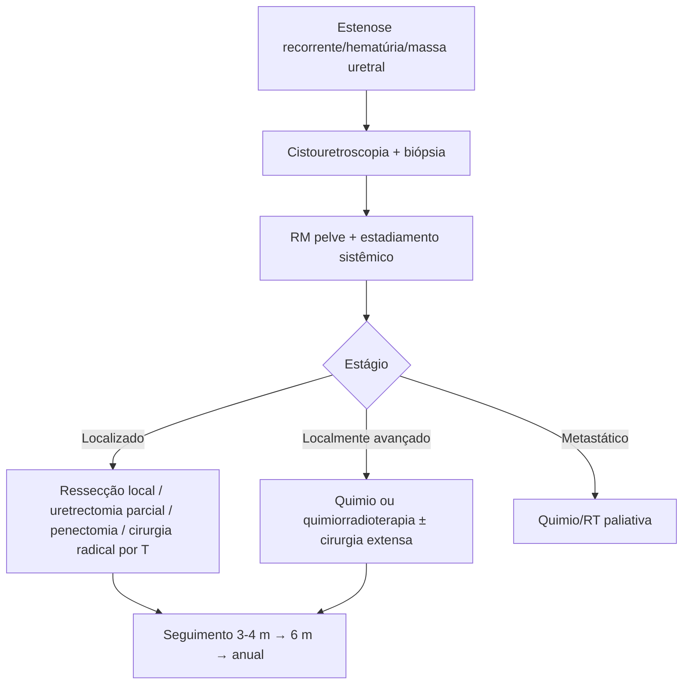

# Câncer de Uretra

> Resumo em palavras próprias do Whitebook (Condutas Cirúrgicas > Cirurgia Urológica), sem fisiopatologia, autoria e referências. Confira detalhes e doses na fonte: https://whitebook.pebmed.com.br/conteudo/?id=39150&categoryId=207&subcategoryId=214

## Epidemiologia
- Raro (< 1% dos tumores geniturinários malignos); mais comum em homens; acima de 60 anos, pico aos 75–84.
- Fatores de risco: inflamação crônica e HPV 16. Homens: ISTs, uretrite, estenose uretral, trauma, instrumentação, radioterapia externa. Mulheres: divertículo uretral (5% dos casos), estase urinária, infecções, arsênio.
- Carcinoma urotelial é frequentemente multifocal (uretra, bexiga, ureter, pelve renal). Cerca de 10% têm metástase à distância ao diagnóstico (pulmão, fígado, osso lítico).
- **Histologia:** epidermoide 70–80%, de células transicionais 15%, adenocarcinoma 5–10% (mais em mulheres), melanoma 4%, paraganglioma, carcinoide, linfoma não Hodgkin, rabdomiossarcoma. **Localização (homem):** bulbomembranosa 60%, peniana 30%, prostática 10%. Uretra feminina: 3–4 cm (terço distal = anterior; 2/3 proximais = posterior).

## Clínica
- Sintomas inespecíficos, simulando estenose benigna; carcinoma se apresenta como estenose em 24–76% → biópsia em estenose recorrente.
- Hematúria (inicial), dificuldade miccional, disúria, secreção, retenção na doença avançada; dor perineal inexplicada, edema genital, priapismo, abscesso periuretral ou fístula (idosos). Linfonodos regionais acometidos em até 30% dos homens ao diagnóstico (menos da metade palpáveis).
- Mulheres: sintomas pélvicos persistentes (dispareunia), disúria, escape hemorrágico, ITU de repetição, massa uretral/pélvica.
- Exame: uretra palpável, linfonodos inguinais, toque retal, exame bimanual na mulher.

## Diagnóstico e estadiamento
- **Biópsia** confirma. Citologia urinária (doença recorrente, estenose, mucosa anormal); cistouretroscopia (extensão); uretrografia retrógrada no homem; biópsia transuretral.
- **RM** é a melhor para estadiamento local, planejamento e fístulas (T2 hiperintenso, perda da imagem em alvo da uretra). Cintilografia óssea se sintomas, FA elevada ou suspeita; PET-CT sem dados.
- **TNM (AJCC/UICC 8ª ed.):** Ta papilar não invasivo; Tis in situ; T1 tecido subepitelial; T2 corpo esponjoso, próstata ou músculo periuretral; T3 corpo cavernoso, além da cápsula prostática, vagina anterior, colo vesical; T4 órgãos adjacentes (bexiga). N1 um linfonodo regional, N2 múltiplos. M1 à distância.
- **Estágios:** 0a (Ta N0), 0is (Tis N0), I (T1 N0), II (T2 N0), III (T1–2 N1 ou T3 N0–1), IV (T4 N0–1, qualquer T N2, qualquer M1).

## Tratamento
Sem consenso (raridade); depende de localização, extensão, histologia e sexo.
- **Localizado (cirurgia preferida):** ressecção transuretral/fulguração/laser (lesões pequenas anteriores superficiais); uretrectomia distal parcial de 1–2 cm (Tis, T1, T2 anterior); penectomia parcial; uretrectomia total ± cistectomia e derivação (Mitrofanoff); cistoprostatectomia radical em bloco (T3); exenteração pélvica + derivação + linfadenectomia ilioinguinal (posterior). Mulheres de baixo grau ou pequenos de alto grau não invasivos: ressecção endoscópica (difícil).
- Linfadenectomia inguinal de rotina não indicada (só se linfonodos aumentados ou palpáveis); linfonodo sentinela não estabelecido. Radioterapia (externa/braquiterapia) é alternativa curativa que preserva função (uretra anterior no homem, proximal na mulher).
- **Localmente avançado:** quimioterapia ou quimiorradioterapia perioperatória reduz massa e extensão cirúrgica; ressecção extensa (inclui vaginectomia anterior); RT para irressecável; RT adjuvante se doença avançada ou margem positiva; quimiorradioterapia definitiva se não candidato ou recusa cirurgia.
- **Metastático:** prognóstico reservado; quimio e/ou RT paliativas, pouco eficazes a longo prazo.
- **Seguimento:** a cada 3–4 meses nos 2 primeiros anos, semestral do 3º ao 5º, anual depois; exame com atenção aos linfonodos inguinais e endoscopia da uretra remanescente; imagem se necessário.
- **Prognóstico:** sobrevida em 5 anos 50–60% (anteriores) e ~10% (posteriores); recidiva local alta. Pior: tumor posterior ou ambos, ≥ 2 cm, estágio avançado, epidermoide, linfonodo positivo.

## Fluxograma (refeito, a partir do texto; o original não traz algoritmo)

