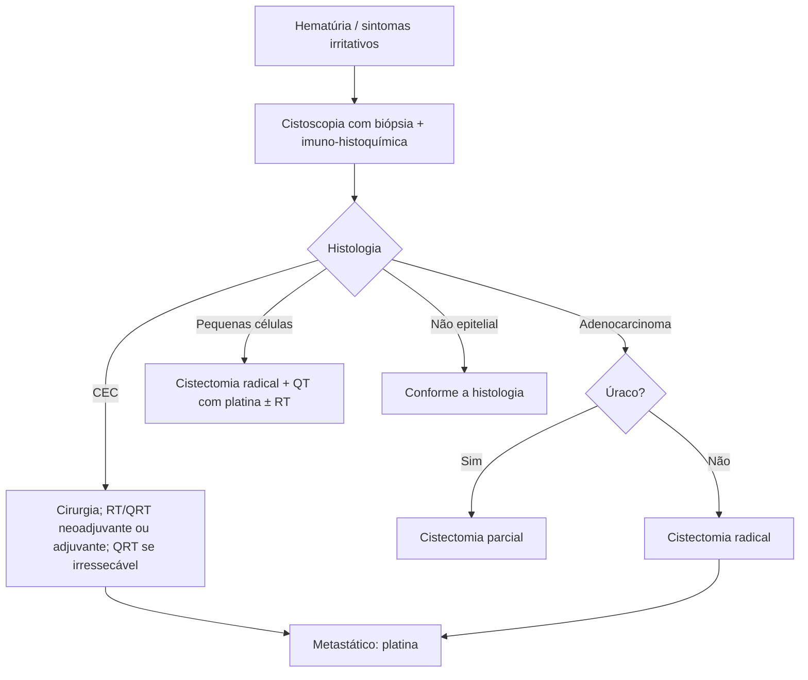

# Cânceres de Bexiga Não Carcinoma Urotelial

> Resumo em palavras próprias do Whitebook (Condutas Cirúrgicas > Cirurgia Oncológica), sem fisiopatologia, autoria e referências. Confira detalhes e doses na fonte: https://whitebook.pebmed.com.br/conteudo/?id=45863&categoryId=207&subcategoryId=212

**Definição e contexto:** neoplasias não uroteliais da bexiga — carcinoma de células escamosas (CEC), adenocarcinomas, pequenas células, sarcomas, melanomas, linfomas etc. Menos de 5% dos tumores vesicais; ~90% são epiteliais (CEC, adenocarcinoma, pequenas células); os não epiteliais incluem sarcomas, paragangliomas, melanomas e linfomas. Metaplasia e infecção crônica estariam na origem. Manejo geral parecido com o do carcinoma urotelial, mas com resposta e sobrevida piores. Doença localizada → cirurgia curativa; metastática → protocolo de estudo, ou esquemas do urotelial/baseados na histologia, extrapolando de outros primários. Ver também “Câncer de Bexiga”.

**Classificação:** epiteliais — epidermoide, adenocarcinoma, pequenas células; não epiteliais — sarcomas, melanomas, linfomas, carcinossarcoma, carcinoma sarcomatoide, paraganglioma.

**Diagnóstico:** hematúria macro ou microscópica e sintomas irritativos (frequência, urgência, disúria). **Cistoscopia com biópsia** é o padrão-ouro; rever lâminas de histologias incomuns; imuno-histoquímica é essencial.

## CEC
- 3–5% dos tumores vesicais no Ocidente; 75% no Oriente (áreas endêmicas de *Schistosoma haematobium*). Diagnóstico em geral localizado, metástase tardia, maior recidiva local.
- **Fatores:** esquistossomose, ITU de repetição, cálculo vesical, RT pélvica prévia, BCG intravesical prévio, ciclofosfamida, tabagismo, bexiga neurogênica.
- **Tratamento:** cirurgia nos estágios iniciais; RT adjuvante ± QT na doença localmente avançada (RT ou QRT neoadjuvante é melhor); QRT em irressecável; QT mais usada: mitomicina + 5-FU ou cisplatina isolada; metastático: esquemas com platina.

## Adenocarcinoma
- < 2% no Ocidente; diagnóstico em geral localizado, mas metástase precoce na evolução. Cirurgia na doença localizada; **úraco** (remanescente embrionário na cúpula; geralmente produz mucina; fatores de risco não estabelecidos) → cistectomia parcial pode dar boas margens; **não úraco** (extrofia vesical, *S. haematobium*) → preservar a bexiga tem resultado ruim, não recomendado. Metastático: platina, 5-FU, FOLFOX (extrapolado do colorretal) ou outros.

## Carcinoma de pequenas células
- < 1% dos tumores vesicais (~600 casos até 2015); muito agressivo, metástase precoce; mesma faixa etária, sexo e sintomas do urotelial. Exige suspeição do patologista; confirmar em fragmentos de RTU: aglomerados de células pequenas com pouco citoplasma, cromatina “sal e pimenta”, > 10 mitoses por campo de 10×; imuno-histoquímica positiva para cromogranina, enolase, sinaptofisina, CD56 (N-CAM).
- **Tratamento:** precoce e multimodal (cistectomia, QT, RT). Estágios iniciais: cistectomia parcial ou RT podem ajudar; cistectomia radical é a melhor opção para eliminar a doença, mas isolada só muda a sobrevida nos estágios I e II; melhores resultados com cistectomia radical + QT adjuvante ou neoadjuvante; metastático: QT com platina.

## Não epiteliais
Sarcoma, carcinossarcoma/sarcomatoide, paraganglioma, melanoma, linfoma: tratar conforme a histologia, com evidência fraca (relatos de caso e pequenas séries).

## Fluxograma (refeito, a partir do texto; o original não traz algoritmo)

