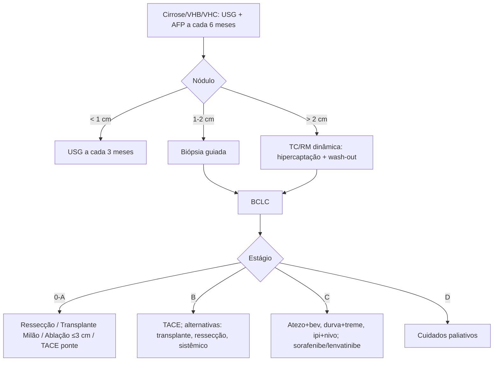

# Carcinoma Hepatocelular

> Resumo em palavras próprias do Whitebook (Condutas Cirúrgicas > Cirurgia Oncológica), sem fisiopatologia, autoria e referências. Confira detalhes e doses na fonte: https://whitebook.pebmed.com.br/conteudo/?id=53698&categoryId=207&subcategoryId=212

**Definição:** câncer primário mais comum do fígado. Mais frequente na Ásia Oriental, Sudeste Asiático e África Subsaariana; 6º câncer mais comum e 4ª causa de morte por câncer; principal causa de óbito em cirróticos; sobrevida em 5 anos 18%. Na maioria associado a cirrose e a hepatites B e C (VHC cirrótico: incidência anual 3–5%), mas pode ocorrer sem cirrose. DHGNA/síndrome metabólica/obesidade tendem a ser as principais causas no Ocidente.

## Fatores de risco
Raro sem hepatopatia; homens 2:1. Cirrose de qualquer causa; aflatoxina (com VHB); VHC é a principal causa no Ocidente e no Japão (antivirais reduzem o risco de 6,2% para 1,5%); VHB é oncogênico independentemente da fibrose (vacina reduz o risco); DHGNA em ascensão; cirrose alcoólica; tabagismo; álcool e HIV sinérgicos.

## Clínica
Dor abdominal; descompensação súbita sem causa; ascite nova (hemorrágica) ou varizes; hepatomegalia; trombose de veia porta; aumento progressivo de GGT, FA e AFP; hipoglicemia. Exame: piora do estado geral, emagrecimento, icterícia, ascite, hepatomegalia ou massa com frêmito/sopro em hipocôndrio direito.

## Rastreio
- Cirróticos de qualquer causa; também portadores de VHB ou VHC sem cirrose. Não rastrear hepatopatia avançada sem proposta curativa nem DHGNA sem cirrose.
- **USG a cada 6 meses** (sensibilidade 47–84%, especificidade 90%) + **AFP a cada 6 meses** (AASLD, NCCN, EASL, APASL).

## Diagnóstico
- **AFP:** elevada em até 90%; > 500–1.000 ng/mL altamente sugestiva; ~30% não secretam; não específica; em cirrótico rastreado com lesão suspeita, > 200 ng/mL tem especificidade de 100%.
- **USG:** triagem; lesões a partir de 0,5–1 cm; nódulo hipoecogênico heterogêneo (depois hiperecoico), halo, trombo portal (muito sugestivo), vaso arterial no Doppler; não basta — seguir com TC/RM dinâmica.
- **TC trifásica** com contraste iodado: arterial 30 s, portal 90 s, equilíbrio 2 min; não indicada para < 1 cm; achado clássico: hipercaptação arterial com **wash-out** na fase portal/equilíbrio; TC de tórax obrigatória no estadiamento. **RM:** mais sensível, sobretudo < 2 cm; mesmo wash-out com gadolínio.
- **Biópsia:** exceção — lesões > 1 cm com imagem inconclusiva, quadro atípico, sem cirrose, nódulos de 1–2 cm; PAAF disseminaria menos.
- **Algoritmo:** nódulo < 1 cm em cirrose → USG a cada 3 meses; 1–2 cm → biópsia guiada (negativa não exclui); > 2 cm → dois métodos de imagem com hipervascularização arterial característica, ou imagem típica + AFP ≥ 500 ng/mL.
- **Diferenciais:** metástases, colangiocarcinoma, hemangioma e tumores benignos, fibrolamelar, abscesso.

## Estadiamento
- **BCLC:** 0 (muito inicial): Child A, nódulo ≤ 2 cm, PS 0. A (inicial): Child A–B, nódulo único qualquer tamanho ou até 3 nódulos ≤ 3 cm, PS 0. B (intermediário): multinodular, função preservada, PS 0. C (avançado): invasão portal ou extra-hepática, PS 1–2. D (terminal): Child C, PS 3–4.
- **TNM (8ª ed.):** T1a solitário ≤ 2 cm; T1b solitário > 2 cm sem invasão vascular; T2 solitário > 2 cm com invasão vascular ou múltiplos ≤ 5 cm; T3 múltiplos com ≥ 1 > 5 cm; T4 ramo portal maior/veia hepática, invasão de órgãos adjacentes (exceto vesícula) ou perfuração peritoneal. N1; M1. Estágios: IA T1a; IB T1b; II T2; IIIA T3; IIIB T4; IVA N1; IVB M1.

## Tratamento curativo ou potencialmente curativo
- **Ressecção:** CHC sem cirrose, ou Child A compensado sem hipertensão portal com poucas lesões pequenas. Exclusão: metástase extra-hepática, multifocal/difuso, cirrose avançada com insuficiência e comorbidades. Remanescente necessário: fígado saudável 20%; disfunção (esteatose, hepatite) 30–60%; cirrótico 40–70%. Volume não basta: usar volumetria + cintilografia com 99mTc-mebrofenina, verde de indocianina etc. Risco: falência hepática pós-operatória (mortalidade 1,2–32%).
- **Transplante:** AASLD/AST 2025 — avaliar todo paciente sem metástase extra-hepática; escolha em CHC precoce com hipertensão portal significativa e/ou cirrose descompensada; multifocal dentro de Milão sem possibilidade de ressecção; recidiva dentro de Milão após ressecção. Remove tumor e restaura a função. **Milão:** nódulo único ≤ 5 cm, ou até 3 nódulos ≤ 3 cm, sem trombose portal neoplásica, sem lesão extra-hepática. Dentro de Milão: seguir 3 meses com cintilografia óssea, TC de tórax e RM de abdome (nódulos < 2 cm são indeterminados) antes de listar. CHC soma pontos ao MELD (importante em Child A). Na fila: imagem a cada ≤ 6 meses e TC de tórax a cada 12 meses. Recidiva pós-transplante dentro de Milão < 15%; doador falecido ou vivo ABO-compatível; critérios de São Francisco/up-to-seven ainda fora da lei brasileira; maior risco de recidiva: invasão vascular e tamanho (recidiva mais no próprio enxerto). Política UNOS (fev/2025): Milão + AFP ≤ 1.000 ng/mL. Sirolimo (após 3 meses) pode ter efeito antineoplásico, mas RCTs de fase III não melhoraram a sobrevida livre de recorrência.
- **Terapias locais:** alternativas ou ponte (downstaging para Milão). *Termoablação* (radiofrequência, micro-ondas): BCLC 0, até 3 cm; limitações em tumores exofíticos e próximos de hilo, alças, vesícula (laparoscopia ajuda); alternativas: braquiterapia/SBRT. *TACE:* quimioterápico intra-arterial + embolização; prolonga sobrevida; BCLC A–B de baixo volume sem opção cirúrgica/ablativa; menor benefício em Child B, invasão portal, grande volume ou piora da função; HAP score; interromper se sem necrose substancial na 2ª sessão, falha de remissão, piora de PS/função.

## Tratamento paliativo (BCLC C e D, ou estágios menores irressecáveis com má resposta local)
- QT sistêmica convencional: resultados ruins, não é padrão.
- **Sorafenibe** (inibidor multicinase VEGF/BRAF; 800 mg/dia, ~5–6 meses): BCLC C, ou B sem cirurgia/progressão após terapia local; Child A e ECOG 0–2; efeitos: diarreia, síndrome mão-pé, fadiga, hipertensão. **Lenvatinibe** não foi inferior ao sorafenibe. 2ª linha: regorafenibe (progrediu após tolerar sorafenibe), cabozantinibe (função preservada, ECOG 0–1; “aguardando aprovação”), ramucirumabe (AFP ≥ 400, função preservada, ECOG 0–1; “aguardando aprovação”).
- **Imunoterapia** é o pilar da 1ª linha em Child A e PS 0–1; três combinações preferidas (NCCN cat. 1): atezolizumabe + bevacizumabe; durvalumabe + tremelimumabe; ipilimumabe + nivolumabe.

## Algoritmo BCLC
- **0–A:** ressecção (tamanho e remanescente adequados); transplante (Milão); termoablação (≤ 3 cm, sem vaso/via biliar adjacente); TACE se houver contraindicação ou como ponte. Alternativas: SBRT, braquiterapia, SIRT.
- **B:** TACE (tumor de 5–10 cm acessível por cateterização superseletiva); alternativas: transplante, ressecção, sistêmico, SIRT após falha da TACE.
- **C:** preferenciais (cat. 1): atezolizumabe + bevacizumabe, durvalumabe + tremelimumabe (STRIDE), ipilimumabe + nivolumabe; outros: sorafenibe, lenvatinibe, durvalumabe isolado, tislelizumabe; RT paliativa para metástase óssea/cerebral.
- **D:** cuidados paliativos de suporte.

## Carcinoma fibrolamelar
Neoplasia distinta (não variante do CHC): adolescentes/adultos jovens, fígado sadio, sem cirrose; fusão DNAJB1–PRKACA (critério diagnóstico); AFP geralmente normal; ressecabilidade maior, prognóstico variável.

## Prognóstico
Depende de tamanho ao diagnóstico, histologia, localização/padrão de crescimento, idade, sintomas e grau de insuficiência hepática.

## Fluxograma (refeito, a partir do texto; o original traz uma tabela BCLC e algoritmo textual)

