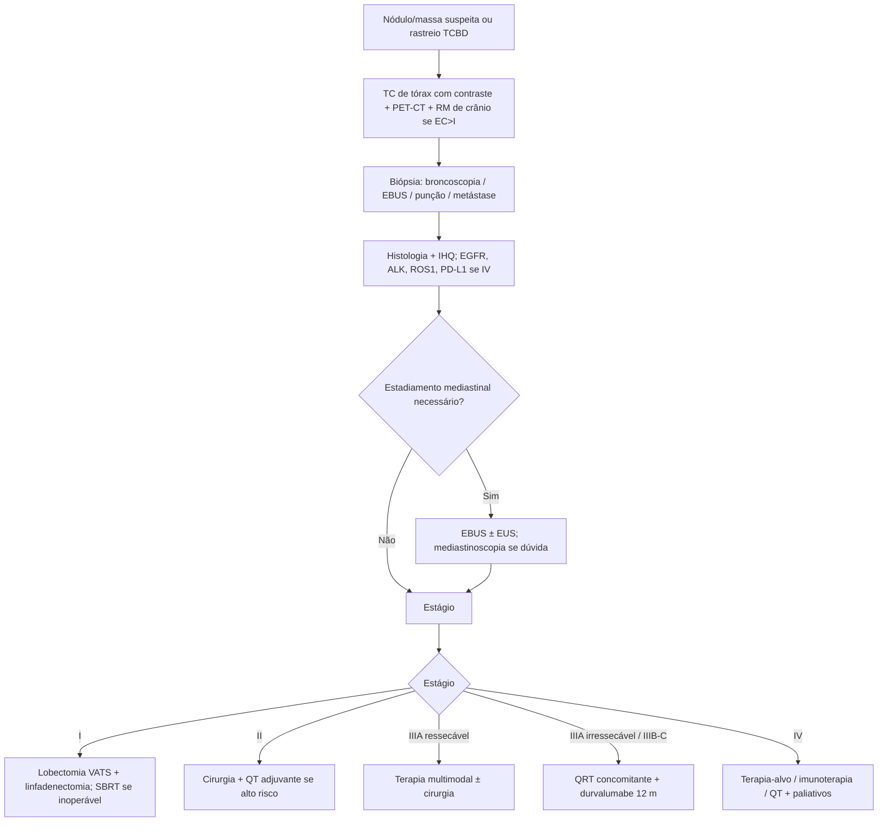

# Carcinoma Não Pequenas Células de Pulmão (CPNPC)

> Resumo em palavras próprias do Whitebook (Condutas Cirúrgicas > Cirurgia Oncológica), sem fisiopatologia, autoria e referências. Confira detalhes e doses na fonte: https://whitebook.pebmed.com.br/conteudo/?id=23693&categoryId=207&subcategoryId=212

**Definição:** neoplasia agressiva de apresentação tardia, originada no parênquima ou nas pequenas vias aéreas. Sinônimos: câncer de pulmão não pequenas células.

## Epidemiologia e fatores de risco
- Câncer de maior incidência e mortalidade por câncer no mundo; no Brasil, 4º mais comum (exceto pele não melanoma). Sobrevida em 5 anos ~18% (global 10–20%). Mais em homens (diferença diminuindo); idade média ao diagnóstico 70 anos. CPNPC = 85% dos cânceres de pulmão. Adenocarcinoma é hoje o subtipo mais comum (inclusive em tabagistas), acomete não fumantes e é mais frequente em mulheres asiáticas.
- Só ~15% diagnosticados precocemente; > 52% já avançados (Brasil 70%). Metástases: adrenais (principal), cérebro, fígado, pleura, ossos. Após cura, risco de segunda neoplasia respiratória 3–5%/ano. Cessação do tabagismo é a principal prevenção (efeito cumulativo persiste ~15 anos).
- **Risco:** tabagismo ativo (> 1 maço/dia por 20 anos; risco 10–20×; qualquer forma de tabaco); passivo (> 1 maço/dia por 25 anos: 2×); doença intersticial; DPOC e deficiência de alfa-1-antitripsina; asbesto, cromo, arsênio, níquel, HPA, sílica, vinil, clorometil éter, berílio, cádmio; solventes, tintas, soldagem, fuligem; radônio; biomassa; predisposição genética; RT torácica; HIV; etilismo.

## Classificação patológica (OMS 2015)
- **Adenocarcinoma:** pré-invasivas (hiperplasia adenomatosa atípica, AIS); minimamente invasivo (MIA: ≤ 3 cm, solitário, predominantemente lepídico, componente invasivo ≤ 0,5 cm; não é MIA se há invasão linfovascular/pleural, necrose ou STAS); invasivo (lepídico — antigo bronquioloalveolar —, acinar, papilar, micropapilar, sólido); variantes: mucinoso invasivo, coloide, fetal, entérico.
- **Escamoso:** queratinizante, não queratinizante, basaloide; pré-invasiva: CEC in situ.
- **Neuroendócrinos:** carcinoide típico (baixo grau), atípico (grau intermediário), grandes células (alto grau). *Pequenas células não pertence ao grupo CPNPC.*
- Outros: sarcomatoide, adenoescamoso, raros (linfoepitelioma-like, NUT, glândula salivar).
- **AIS:** ≤ 3 cm, solitário, lepídico puro, sem invasão estromal/vascular/pleural, sem STAS, sem atipia nuclear relevante, predominantemente não mucinoso. **Hiperplasia adenomatosa atípica:** ≤ 5 mm, solitária, lepídica, atipia discreta e uniforme, menos celular que o AIS.

## Rastreamento
- Tabagistas ativos ou ex-tabagistas (≥ 1 maço/dia por 20 anos, cessação há ≤ 15 anos), de 55 a 80 anos: TC de baixa dose (1,5 mSv) anual. Não usar radiografia.
- **NLST** (n = 53.456; TCBD vs radiografia): mais diagnósticos com TCBD; redução de 20% na mortalidade por câncer de pulmão (NNS 320); ~50% dos achados precoces; mais falso-positivos e procedimentos invasivos. Positivo: nódulo ≥ 4 mm não calcificado novo, massa, adenomegalia ou derrame. Críticas: custo-efetividade, disponibilidade, falso-positivos, sobrediagnóstico, doenças granulomatosas endêmicas, validade externa.
- **NELSON** (n = 15.791): TCBD em 1, 2 e 2,5 anos; sensibilidade 84,6%, especificidade 98,6%, VPP 40,4%, VPN 99,8%; risco em 2 anos de 1,3%; 51,2% adenocarcinomas; 69% em IA/IB; maior benefício em mulheres.

## Apresentação clínica
- **Locorregional:** tosse (50–75%, mais em tumores centrais), hemoptise (25–50%), dispneia (25%; compressão, linfangite, pneumonite obstrutiva, atelectasia, derrames, paralisia frênica, pneumotórax), dor torácica (20%). Síndromes: Horner; veia cava superior; Pancoast; rouquidão (laríngeo recorrente).
- **Paraneoplásicas:** hipercalcemia (precoce: anorexia, náusea, constipação, poliúria; tardia: confusão, coma, nefrocalcinose, IRA), SIADH, Cushing, neurológicas (Eaton-Lambert, ataxia cerebelar, neuropatias, encefalite límbica, retinopatia, opsomioclono), hematológicas (anemia, trombocitose, eosinofilia, Trousseau, TEV, CIVD), osteoartropatia hipertrófica, dermato/polimiosite.
- **Metástases:** cerebral (cefaleia, vômito, alterações visuais, déficit, crises); óssea (dor); hepática e adrenal geralmente assintomáticas. Sinais: síndrome consumptiva, linfonodo > 1 cm, papiledema, massa subcutânea, hepatomegalia, disfonia.

## Diagnóstico
- Objetivos: extensão e estadiamento, local e método da biópsia, subtipo histológico, comorbidades, paraneoplasias, preferências; evitar atraso. Em geral ambulatorial (exceto hemoptise importante, dispneia incapacitante, metástases encefálicas). Ideal concluir em até 6 semanas (reavaliar se > 8).
- **Laboratório:** hemograma, eletrólitos incl. cálcio, FA, GGT, transaminases, bilirrubinas, creatinina, ureia, proteínas. Sem marcador tumoral de rotina. FA isolada ↑ sugere osso; FA + GGT sugerem fígado.
- **Imagem:** radiografia é triagem (baixa especificidade; qualquer suspeita vai para TC de tórax). Lesões suspeitas: nódulo (< 3 cm) ou massa (> 3 cm) com contorno irregular/espiculado, lobo superior, vidro fosco periférico, broncograma, cavitação espessa, crescimento, múltiplos, derrame, linfonodos, pneumonia pós-obstrutiva, atelectasia. **TC com contraste** (incluindo abdome superior/adrenais/fígado) é o exame de eleição, mas é pouco acurada para metástase mediastinal.
- **Tecido:** diagnóstico definitivo só por histologia/citologia (correlação maior em CEC e pequenas células que em adenocarcinoma).
  - *Escarro:* sensibilidade 70% (maior em CEC), até 5 amostras, baixo VPN, falso-positivos em inflamação ou laringe/faringe.
  - *Biópsia líquida (cfDNA):* mutações e monitoramento; pouco disponível.
  - *Broncoscopia:* lesões centrais (acurácia 70–90%; periféricas 30–40%); idealmente 5 fragmentos; contraindicações: insuficiência respiratória, INR > 1,5, plaquetas < 50.000, ureia > 10/Cr > 3, anticoagulação; complicações 0,08–5%; criobiópsia melhora rendimento.
  - *EBUS:* radial (periférico) e setorial (EBUS-TBNA, apenas citologia).
  - *Punção transtorácica* (TC/USG/fluoroscopia; sistema coaxial): periféricas e grandes; acurácia > 95%, especificidade 93–99%; complicações 10–20% (pneumotórax, hemotórax, empiema, pneumonia).
  - *Líquido pleural:* citologia 60–82%; EGFR/ALK em cell block em > 90%.
  - *Cirurgia diagnóstica:* último recurso. Na suspeita de metástase, biopsiar a metástase (diagnostica e estadia).
- **Histologia:** adenocarcinoma (diferenciação glandular, núcleo excêntrico, macronucléolo); CEC (pontes intercelulares, queratinização). **Imuno-histoquímica** quando o subtipo não for definido (um marcador para cada): escamoso p63/p40/CK5-7/desmogleína; adeno TTF-1, napsina A, mucina, surfactantes; pequenas células TTF-1, Ki-67, sinaptofisina/cromogranina; sem marcador = NOS.
- **Molecular:** adenocarcinoma estágio IV → EGFR, ALK, ROS1, KRAS.
- **Diferenciais:** doenças granulomatosas (TB, histoplasmose, granulomatose com poliangiíte), pequenas células, carcinoide, mesotelioma, metástases pulmonares.

## Estadiamento não invasivo
- **TC de tórax:** T e N; incluir vidro fosco adjacente na medida, excluir espículas desmoplásicas; linfonodo suspeito > 1 cm no menor eixo; falso-positivo 20–30%, falso-negativo 21%.
- **PET-CT 18FDG:** SUVmax > 2,5 sugere malignidade (sem corte definitivo); linfonodo com captação acima do sangue mediastinal é provável metástase. Mais acurado que a TC para N, T e M; evita toracotomias fúteis; detecta até 30% de metástases não vistas. Sensibilidade 90%, especificidade 85%, acurácia 87%. Falso-positivos: granuloma, inflamação, infecção, adenomas adrenais (9%). Falso-negativos (~6%): adenocarcinoma mucinoso, AIS, carcinoides, lesões < 10–20 mm, vidro fosco/subsólidos, tumores centrais, N1 captante em lobo superior direito, cadeias 4 e 7. Não avalia SNC. Considerar em todo candidato à cirurgia; positividade não dispensa confirmação histológica, sobretudo em metástase única ou paciente operável.
- **RM:** padrão-ouro para cérebro (gadolínio). Indicada em EC > I (mesmo sem sintomas), sintomas de SNC e tumores localmente invasivos (diafragma, coração, vasos, forames, plexo braquial, coluna). Sem RM, TC de crânio com contraste. Cintilografia óssea: pouco usada (falso-positivos); se sintomas ósseos ou sem PET.

## Estadiamento invasivo
Acometimento N2 múltiplo, N3 ou extracapsular piora a sobrevida, mesmo achado só no intraoperatório. Pode-se dispensar em tumor periférico (terço externo), < 3 cm, cN0 (TC e PET negativos); é essencial em tumores invasivos, centrais, Pancoast ou suspeita mediastinal.
- **EBUS-TBNA:** método de escolha em muitos guidelines; ambulatorial; cadeias 1, 2, 4, 7, 10, 11; apenas citologia.
- **EUS:** complementar ao EBUS; cadeias 5, 7, 8, 9 e adrenais.
- **Mediastinoscopia:** padrão-ouro histórico; anestesia geral; complicações 0,19–2%, mortalidade 0,04–0,08%; cadeias 2, 4, 7; sensibilidade 80–95%, VPN 91%, falso-negativo 5–9%; indicada se suspeita alta apesar de EBUS/EUS negativos.
- **VAMLA** (cadeias 2, 4, 7, 10) e **TEMLA** (1–8, 10): sensibilidade e VPP altos, mas mais complicações; não padrão.
- **Chamberlain (mediastinotomia anterior):** cadeias 5 e 6, pouco usada; sensibilidade 71%, VPN 91%.
- **VATS:** cadeias 5 e 6 (à esquerda), demais de um lado; biópsia de pleura/pericárdio; sensibilidade 100%, falso-negativo 4%; pode ser feita com congelação no mesmo ato da lobectomia.
- **Mapa linfonodal IASLC 2009:** estações 1 (cervicais/supraclaviculares), 2 (paratraqueais superiores), 3A/3P (pré-vascular, retrotraqueal), 4 (paratraqueais baixos; 4R até borda esquerda da traqueia), 5 (subaórtico), 6 (para-aórtico), 7 (subcarinal), 8 (paraesofágico), 9 (ligamento pulmonar), 10 (hilar), 11 (interlobar), 12 (lobar), 13 (segmentar), 14 (subsegmentar). A linha divisória D/E é a borda lateral esquerda da traqueia. (Os limites anatômicos detalhados estão na fonte, assim como a figura.)

## Estadiamento TNM (AJCC/UICC, 8ª ed.)
- **T:** Tis in situ; T1mi (MIA); T1a ≤ 1 cm; T1b > 1–2; T1c > 2–3 (envolto por pulmão/pleura visceral, sem invasão além do lobar); T2a > 3–4; T2b > 4–5 (ou invasão de brônquio principal sem carina, pleura visceral, atelectasia/pneumonite hilar); T3 > 5–7 ou pleura parietal, parede (incl. sulco superior), frênico, pericárdio parietal, nódulo no mesmo lobo; T4 > 7 ou diafragma, mediastino, coração, grandes vasos, traqueia, laríngeo recorrente, esôfago, vértebra, carina, nódulo em outro lobo ipsilateral.
- **N:** N1 peribrônquico/hilar ipsilateral e intrapulmonar; N2 mediastinal/subcarinal ipsilateral; N3 mediastinal/hilar contralateral, escaleno ou supraclavicular.
- **M:** M1a nódulo em lobo contralateral, nódulos pleurais/pericárdicos ou derrame maligno; M1b metástase extratorácica única; M1c múltiplas.
- **Grupos:** IA1 (T1mi/T1a N0), IA2 (T1b), IA3 (T1c), IB (T2a N0), IIA (T2b N0), IIB (T1–2 N1 ou T3 N0), IIIA (T1–2 N2, T3 N1, T4 N0–1), IIIB (T1–2 N3 ou T3–4 N2), IIIC (o texto lista “T3–T4 N2” de novo; na 8ª ed. é T3–4 N3 — conferir), IVA (M1a–b), IVB (M1c).
- **Invasão pleural visceral:** PL0 (subpleural), PL1 (além da camada elástica), PL2 (superfície pleural) — PL1/PL2 = T2; PL3 (pleura parietal) = T3.

## Tratamento
Depende de estágio, comorbidades, função pulmonar, status funcional, nutrição e preferência. Diagnóstico e tratamento podem ser simultâneos.

**Estágio I**
- Ressecção cirúrgica é o tratamento de eleição se operável (apenas ~15% são candidatos; 45% desses operados). **Operabilidade** (condições do paciente) ≠ **ressecabilidade** (tumor). R0 (macro e microscopicamente negativa), R1 (microscópica positiva), R2 (macroscópica positiva; o texto grafa “negativas”).
- **Risco cardíaco (ThRCRI):** doença coronariana 1,5; doença cerebrovascular 1,5; Cr > 2 mg% 1; pneumonectomia 1,5. Classe A (0): 1,5%; B (1–1,5): 5,8%; C (2–2,5): 19%; D (> 2,5): 23%. ≥ 2 pontos → cardiologia formal antes da avaliação pulmonar.
- **Pulmonar:** espirometria completa com DLCO; dúvida → ergoespirometria. Ppo VEF1 = VEF1 × (19 − segmentos removidos) ÷ 19 (segmentos: LSD 3, LM 2, LID 5, LSE 3 + língula 2, LIE 4). Seguro: ppo VEF1 > 2 L (pneumonectomia), > 1,5 L (lobectomia). Ppo VEF1 e ppo DLCO > 60% → baixo risco (< 1%), sem exame adicional; < 60% → ergoespirometria: VO2 máx > 20 mL/kg/min baixo risco; 10–20 → VE/VCO2 ≤ 35 intermediário-baixo, > 35 intermediário-alto; < 10 → alto risco, cirurgia contraindicada.
- **Operações:** lobectomia = padrão-ouro; pneumonectomia para tumores centrais/hilares (maior morbidade). **Sublobares:** segmentectomia anatômica, cunha (wedge), segmentectomia estendida (com linfonodos hilares/mediastinais), segmentectomia em manga. Indicadas em periféricos ≤ 2 cm (AIS), idosos (> 70), > 50% de vidro fosco, função limitada, comorbidade cardíaca ou cirurgia prévia. Recorrência: cunha > segmentectomia > lobectomia; margem > 2 cm ou maior que o nódulo, com linfadenectomia N1 e N2. Único RCT em T1N0M0: mais recidiva local com sublobar, sem diferença de sobrevida; se tolera lobectomia, fazer. Grandes células não é elegível.
- **Linfonodos:** amostragem ou linfadenectomia sistemática, sempre; ≥ 3 estações N1 e 3 N2 (incluindo a 7).
- **Via:** toracotomia ou minimamente invasiva (VATS/robótica), hoje preferencial (menos dor, internação, dreno, complicações, mortalidade); VATS fora de centros de referência faz linfadenectomia inadequada; robótica amplia amostragem e ergonomia.
- QT neoadjuvante sem papel; QT adjuvante não no I, exceto subgrupo IB (discutir). **SBRT:** inoperáveis ou candidatos a sublobar; EC I N0, ≤ 5 cm, preferencialmente periférico (central em 2 cm da árvore principal exige mais frações); controle local ~90%, SLP 88% em 2 anos; também em tumores sincrônicos; sem SBRT, RT conformada na maior dose possível.

**Estágio II**
- Cirurgia é o tratamento de escolha (mesmas opções do I; sublobar em casos selecionados). Adjuvância depende do risco: R0 pode apenas observar; alto risco (indiferenciado, invasão vascular, cunha, > 4 cm, pleura, N desconhecido) → QT adjuvante. R1/R2: reoperar se possível ± QT/QRT. Estágio II N1: ressecção seguida de QT adjuvante; margens positivas → reoperar e QRT sequencial ou concomitante.
- **T3N0** (parede, via aérea proximal, mediastino): ressecção completa se possível; QRT concomitante ou QT neoadjuvante opcionais (com margens boas pode apenas observar); sem neoadjuvância, R0 → QT adjuvante; R1/R2 → reoperar e QT/QRT. **Pancoast:** neoadjuvância seguida de ressecção ± adjuvância.
- QT à base de platina; adjuvante e neoadjuvante comparáveis (ganho de ~5% na sobrevida em 5 anos).

**Estágio IIIA**
- Doença localmente avançada e heterogênea; avaliação multidisciplinar. Classificação N2: non-skip (pN1N2, N2a1) e skip (pN0N2, N2a2).
- **T3N1:** cirurgia rara (achado intraoperatório de T3N0): garantir margens; QT adjuvante se > 5 cm ou linfonodo +; R1 → considerar RT.
- **N2:** ponto mais controverso; cadeia única tem sobrevida parecida com N1; cirurgia só dentro de terapia multimodal (QT ± RT neoadjuvante ou adjuvante); neoadjuvância tem melhor adesão e seleção, sem benefício claro de somar RT (mais fístulas).
- **T4:** sem evidência randomizada; preferir QT neoadjuvante; cirurgia + QT adjuvante em casos especiais; incompleta → RT; maior benefício em carina, traqueia, VCS e vértebra; exige N0/N1 confirmado por mediastinoscopia; pior com pneumonectomia.
- **Irressecável:** QRT definitiva (concomitante preferida) com dupla de platina + etoposídeo ou paclitaxel; RT isolada se não tolerar QT; durvalumabe por 12 meses após QRT; nivolumabe promissor. RT craniana profilática: não indicada.

**Estágios IIIB e IIIC:** suspeitar por linfonodo supraclavicular, disfonia, paralisia de prega vocal, invasão traqueal/carina; QRT concomitante em PS favorável; sequencial ou RT isolada se não tolerar; durvalumabe de consolidação por 12 meses se sem progressão.

**Estágio IV:** terapia sistêmica para PS 0–2; cuidados paliativos precoces; cessação do tabagismo. Pesquisar EGFR, ALK, ROS1, PD-L1 (e, se possível, BRAF, RET, HER2, MET). Imunoterapia (nivolumabe, pembrolizumabe); terapia-alvo com ITQ (erlotinibe, gefitinibe, osimertinibe; EGFR mutado = primeira linha; resistência T790M → osimertinibe); QT; combinações. RT craniana/radiocirurgia em metástases cerebrais selecionadas. **Oligometástase** (1–3 sincrônicas): sobrevida longa com sistêmico + consolidação local (evidência limitada); metacrônicas limitadas: RT de alta dose ou cirurgia; nódulo solitário contralateral: tratar com intuito curativo na maioria.
- **Paliação:** derrame pleural maligno — inicial: toracocentese de alívio/dreno; recidiva: toracocentese repetida, drenagem, pleurodese, shunt pleuroperitoneal. (Há também menção a stent para obstrução de via aérea.)

## Seguimento e prognóstico
- Sem protocolo consolidado: cirurgião torácico por 3–6 meses; complicações em 3–6 meses; anamnese + TC de tórax a cada 4–6 meses nos 2 primeiros anos, depois anual até 5 anos; cessação do tabagismo; PET, RM e laboratório não de rotina.
- **Pior prognóstico:** estágio avançado, status funcional ruim, afrodescendente, invasão linfática/microvascular, baixa diferenciação, linfonodos, tamanho, recorrência, tabagismo mantido no pré-operatório.
- **Sobrevida (1 ano / 5 anos):** IA1 97/92%; IA2 94/83; IA3 90/77; IB 87/68; IIA 79/60; IIB 72/53; IIIA 55/36; IIIB 44/26; IIIC 24/13; IVA 23/10; IVB 10/0.

## Fluxograma (refeito, a partir do texto; o original não traz algoritmo)

