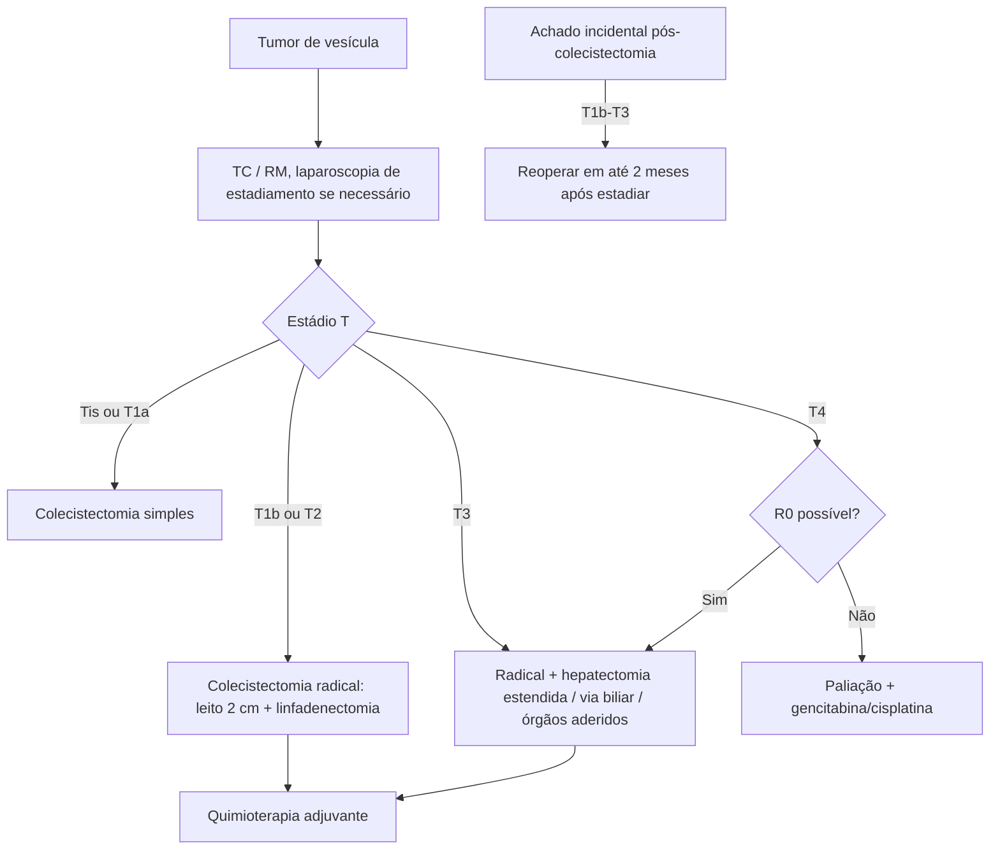

# Carcinoma de Vesícula Biliar

> Resumo em palavras próprias do Whitebook (Condutas Cirúrgicas > Cirurgia Oncológica), sem fisiopatologia, autoria e referências. Confira detalhes e doses na fonte: https://whitebook.pebmed.com.br/conteudo/?id=63176&categoryId=207&subcategoryId=212

**Definição:** neoplasia mais frequente do trato biliar, mas só 3% das malignas do aparelho digestivo. Agressiva, de prognóstico ruim por diagnóstico tardio; mais em mulheres caucasianas de 60–70 anos; geralmente no fundo; achado em 0,2–3% das colecistectomias.

## Fatores de risco
Colelitíase (cálculos > 3 cm; principal), colecistite crônica longa, vesícula em porcelana, pólipos adenomatosos > 10 mm, colangite esclerosante primária, *Salmonella typhi*, cistos biliares, junção pancreatobiliar anômala, fármacos (metildopa, ACO, TH pós-menopausa, isoniazida), tabagismo, obesidade.

## Clínica e diagnóstico
- Assintomático ou como colelitíase sintomática (dor em HCD pós-gordura, náuseas, vômitos, anorexia); icterícia, massa palpável e síndrome consuptiva indicam doença avançada. A maioria é diagnosticada por acaso (investigando litíase ou no intra/pós-operatório).
- Laboratório inespecífico: FA e bilirrubina ~2× o normal; transaminases altas sugerem invasão/metástase hepática; CA 19-9 e CEA elevados em doença avançada.
- **USG:** melhor para detecção precoce (lesões a partir de 5 mm); padrão de múltiplas camadas sugere degeneração maligna; calcificação intramural, massa imóvel protrusa, perda da interface com o fígado. **TC/RM:** estadiamento linfonodal e à distância. **Laparoscopia diagnóstica:** detecta doença hepática e extra-hepática não vista nas imagens.

## Estadiamento (UICC/AJCC 8ª ed.)
- **T:** Tis in situ; T1a lâmina própria; T1b muscular; T2a tecido perimuscular do lado peritoneal sem serosa; T2b lado hepático sem invasão do fígado; T3 perfura a serosa e/ou invade fígado ou estrutura adjacente (estômago, duodeno, pâncreas, cólon, vias biliares extra-hepáticas, omento); T4 veia porta ou artéria hepática ou ≥ 2 órgãos extra-hepáticos.
- **N:** N0; N1 = 1–3 linfonodos; N2 = ≥ 4. **M:** M0/M1.
- **Estágios:** 0 (Tis); I (T1 N0); IIA (T2a N0); IIB (T2b N0); IIIA (T3 N0); IIIB (T1–3 N1); IVA (T4 N0–1); IVB (qualquer T N2 ou M1).
- **Diferenciais:** colelitíase, colecistite, colangite, coledocolitíase, colangiocarcinoma, hepatite.

## Tratamento
Único curativo é a ressecção completa.
- **Tis e T1a:** colecistectomia simples (aberta ou laparoscópica).
- **T1b e T2:** colecistectomia radical aberta com margem R0 (colecistectomia + hepatectomia de ~2 cm do leito + linfadenectomia do cístico, hepática comum, portocava e colédoco), incluindo os portais se houve laparoscopia prévia.
- **T3:** como T1b/T2, podendo exigir hepatectomia estendida (IVb), ressecção da via biliar com hepaticojejunostomia e de estruturas aderidas.
- **T4:** como T3 com ≥ 2 estruturas, se garantir R0; em geral R0 não é possível e citorredução não é indicada.
- **Achado incidental** (0,25–1,5% das colecistectomias): até T1a não reoperar; T1b–T3 → reoperação radical em até 2 meses, após estadiamento (TC/RM); considerar laparoscopia diagnóstica em T3, pouco diferenciado ou perfuração da vesícula; metástase peritoneal/hepática contraindica ressecção. T3–T4: hepatectomias radicais (IVb+V, central IV/V/VIII ou trissegmentectomia direita) visando R0.
- **Adjuvância:** radio e quimio isoladas não mostraram benefício de sobrevida, mas QT adjuvante com 5-FU ou gencitabina é recomendada, com cisplatina em alto risco (T4, N1, R1); radioterapia adjuvante pode ser considerada sem linfonodos e com margem positiva.
- **Irressecável/metastático:** paliação (dor, icterícia, prurido, obstrução intestinal; endopróteses percutâneas ou endoscópicas, bypass biliar e duodenal); QT paliativa com gencitabina + cisplatina.

## Prognóstico
Tardio e restrito. Pior: profundidade, margem positiva, baixa diferenciação, invasão linfática ou do colédoco. Metástase peritoneal mais comum em T3, pouco diferenciados e perfuração da vesícula. T1a/T1b com margem negativa têm bom prognóstico. Sobrevida global em 5 anos: 5–15%.

## Fluxograma (refeito, a partir do texto; o original não traz algoritmo)

