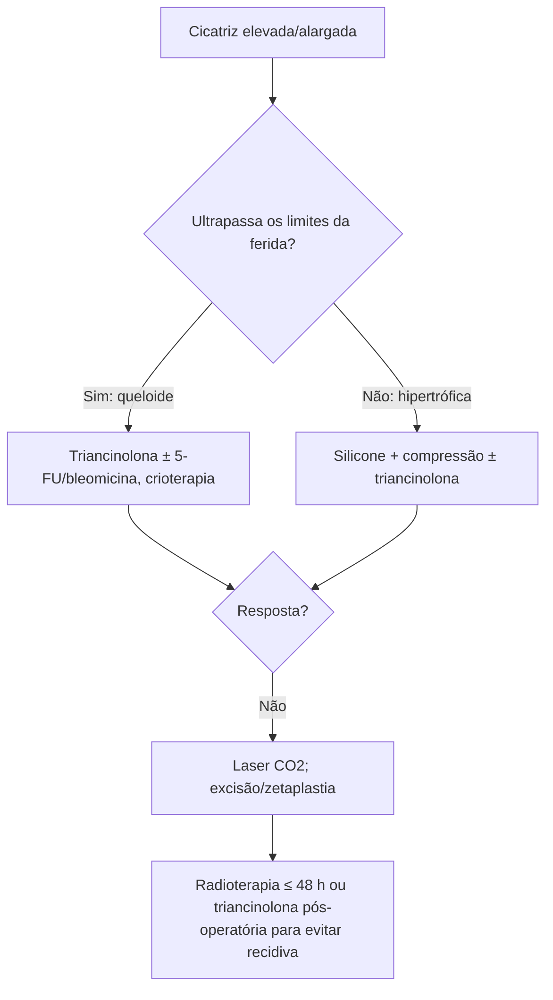

# Cicatrização Patológica

> Resumo em palavras próprias do Whitebook (Condutas Cirúrgicas > Cirurgia Plástica), sem autoria e referências. Confira detalhes e doses na fonte: https://whitebook.pebmed.com.br/conteudo/?id=63191&categoryId=207&subcategoryId=947

**Definição:** desequilíbrio da cicatrização normal, com cicatriz fora do padrão esperado.
- **Hipertrófica:** elevada, surge nas primeiras semanas, não ultrapassa os limites da ferida; regride em 1–2 anos na maioria; recidiva rara.
- **Alargada:** bordas afastadas por tensão mecânica, sem proliferação fibroblástica.
- **Queloide:** fibroproliferação persistente que cresce além da ferida original, não regride, tem base genética e tende a recidivar.

## Fisiopatologia (resumo)
Inflamação crônica da derme reticular (↑ IL-6, TNF-α, microambiente pró-fibrótico); colágeno com maior síntese e menor degradação (↑ prolil-hidroxilase, ↓ alfa-2-macroglobulina); persistência de miofibroblastos por TGF-β1 e excesso de colágeno I e III (fibrilas espessas e irregulares nos queloides); mecanotransdução via TGF-β — incisões fora das linhas de Langer e áreas de alta tensão aumentam o risco.

## Epidemiologia e fatores de risco
- Hipertrófica é mais frequente que queloide: até 35% das incisões e 72% das queimaduras; mais em pele clara. Queloide mais em pele negra (5–16%).
- Locais de queloide: tórax anterior, ombros, face flexora de membros, região escapular, mandíbula, lóbulo da orelha, pescoço anterior, feridas que cruzam as linhas de tensão; inflamação crônica (brincos, trauma repetido); às vezes espontâneo.
- Risco: cicatrização por segunda intenção (> 3 semanas), inflamação prolongada (corpo estranho, infecção, queimadura, fechamento inadequado), Fitzpatrick IV–VI, história familiar, gravidez, dermatite atópica, alta tensão.

| Hipertrófica | Queloide | Alargada |
|---|---|---|
| elevada, eritematosa, pruriginosa, dolorosa | cresce além da ferida, persiste por anos, pruriginosa, dolorosa, eritematosa | plana ou deprimida, larga, assintomática |
| restrita aos limites; pode achatar/clarear | história pessoal/familiar frequente | sem inflamação ativa; tensão persistente; com maturação adequada pode desaparecer |

## Diagnóstico
Clínico. À microscopia óptica hipertrófica e queloide não se distinguem; na microscopia eletrônica/imunoquímica, queloide tem colágeno espesso e hialuronato epidérmico aumentado, e a hipertrófica, estruturas nodulares com fibras finas e actina de músculo liso aumentada. Queloide: epiderme normal, vascularização abundante, derme espessada, mais células inflamatórias, feixes de colágeno largos e nódulos acelulares; proteoglicanos em excesso.

## Prevenção
Incisões paralelas às linhas de Langer, reduzir tensão com suturas profundas, evitar trauma, evitar UV precoce, silicone após epitelização (~2 semanas).

## Tratamento
- **Compressão** (bandagem elástica, meias, luvas ou roupas sob medida): 6–12 meses (até 24 em queimaduras), cerca de 23 h/dia por 12 meses, pressão ~20–30 mmHg.
- **Silicone (gel/placa):** reduz volume, espessura, eritema e elasticidade (melhora relatada 80–100%); por hidratação e estabilização mecânica; ≥ 12 h/dia por no mínimo 6–12 meses.
- **Triancinolona intralesional:** 10–40 mg/mL a cada 4–6 semanas na derme, até achatar e aliviar sintomas; padrão para hipertróficas (resposta melhor que em queloides). Algoritmo descrito: triancinolona para hipertróficas finas a largas, silicone para as muito largas. Efeitos menores: hipopigmentação, telangiectasias, atrofia subcutânea. Outras opções: vitamina E, óxido de zinco, antineoplásicos, imunoterapia.
- **5-fluoruracila:** inibe fibroblastos; melhor com triancinolona, menos eficaz sozinha, pode reduzir recidiva. **Bleomicina:** pode ser mais eficaz que o 5-FU isolado, mais dor local, menor recidiva em alguns estudos; não como primeira linha isolada.
- **Crioterapia:** trombose microvascular, redução média ~50% do volume, facilita infiltrações; risco de hipopigmentação.
- **Laser CO₂ fracionado** (2ª/3ª linha): melhora altura, eritema e maleabilidade, melhor em Fitzpatrick I–III; pode combinar com 5-FU ou triancinolona.
- **Cirurgia:** orientar a ferida nas linhas de tensão; excisão fusiforme (1ª linha de revisão); **zetaplastia** para cicatrizes fora das linhas (ângulo de 30° alonga 25%; 45° 50%; 60° 75%; 75° 100%; 90° 120%); expansão tecidual ou excisão seriada em cicatrizes grandes (expansão preferida se > 2 excisões).
- **Radioterapia:** monoterapia ou após excisão, idealmente em até **48 h**; 30 Gy melhores em alguns estudos; braquiterapia de alta dose + excisão previne recorrência em 80–94% (hiperpigmentação e telangiectasias possíveis).
- **Recorrência:** cirurgia isolada 50–80%; cirurgia + triancinolona pós-operatória < 50%; triancinolona tópica + intralesional ~15%; cirurgia + radioterapia < 10%.

## Fluxograma (refeito, a partir do texto; o original não traz algoritmo)

