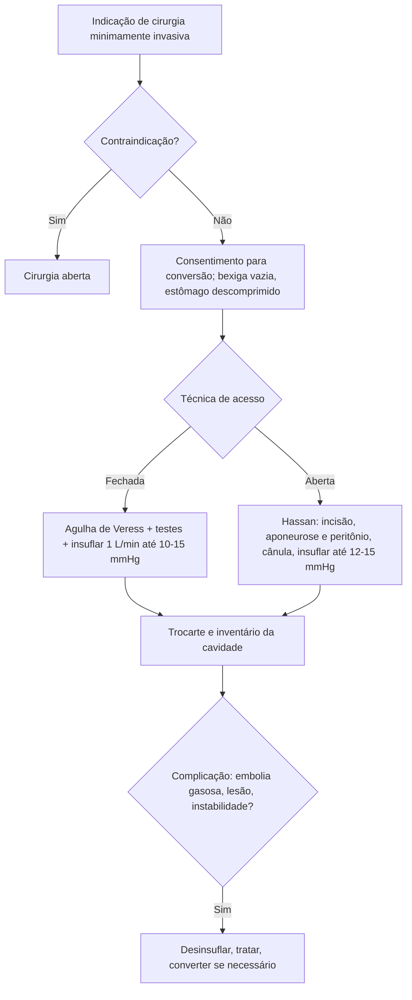

# Cirurgia Abdominal Minimamente Invasiva

> Resumo em palavras próprias do Whitebook (Condutas Cirúrgicas > Cirurgia Geral e do Aparelho Digestivo), sem fisiopatologia, autoria e referências. Confira detalhes e doses na fonte: https://whitebook.pebmed.com.br/conteudo/?id=39181&categoryId=207&subcategoryId=211

**Definição:** abordagem com invasão mínima, menor trauma tecidual e menor resposta endócrino-metabólica e imunológica ao trauma. Aplica-se a várias especialidades; onde existe cavidade (mesmo virtual) ela pode ser expandida com CO₂, solução salina ou balão. Cirurgia robótica também é minimamente invasiva.

## Equipamento
- **Monitor, câmera** (foco, zoom, balanço de branco), **fonte de luz** (cabo até a ótica).
- **Ótica:** 5 ou 10 mm; 0°, 30° ou 45° (as angulares são mais difíceis, porém mostram mais e são muito usadas).
- **Insuflador de CO₂:** CO₂ por ser difusível no sangue, não inflamável, inócuo aos tecidos e barato. Insuflar devagar (fluxo inicial 1–3 L/min), com PIA final desejável **14–15 mmHg**.
- **Trocarte:** bainha valvulada + mandril (perfurante ou rombo); 3 mm (minilaparoscopia), 5, 10, 11, 12 mm.
- Instrumental conforme o procedimento.

## Vantagens e limitações
- **Vantagens:** recuperação rápida, retorno precoce às atividades, menos dor, menor infecção, menos hérnia incisional, menos perda sanguínea, menos aderências, menor risco de TEP (deambulação precoce), estética, menor custo global.
- **Limitações:** visão 2D (robótica é 3D), curva de aprendizado, perda do tato e da noção de tração (controverso), manipulação em “espelho”.

## Alterações fisiológicas do pneumoperitônio
- **Cardiovasculares:** ↑ RVP, ↑ PAM e pressão capilar pulmonar, ↓ DC, ↓ retorno venoso (sequestro nos MMII); pior em baixa reserva cardiovascular. O DC cai ao máximo nos primeiros 5 min; a RVP cai após 10 min. Agravam: pressões altas, desidratação, Trendelenburg reverso (cefaloaclive), duração e tipo da cirurgia, estratégia ventilatória. Regionais: ↑ fluxo cerebral e PIC (perfusão normal), ↓ pH gástrico, ↓ microcirculação hepática e intestinal, ↓ fluxo renal e perfusão medular, ↓ fluxo venoso de MMII.
- **Ventilatórios:** ↓ CPT, CVF e fluxo expiratório; ↑ resistência; ↓ complacência; ascensão do diafragma; retenção de CO₂; ↑ pressão intratorácica. Comunicar qualquer alteração para considerar reduzir o pneumoperitônio.
- **Gastrintestinais:** compressão gástrica, ↑ pressão intragástrica, regurgitação. **Urinários:** oligúria intraoperatória (catecolaminas, ADH, aldosterona).
- **Imunológicos:** PCR, glicemia e leucócitos sobem, porém menos que na cirurgia aberta; possível menos infecção e menor recorrência/implante tumoral.
- **Neuro-humorais:** ↑ ADH, aldosterona, renina e catecolaminas, em menor grau que na cirurgia convencional. **Mecânico:** compressão da cava e da aorta.

## Técnica
Consentimento para possível conversão; bexiga vazia e estômago não distendido; palpar o abdome (massas, borda hepática); observar circulação colateral.
- **Veress (fechado, às cegas):** agulha de Veress por incisão umbilical (mais comum) ou ponto de Palmer; ao entrar, a ponta romba protege. Testes: abrir a torneira, gota de SF na ponta do conector (deve ser aspirada), injetar 10 mL de SF e tentar aspirar. Insuflação inicial **1 L/min até 10–15 mmHg**; retirar a agulha, alargar a incisão e passar o trocarte (óptico se disponível).
- **Hassan (aberto):** incisão de 1,5–2 cm periumbilical; dissecar até a aponeurose, reparar (Backhaus ou pontos) e abrir; abrir o peritônio de forma romba; reparar as bordas; inserir a cânula; insuflar 1 L/min até **12–15 mmHg**. A escolha depende da experiência.

## Contraindicações
Gestação (conforme idade gestacional e condição materna), obesidade considerável (conforme a cirurgia), doença cardiopulmonar grave, peritonite grave, hérnia irredutível, aderências extensas, grandes aneurismas abdominais, obstrução com distensão acentuada, coagulopatia, TCE grave.

## Complicações
Lesões vasculares e parietais, enfisema subcutâneo, pré-pneumoperitônio, **embolia gasosa** (rara e potencialmente fatal: hipotensão abrupta, hipoxemia, taquicardia, edema agudo de pulmão, sopro precordial, cianose craniocervical; conduta: desinsuflar, decúbito lateral esquerdo com cabeça baixa, hiperventilar, cateter venoso central e aspirar o gás se grave), pneumomediastino/pneumopericárdio/pneumotórax, lesão visceral, ISC, TEV, aderências, fístulas, hérnia no sítio do trocarte, regurgitação e aspiração, colapso cardiovascular, dor escapular por irritação frênica (autolimitada), implante tumoral em trocarte (ex.: neoplasia de vesícula achada após colecistectomia), hipoxemia, hipercapnia e acidose respiratória.

## Cirurgia robótica
Mais moderna, em crescimento no Brasil. O cirurgião opera em console, com visão 3D, movimentos filtrados contra tremor e instrumentos articulados em todas as direções. Usada em urologia, ginecologia, cirurgia geral/digestiva, coloproctologia, torácica, cabeça e pescoço, cardíaca, pediátrica e oncológica; exige habilitação específica.

## Fluxograma (refeito, a partir do texto; o texto original não traz uma figura)

