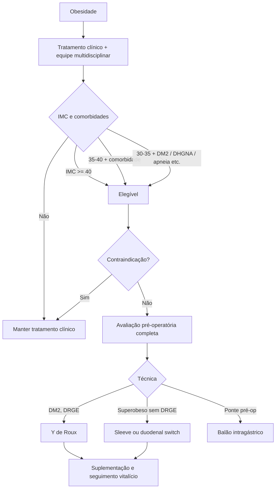

# Cirurgia Bariátrica

> Resumo em palavras próprias do Whitebook (Condutas Cirúrgicas > Cirurgia Geral e do Aparelho Digestivo), sem fisiopatologia, autoria e referências. Confira detalhes e doses na fonte: https://whitebook.pebmed.com.br/conteudo/?id=22597&categoryId=207&subcategoryId=211

**Definição:** procedimento para obesidade grave, popularmente “redução do estômago”; altera a forma/capacidade gástrica e a absorção calórica. Sinônimos: cirurgia metabólica, antiobesidade.

## Classificação do IMC
Normal 18,5–24,9; sobrepeso 25–29,9; obesidade I 30–34,9; II 35–39,9; III ≥ 40; superobeso ≥ 50; super-superobeso ≥ 60 kg/m². Tratamento inicial: medidas comportamentais, exercício, fármacos e equipe multidisciplinar; cirurgia se falhar.

## Indicações (CFM, Resolução 2.429/2025)
- IMC > 40 kg/m².
- IMC 35–40 com ≥ 1 doença agravada pela obesidade que melhore com a perda de peso.
- IMC 30–34,9 com: DM2, doença cardiovascular grave com lesão de órgão-alvo, DRC precoce em DM2, apneia grave, DHGNA com fibrose, doença com indicação de transplante, DRGE com indicação cirúrgica, osteoartrose grave.
- IMC estável por ≥ 2 anos com comorbidades fora da meta apesar do tratamento clínico.
- **> 65 anos:** avaliação específica (risco, expectativa de vida, benefício). **16–18 anos:** mesmos critérios do adulto, com compreensão do paciente e da família e seguimento multidisciplinar. **14–16 anos:** excepcional, IMC > 40 com complicação de risco à vida.

## Contraindicações
Obesidade por causa endócrina tratável (Cushing; exceto hipotalâmica intratável), transtorno alimentar não controlado, transtorno psiquiátrico grave sem controle, abuso recente de álcool/drogas, ASA IV, coagulopatia grave, incapacidade de seguir as exigências nutricionais por toda a vida (incluindo vitaminas), dificuldade de entender riscos e mudanças necessárias.

## Avaliação pré-operatória
- Compromisso com mudança de estilo de vida; estimular perda ≥ 10% do peso; não operar se o paciente consegue perder e manter peso sem a cirurgia.
- Equipe mínima: cirurgião, endocrinologista (ou clínico), cardiologista, psiquiatra, nutrólogo, nutricionista, psicólogo. Estabilidade psiquiátrica, sem álcool/drogas.
- **Anamnese:** evolução do peso, fatores, medicamentos, comorbidades, antecedentes, família, atividade física, avaliação psiquiátrica/nutricional/social.
- **Exames:** hemograma, coagulograma, tipagem, glicemia, lipidograma, função hepática, dinâmica do ferro, folato, B12, B1, vitaminas A/D/E/K, cálcio, zinco, cobre, urina I, ECG, RX de tórax, EDA; espirometria se quadro respiratório; Doppler de MMII se risco de TEV; USG de abdome e sorologias de hepatites se transaminases 2–3× o normal; densitometria óssea. Sem pesquisa rotineira de causas raras (hipercortisolismo só se estigmas).
- **Orientações:** parar de fumar 8–12 semanas antes; suspender anticoncepcional e TRH 1 mês antes; mulheres em idade fértil: β-hCG pré-operatório e contracepção segura por ao menos 12 meses.

## Técnicas
- **Restritivas:** gastrectomia vertical (sleeve), banda gástrica ajustável, balão intragástrico; perda mais gradual.
- **Disabsortivas isoladas:** desvio jejunoileal, derivação biliopancreática (desnutrição, cirrose, IRC, deficiências).
- **Combinadas:** predominantemente disabsortivas — Scopinaro, duodenal switch; predominantemente restritiva — bypass em Y de Roux (Fobi-Capella).
- **Bypass gástrico em Y de Roux:** melhor para diabéticos; reservatório (pouch) ~20 mL; exclui estômago remanescente, duodeno e 50 cm de jejuno; alça biliopancreática desemboca 100–159 cm distal; ↓ grelina, ↑ GLP-1 e CCK; perda de peso ~70% em 2 anos; mortalidade 0,5%; reposição de polivitamínico e mineral e controle de ferro, cálcio, vitamina D.
- **Scopinaro:** gastrectomia horizontal, exclusão de todo o jejuno e parte do íleo (2,5 m), alça comum de 50 cm; mais efeitos (diarreia, flatos fétidos, desnutrição, vitaminas lipossolúveis); perda ~80%; mortalidade ~1%.
- **Duodenal switch:** gastrectomia vertical com preservação do piloro e anastomose íleo-duodenal; alça comum 75–100 cm da válvula ileocecal; perda de excesso de peso ~75–80% em 2 anos.
- **Sleeve:** promissora como procedimento inicial no superobeso (IMC 50); evitar em DRGE; remove ~80% da grande curvatura; calibrar com sonda 32–36F; risco de sangramento/fístula pela linha de grampos; melhora grelina, CCK, GLP-1 e resistência insulínica; perda ~60% em 2 anos.
- **Banda gástrica:** puramente restritiva, teoricamente reversível; prótese de silicone ao redor da cárdia ajustada por porta; saciedade precoce; perda ~35% em 2 anos; perda diminui e há reganho.
- **Balão intragástrico:** endoscópico, não cirúrgico; ponte pré-operatória em superobeso; máximo 6 meses (nova colocação após ≥ 30 dias); indicação IMC > 27 (ANVISA) ou > 50 (CFM); complicações: intolerância, ruptura; perda 20–40%; reganho alto após retirada.

## Pós-operatório e seguimento
- UTI raramente necessária (exceto intercorrência ou alto risco: cardiopatas, diabéticos). Monitorização cardíaca e saturação por 24–48 h em arritmia, DAC, DPOC, apneia, asma. Analgesia, antiemético, hidratação, fisioterapia respiratória, deambulação precoce, CPAP na apneia.
- **TEV:** deambulação, compressão pneumática, heparina (HNF ou HBPM, 3 antes e após o procedimento, conforme o texto); alto risco: considerar filtro de cava.
- **Dieta:** líquidos claros em 24–48 h; líquida total em 10–14 dias; progredir até o fim do 2º mês.
- **Imagem:** seriografia no 1º PO é controversa (baixa sensibilidade); no sleeve, sem imagem de rotina; banda: exame contrastado para posição e obstrução.
- **Alta:** banda no 1º PO; sleeve ou bypass no 2º PO se tolerar dieta.
- **Orientações:** ~2 L de líquidos/dia; no disabsortivo, polivitamínico/minerais; B12 500 µg VO/dia ou 1.000 µg IM/mês; vitamina C 500 mg/dia (com o ferro); ferro 325 mg/dia; cálcio (carbonato ou citrato) 500 mg 2×/dia separado do ferro; vitamina D > 3.000 UI/dia ou > 20.000 UI/semana. Varfarina: monitorar TP/INR (coagulopatia). Evitar esforço pesado e > 4,5 kg. Bypass: sem AINE (úlcera marginal), AAS permitido em vasculopatas. Comer devagar, mastigar bem, parar na saciedade, líquidos 30 min após as refeições. Retorno ao trabalho: banda 1–2 semanas; Y de Roux e sleeve 2–4 semanas. O peso estabiliza em ~18 meses.
- **Revisões:** bypass/sleeve em 2–4 semanas, depois 3, 6, 9, 12, 18 e 24 meses e anual; banda em 2 e 6 semanas, depois a cada 4–6 semanas no 1º ano e a cada 6 meses. Laboratório: PTH, cálcio, fósforo, 25-OH vitamina D, cálcio urinário 24 h; ferro, ferritina, saturação, hemograma (atenção às mulheres férteis); USG de abdome para colelitíase.

## Complicações
Desconforto respiratório precoce (acidose metabólica ou atelectasia), **fístula** (taquicardia sustentada mesmo sem febre, leucocitose ou dor), hérnia interna (laparoscopia diagnóstica e fechamento da brecha se a imagem não esclarecer), obstrução, deiscência, estenose (entalo), hemorragia (precoce), ISC, TEV, diarreia e flatulência (disabsortivos), anemia, deficiências vitamínicas, doença osteometabólica, dumping precoce e tardio (Y de Roux), hipoglicemia, deslizamento e erosão da banda, megaesôfago.

## Fluxograma (refeito; o original é um Decision Track na fonte)

