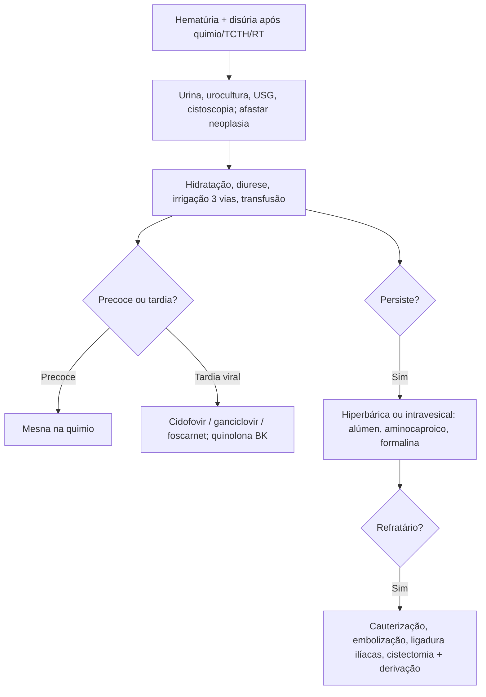

# Cistite Hemorrágica

> Resumo em palavras próprias do Whitebook (Condutas Cirúrgicas > Cirurgia Urológica), sem fisiopatologia, autoria e referências. Confira detalhes e doses na fonte: https://whitebook.pebmed.com.br/conteudo/?id=61567&categoryId=207&subcategoryId=214

**Definição:** síndrome de inflamação com sangramento difuso da bexiga, causada por radiação, medicamentos, toxinas ou vírus urotrópicos, de gravidade variável. Sinônimos: cistite hemática, cistite sangrante, hematúria de origem vesical. A intensidade da cor da urina não reflete a gravidade do sangramento.

## Formas
- **Precoce:** durante a quimioterapia ou até 72 h depois; ciclofosfamida (doses > 10 mg/kg) é a mais comum, também ifosfamida; a pró-droga é ativada no fígado (CYP450) e a **acroleína** lesa o urotélio (edema → ulceração → neovascularização → hemorragia → necrose). Até 75% após ciclos sem uroproteção.
- **Tardia:** a partir do 3º dia após transplante de células-tronco (TCTH; incidência 12–25%, mais em homens); causas: doença enxerto-contra-hospedeiro e vírus urotrópicos (BK, JC, CMV, adenovírus). Fases: agressão urotelial → reativação viral sob imunossupressão → ataque de linfócitos do doador após enxertia.
- **Radiação:** edema, endarterite obliterante, isquemia, reperfusão e fibrose.
- **Clínica:** disúria e/ou dor suprapúbica. **Graus:** 1 hematúria microscópica; 2 macroscópica; 3 com coágulos; 4 com coágulos e disfunção renal.

## Diagnóstico
Clínico + sedimento urinário, urocultura, citologia, USG de vias urinárias, urotomografia, cistoscopia. **Diferenciais:** hematúria glomerular, neoplasia vesical/urotelial, síndrome nefrítica, nefropatia por IgA, Alport, obstrução ureteral maligna, ITU, litíase, discrasias, anticoagulantes.

## Tratamento
- **Medidas gerais (ambas):** hiper-hidratação, diurese forçada (diurético de alça), irrigação vesical contínua com sonda de 3 vias ± aspiração de coágulos, transfusão, suspender anticoagulação se possível.
- **Precoce (prevenção): Mesna** liga-se à acroleína (tioéter inócuo): 3 injeções IV/dia, cada uma com 20% da dose da oxazafosforina (ciclofosfamida, ifosfamida, trofosfamida), na hora da droga, 4 h e 8 h depois.
- **Tardia (viral):** cidofovir (BK, adenovírus, JC; nefrotóxico); ganciclovir 5 mg/kg 2×/dia por 14 dias (CMV, adenovírus); foscarnet se CMV resistente; quinolonas úteis em profilaxia/tratamento de BK.
- **Oxigenoterapia hiperbárica** (câmara com O₂ 100%, 2–3 atm; 20–60 sessões de 90–120 min; melhor nos primeiros 6 meses; efeitos: miopia, barotrauma, otalgia, catarata), em geral após falha das intravesicais. Terapia celular (T-específicos, TCTH alogênico) com poucos relatos; fator VII ativado, fator XIII.
- **Intravesicais:** formalina 1–2% (último recurso; centro cirúrgico com anestesia, gravidade 10–15 min; excluir RVU, proteger uretra e períneo); sais de alumínio (alúmen) 0,5–1% (sem anestesia, sucesso 66–100%; evitar na insuficiência renal; náusea, convulsão, encefalopatia); ácido aminocaproico oral ou intravesical (sucesso 92% e 100%; ~80% excretado na urina); prostaglandina E2 (custo alto); nitrato de prata (resultados conflitantes; diluir em água); pentosano polissulfato (análogo da heparina; repara glicosaminoglicanas; cefaleia, diarreia, disfunção hepática, maculopatia após 3–5 anos).
- **Refratários:** cola de fibrina intravesical; cistoscopia com cauterização (sobretudo grau 4); embolização superseletiva das artérias vesicais; ligadura das ilíacas internas; **cistectomia simples com derivação urinária** (conduto ileal, ureterostomia ou nefrostomia) como passo final.

## Fluxograma (refeito, a partir do texto; o original não traz algoritmo)

