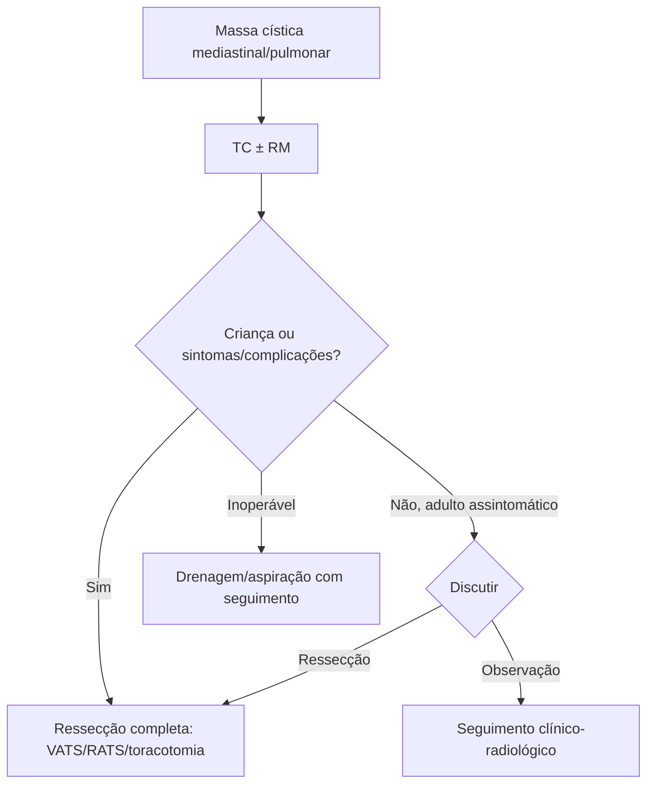

# Cisto Broncogênico

> Resumo em palavras próprias do Whitebook (Condutas Cirúrgicas > Cirurgia Torácica), sem fisiopatologia, autoria e referências. Confira detalhes e doses na fonte: https://whitebook.pebmed.com.br/conteudo/?id=54116&categoryId=207&subcategoryId=215

**Definição:** malformação congênita do trato respiratório (brotamento anômalo do intestino anterior primitivo); lesão cística unilocular, em geral benigna, revestida por epitélio respiratório.

## Epidemiologia e clínica
- Prevalência ~1:42.000; ~15% das malformações císticas pulmonares congênitas, ~60% das lesões císticas e ~10% das massas do mediastino; mais em homens e à direita. Mais comum no mediastino, junto à carina ou ao hilo direito; 20% intrapulmonares. Localizações raras: sub/intradiafragmática, endotraqueal/endobrônquica, supra/infraclavicular, suprasternal, subcutânea, ombro, cervical, retroperitoneal, coluna lombar, cardíaca.
- Raramente associa-se a cardiopatias ou a outras malformações pulmonares (sequestro, enfisema lobar). Baixo potencial de malignização (carcinoma mucoepidermoide). Geralmente assintomático; mais sintomático em crianças (compressão); em adultos, dor torácica e tosse.
- **Sintomas:** tosse persistente, estridor, febre, expectoração purulenta, sibilância (simula asma), infecções de repetição, hemoptise, complicações pleurais por ruptura/infecção, dor torácica, dispneia, disfagia. Antenatal: grandes cistos podem causar hipoplasia pulmonar e hidropsia (às vezes amniocentese). Neonatal: obstrução intraluminal e desconforto respiratório grave.

## Diagnóstico
- **RX:** muitas vezes não vê o cisto; massa redonda de densidade água, nível hidroaéreo (infecção), desvio traqueal, atelectasia/enfisema, derrame, hidropneumotórax.
- **TC** (mais elucidativa): massa cística mediastinal, 10–60 UH, margens nítidas, homogênea ou heterogênea, compressão de brônquios/traqueia/esôfago, nível hidroaéreo; contraste delineia a parede. **RM:** sinal intermediário/baixo em T1 e alto em T2; boa acurácia.
- **Ecoendoscopia (EBUS/EUS):** lesão anecoica/hipoecoica ou com debris; punção para citologia/cultura (baixa acurácia citológica); descompressão imediata eventual; risco de infecção/recidiva se não ressecado.
- **Histopatologia (definitiva):** epitélio pseudoestratificado ciliado colunar/cuboide, cartilagem, glândulas mucosas.
- **Classificação:** tipo I paratraqueal, II carina, III hilar, IV paraesofágico, V miscelânea. Quanto à via aérea (Maturu): extraluminais (compressão extrínseca), intramurais (entre camadas da parede, cartilagem alterada), intraluminais (submucosos, protrusão na luz).
- **Diferenciais:** cisto entérico/esofágico, higroma cístico, hidático (áreas endêmicas), tímico, pericárdico, timoma, teratoma, linfoma, tumores germinativos.
- **Complicações:** compressão, infecção (simula abscesso/pneumonia de repetição), ruptura, fístula broncoesofágica, compressão cardíaca com arritmia, derrame pleural/pericárdico, trombose de veia pulmonar, pneumotórax, mediastinite.
- Sintomáticos suportivos: dipirona 1–2 g EV até 4/4 h (máx. 5 g/24 h) ou 500–1000 mg VO; paracetamol 500–750 mg 6/6 h; metoclopramida 10 mg 8/8 h; bromoprida 10 mg EV 8/8 h; omeprazol 20–40 mg/dia; pantoprazol 20–40 mg/dia.

## Tratamento
- **Padrão: ressecção cirúrgica.** Assintomáticos: controverso; a favor da ressecção — evita sintomas/complicações (até 66%) e malignização (< 1%). Na infância, indicar cirurgia mesmo assintomático (risco e ausência de regressão).
- **Indicações:** infecção, perfuração, compressão de via aérea, crescimento, suspeita de malignidade/dúvida diagnóstica.
- **Drenagem/aspiração** (endoscópica ou percutânea): risco elevado de recidiva; pode servir como pré-operatório em quadro compressivo ou em inoperáveis (com seguimento).
- **Vias:** toracotomia (mediastinais e intraparenquimatosas), VATS, RATS, laparoscopia (intra/subdiafragmáticas), mediastinoscopia.
- **Técnica:** ressecção completa (recidiva em semanas a meses se incompleta); intrapulmonares: lobectomia ou cunha (periféricos); aderências importantes: excisão parcial com ablação do epitélio remanescente (etanol ou cauterização); drenagem intraoperatória ajuda a mobilizar; há pedículo ao mediastino.
- **Complicações pós-operatórias:** recidiva, traqueomalácia, fístula aérea prolongada, mediastinite por lesão de via aérea, infecção.

## Fluxograma (refeito, a partir do texto; o original não traz algoritmo)

