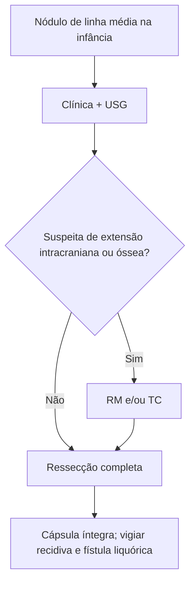

# Cisto Dermoide

> Resumo em palavras próprias do Whitebook (Condutas Cirúrgicas > Cirurgia Geral e do Aparelho Digestivo), sem fisiopatologia, autoria e referências. Confira detalhes e doses na fonte: https://whitebook.pebmed.com.br/conteudo/?id=39153&categoryId=207&subcategoryId=211

**Definição:** tumor cístico benigno e raro, de origem no epitélio germinativo embrionário, com revestimento epidérmico — forma cística benigna de teratoma, com queratina, sebo e muitas vezes pelos. Ao contrário do teratoma ovariano, raramente contém ossos e dentes.

## Aspectos gerais
- Decorre de aprisionamento de ectoderma; típico da **linha média**.
- ~70% em cabeça e pescoço (linha média frontal, glabela, periorbitário, nasal); em geral diagnosticado na infância.
- **Teorias:** aprisionamento de epitélio no fechamento do 1º e 2º arcos branquiais (3ª–4ª semana); ou implante de células epiteliais profundas por trauma intrauterino (amniocentese, acidente).

## Clínica
Nódulo subcutâneo bem circunscrito, firme e elástico, indolor e de crescimento lento; conteúdo pastoso amarelado (queratina), pelos e sebo; às vezes pequeno orifício ou fístula central.

## Diagnóstico
Essencialmente clínico; imagem para excluir diferenciais.
- **USG** de partes moles: lesões superficiais.
- **RM:** de escolha se há suspeita de invasão de estruturas nobres ou extensão intracraniana.
- **TC:** erosões ósseas e planejamento cirúrgico.
- **Diferenciais:** cisto epidermoide, lipoma, higroma cístico, encefalocele/meningocele.

## Tratamento
Padrão-ouro: **ressecção completa sem romper a cápsula**. Complicações: recidiva local, infecção, fístula liquórica (se comunicação intracraniana), queloide/cicatriz hipertrófica.

## Fluxograma (refeito, a partir do texto; o texto original não traz uma figura)

