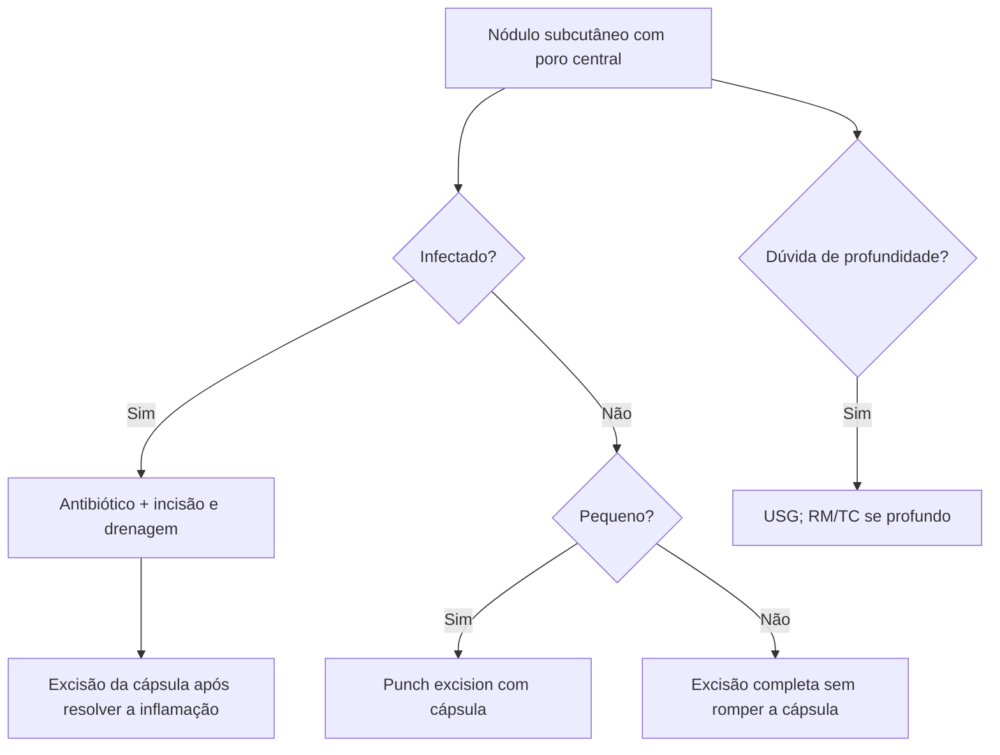

# Cisto Epidermoide

> Resumo em palavras próprias do Whitebook (Condutas Cirúrgicas > Cirurgia Geral e do Aparelho Digestivo), sem fisiopatologia, autoria e referências. Confira detalhes e doses na fonte: https://whitebook.pebmed.com.br/conteudo/?id=39154&categoryId=207&subcategoryId=211

**Definição:** lesão benigna da pele (cisto de inclusão epidérmica), revestida por epitélio escamoso estratificado, que acumula queratina dentro da cápsula. Sinônimos: cisto epidérmico, de queratina; o termo “cisto sebáceo” não deve mais ser usado.

## Aspectos gerais
- Tipo mais comum de cisto cutâneo; parede epitelial com descamação (queratina) e debris gordurosos.
- Pode se associar, às vezes, a carcinoma basocelular.
- Áreas com pelos: tronco, face, couro cabeludo; pode ocorrer em qualquer local.

## Clínica
- Nódulo subcutâneo bem delimitado, móvel sobre planos profundos.
- Frequentemente com orifício central (poro dilatado) que drena queratina à pressão.
- Infecção secundária: dor, eritema e calor local.
- **Diferenciais:** cisto de fenda branquial, dermoide, lipoma, mília, cisto da rafe mediana, cisto mixoide, tumor de paratireoide, esteatocistoma, cisto tireoglosso, cisto pilonidal, síndrome de Gardner, tumor fibroso, síndrome de Favre-Racouchot.

## Exames
Em geral desnecessários; úteis na dúvida sobre profundidade, relação com estruturas nobres ou acesso complexo. **USG** costuma bastar; **RM/TC** em lesões profundas junto a estruturas nobres.

## Tratamento
- **Cisto infectado:** antibiótico para gram-positivos + incisão e drenagem; tratamento definitivo depois, sem inflamação, retirando a cápsula. Só drenar tem alta recorrência.
- **Cisto não infectado:** excisão completa sem romper a cápsula (complicações: recorrência, equimose, hematoma). Em lesões pequenas, pode-se usar *punch excision*, garantindo a retirada da cápsula inteira.

## Fluxograma (refeito, a partir do texto; o original é um atlas na fonte)

