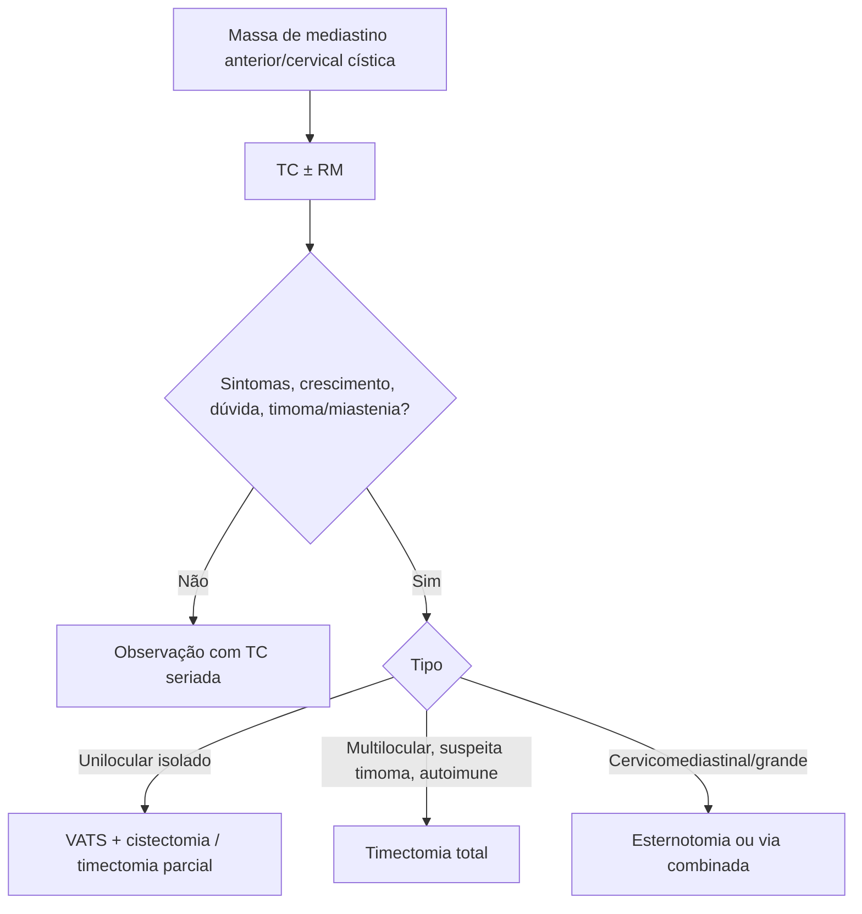

# Cisto Tímico

> Resumo em palavras próprias do Whitebook (Condutas Cirúrgicas > Cirurgia Torácica), sem fisiopatologia, autoria e referências. Confira detalhes e doses na fonte: https://whitebook.pebmed.com.br/conteudo/?id=39155&categoryId=207&subcategoryId=215

## Epidemiologia
- Raro: 1–3% das lesões do mediastino anterior; lesão cervicomediastinal; diagnóstico em geral aos 30–60 anos; ambos os sexos. Congênito: 50% diagnosticados nas duas primeiras décadas. Adquiridos (radiação, infecção como tuberculose, trauma, degeneração cística de tumores tímicos): risco de malignização.
- ~1% das crianças com HIV têm cistos tímicos grandes multiloculares; associações descritas com distúrbios imunológicos, Sjögren e histiocitose de células de Langerhans. Pode complicar com hemorragia ou infecção.

## Clínica e diagnóstico
- Geralmente assintomático (achado incidental). Sintomas compressivos em 39%: dispneia, tosse, dor torácica, disfonia, disfagia, massa cervical. Raramente miastenia gravis (cistos multiloculares). Sem marcador biológico específico.
- **RX de tórax:** lesões pequenas não aparecem; as visíveis são indistinguíveis de outras lesões do mediastino anterior.
- **TC:** massa bem circunscrita, uni ou multiloculada, atenuação de partes moles, septações; maior atenuação se hemorragia/infecção; calcificação linear em alguns; mediastino anterior ou cervical; contraste mostra relação com estruturas vizinhas; > 20 UH em conteúdo proteico pode simular tumor sólido.
- **RM:** não complicados — baixo sinal em T1, alto em T2, sem realce por gadolínio; complicados — alto sinal em T1 e T2. Não desenvolvem septações, nódulos murais ou espessamento irregular mesmo após 5 anos. USG cervical com Doppler pode ser usada.
- **Anatomopatologia:** da peça cirúrgica. Biópsia não é rotina (infecção, ruptura, falso-negativo). Corpúsculos de Hassall e restos de timo na parede; líquido geralmente pouco útil.
- **Tipos:** *congênito* (ducto timofaríngeo/bolsas branquiais; líquido claro e acelular; geralmente unilocular, parede fina; mais no pescoço; epitélio escamoso, sem inflamação, Hassall evidentes); *adquirido* (pós-radiação em linfoma/câncer de laringe, multiloculares associados a HIV, LES, linfoma não Hodgkin, seminoma, carcinoma tímico; líquido espesso, hemorrágico ou acastanhado; inflamação linfoplasmocitária, colesterol, hiperplasia linfoide; pode calcificar/fibrosar; mais no mediastino anterior).
- **Diferenciais:** teratoma cístico, cisto tireogênico, pericárdico, broncogênico, bócio/tireoide ectópica, timoma, linfangioma, seminoma cístico, fibrossarcoma, hemangioma, cisto branquial.
- **Complicações:** malignização (mais nos multiloculares), sangramento, infecção, compressão (vasos, esôfago, vias aéreas, coração).

## Sintomáticos (suporte)
Dor/febre ≥ 37,8 °C: dipirona 1–2 g EV até 4/4 h (máx. 5 g/24 h) ou gotas 20–40 VO; paracetamol 500–750 mg VO até 6/6 h. Náuseas: metoclopramida 10 mg EV/VO 8/8 h; bromoprida 10 mg EV 8/8 h. Proteção gástrica: omeprazol 20–40 mg/dia ou pantoprazol 20–40 mg/dia.

## Tratamento
- **Conservador:** assintomáticos e bem caracterizados, com TC seriada (tamanho e densidade podem variar; sem malignização em até 5 anos de seguimento).
- **Cirurgia:** sintomáticos, crescimento progressivo, dúvida diagnóstica, associação com timoma ou miastenia gravis.
- **Técnicas:** VATS (1ª escolha); timectomia parcial com cistectomia (cistos isolados, não infiltrativos); timectomia total (multiloculares, suspeita de timoma, doença autoimune, comprometimento do parênquima); esternotomia mediana ou via combinada (cervicomediastinais ou grandes retroesternais); ressecção de grandes vasos (raro, invasão, sobretudo timoma).

## Fluxograma (refeito, a partir do texto; o original não traz algoritmo)

