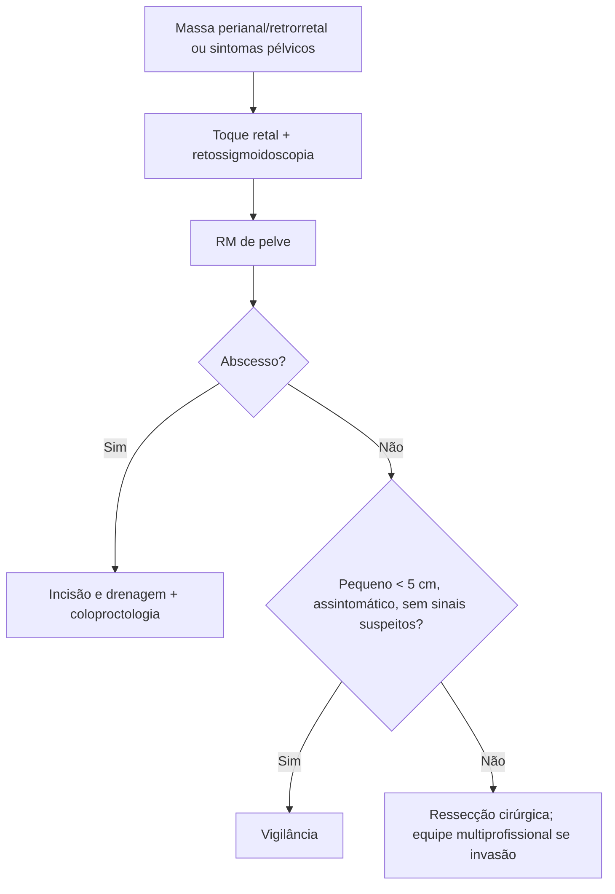

# Cistos Perianais

> Resumo em palavras próprias do Whitebook (Condutas Cirúrgicas > Cirurgia em Coloproctologia), sem fisiopatologia, autoria e referências. Confira detalhes e doses na fonte: https://whitebook.pebmed.com.br/conteudo/?id=44551&categoryId=207&subcategoryId=213

**Definição:** cavidades revestidas por membrana, com conteúdo gasoso, líquido ou semissólido. Raros na região perianal; mais comuns na região retrorretal/pré-sacral. Origem em geral congênita (remanescentes do intestino posterior). Muitos fazem diagnóstico diferencial com fístula anorretal.

**Tipos:** cisto dermoide, epidermoide, de duplicação retal, hamartoma, teratoma.

## Clínica
- Pouco sintomáticos; muitos são achados incidentais no toque retal ou em imagem.
- Dor vaga, prolongada, na pelve, períneo ou região lombar; inchaço e dor perianal se inflamados; sangramento anal indolor ocasional.
- Grandes massas: constipação (obstrução retal) e infecção urinária de repetição (compressão uretral). Teratomas sacrococcígeos que invadem a cauda equina: fraqueza e dormência de membros inferiores (raro).
- Toque retal: massa extrarretal que desloca o reto anteriormente; o exame físico isolado não fecha o diagnóstico.

## Diagnóstico
- **Retossigmoidoscopia flexível:** abaulamento extrínseco; mucosa inflamada sugere infecção prévia ou erosão da parede retal.
- **TC/RM de pelve:** diferencia cístico, sólido ou misto e a invasão de estruturas pélvicas; **RM é o padrão-ouro**.
- **Diferenciais:** hemorroidas, fístulas, abscessos, cisto pilonidal, hidradenite supurativa, trauma perineal, dermatoses, câncer anal ou de reto distal.

## Conduta
- Em geral **ressecção cirúrgica**, escolhendo a técnica por localização, tamanho e morfologia; encaminhar ao coloproctologista. Lesões grandes com invasão neuromusculoesquelética: equipe multiprofissional (pode exigir excisão do cóccix).
- **Vigilância** para cistos pequenos (< 5 cm), assintomáticos e sem sinais radiológicos suspeitos.
- **Abscesso:** incisão e drenagem, depois coloproctologia.

## Fluxograma (refeito, a partir do texto; o original não traz algoritmo)

