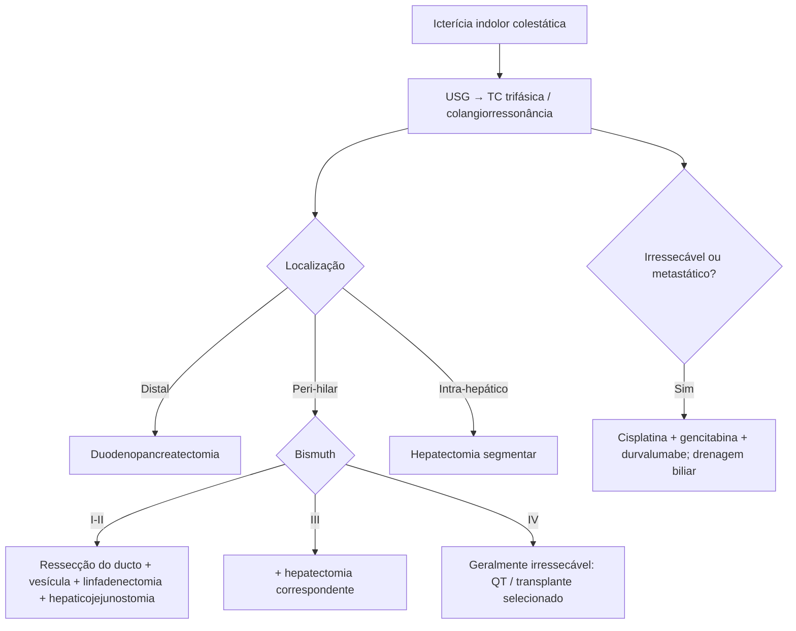

# Colangiocarcinoma

> Resumo em palavras próprias do Whitebook (Condutas Cirúrgicas > Cirurgia Oncológica), sem fisiopatologia, autoria e referências. Confira detalhes e doses na fonte: https://whitebook.pebmed.com.br/conteudo/?id=22593&categoryId=207&subcategoryId=212

**Definição:** neoplasia maligna das vias biliares (intra-hepática, hilar ou distal). > 90% adenocarcinomas; mutações em K-ras e p53; subtipos esclerosante (mais proximal), nodular e papilar (mais distais). Raro (3% dos tumores GI), agressivo, diagnóstico tardio; 5ª–7ª décadas; discreto predomínio masculino; 60–80% proximais, sobretudo na confluência (tumor de Klatskin).

## Fatores de risco
Colangite esclerosante primária, cistos de colédoco/Caroli, hepatites B e C, síndrome de Lynch, papilomatose biliar múltipla, parasitoses (*Clonorchis sinensis*, *Opisthorchis viverrini*), dióxido de tório.

## Clínica
Muitas vezes assintomático; perda de peso, anorexia, fraqueza, dor; icterícia colestática indolor (colúria, acolia, prurido); dor sugere invasão perineural; sinal de Courvoisier-Terrier em distais avançados.

## Diagnóstico
- FA, GGT e bilirrubina direta elevadas; CEA e CA 19-9 não são diagnósticos (acompanhamento). USG: primeira avaliação (massa, dilatação). TC trifásica e colangiorressonância: extensão, metástases e planejamento; USE para terços médio e distal do colédoco. Obstrução unilateral → atrofia do segmento com hipertrofia contralateral.
- **Classificação:** intra-hepático (10%; ductos de 2ª ordem ou mais distais, sem atingir o hilo); peri-hilar (~50%; da bifurcação à inserção do cístico — Klatskin); distal (~40%; do cístico à papila). **Bismuth-Corlette:** I abaixo da confluência; II atinge a confluência; IIIa/IIIb estende ao ducto direito/esquerdo; IV multicêntrico ou envolve confluência e ducto direito ou esquerdo.
- **Estadiamento AJCC 8ª ed.:**
  - *Intra-hepático:* T1a solitário ≤ 5 cm sem invasão vascular; T1b > 5 cm; T2 invasão vascular intra-hepática ou múltiplos; T3 peritônio visceral; T4 estruturas extra-hepáticas. N1/M1. Estágios IA, IB, II (T2), IIIA (T3), IIIB (T4 ou N1), IV (M1).
  - *Peri-hilar:* T1 confinado ao ducto; T2a além da parede, na gordura; T2b parênquima hepático; T3 ramos unilaterais da veia porta ou artéria hepática; T4 porta ou ramos bilateralmente, artéria hepática comum, ou envolvimento contralateral. N1 1–3; N2 ≥ 4. Estágios I, II (T2), IIIA (T3), IIIB (T4), IIIC (N1), IVA (N2), IVB (M1).
  - *Distal:* T1 profundidade < 5 mm; T2 5–12; T3 > 12; T4 tronco celíaco, AMS, artéria hepática comum. Estágios I (T1N0), IIA (T1N1 ou T2N0), IIB (T2N1 ou T3N0–1), IIIA (N2), IIIB (T4), IV (M1).
- **Diferenciais:** colelitíase, colecistite, coledocolitíase, cistos de colédoco, neoplasia de vesícula, hepatite.

## Tratamento
Cirurgia é o único curativo. **Contraindicações:** metástases hepáticas bilobares, doença extra-hepática, acometimento da veia porta ou artéria hepática lobar bilateral, atrofia lobar com envolvimento portal ou biliar contralateral. Histologia prévia é dispensável (7–15% das ressecadas são benignas), salvo se não for cirúrgico. Objetivo: margens negativas e reconstrução bilioentérica.
- **Preparo:** nutrição, probióticos, prurido, hidratação (icterícia ↑ risco renal), sais biliares e vitamina K; drenagem biliar (transparieto-hepática ou endoscópica) em desnutrição, embolização portal pré-operatória (ALPPS), prurido intratável, colangite em ducto sem drenagem, hepatectomia direita para Bismuth IIIA ou IV, bilirrubina > 10 mg%, demora até a ressecção — aumenta colangite, mas melhora coagulopatia, nutrição, cicatrização e reduz insuficiência hepática.
- **Distal:** duodenopancreatectomia (congelação da margem proximal do ducto). **Peri-hilar:** Bismuth I–II — ressecção em bloco do ducto com margens de 5–10 mm e da vesícula, linfadenectomia regional e hepaticojejunostomia em Y de Roux (tipo II pode exigir caudado); III — somar hepatectomia correspondente; IV — geralmente irressecável (centros especializados com reconstrução da porta). Consenso ALEH considera transplante hepático em casos selecionados de peri-hilar e intra-hepático. **Intra-hepático:** hepatectomia do segmento com margem livre; < 30% são candidatos.
- Alguns centros dão QRT adjuvante com linfonodo positivo ou R1 (sem suporte na literatura).
- **Paliação:** drenagem biliar endoscópica ou percutânea, narcóticos, neurólise do plexo celíaco, endoprótese duodenal; paliação cirúrgica não melhora sobrevida (só se achado intraoperatório de irressecabilidade). **Primeira linha avançada:** cisplatina + gencitabina + durvalumabe; após progressão, FOLFOX (benefício limitado).
- **Prognóstico:** pior com expansão longitudinal na parede e tecidos periductais, serosa, parênquima hepático e linfática; sobrevida longa limitada mesmo após ressecção.

## Fluxograma (refeito, a partir do texto; o original não traz algoritmo)

