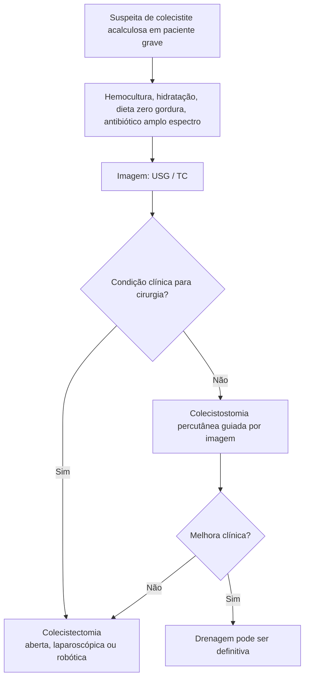

# Colecistite Acalculosa

> Resumo em palavras próprias do Whitebook (Condutas Cirúrgicas > Cirurgia Geral e do Aparelho Digestivo), sem fisiopatologia, autoria e referências. Confira detalhes e doses na fonte: https://whitebook.pebmed.com.br/conteudo/?id=45169&categoryId=207&subcategoryId=211

**Definição:** inflamação da vesícula sem cálculos, por esvaziamento anormal, colestase e hipoperfusão, no contexto de doença aguda grave (distúrbios clínicos/cirúrgicos, trauma, queimaduras). Forma mais grave da doença biliar inflamatória, com mais complicações e mortalidade.

## Epidemiologia
- ~**5–10%** das colecistites em adultos e **50–70%** em pacientes críticos; mais comum em homens idosos.
- Mais gangrena e perfuração que a litiásica; imunossuprimidos e HIV têm maior risco.
- Mortalidade **10–50%** (maior se tratamento tardio).

## Classificação
- Não complicada (sem necrose/perfuração); supurada (coleção purulenta); gangrenosa (necrose da parede); perfurada (necrose + ruptura).

## Quadro clínico
- Em pacientes graves/ventilados a anamnese vale pouco; exame: febre, desconforto abdominal inespecífico, sensibilidade em HCD, plastrão palpável, às vezes icterícia.
- Em conscientes: dor em HCD, Murphy, náuseas, vômitos, anorexia, febre/calafrios.
- **Contextos de risco:** sepse, UTI, nutrição parenteral prolongada, doença cardiovascular, pós-operatório de cirurgia cardíaca ou de reconstrução aórtica, pós-TMO, politrauma, queimaduras, diabetes, dismotilidade vesicular, hepatite A (gestação, crianças), EBV, cisto de colédoco.

## Diagnóstico
- **USG:** ausência de cálculos/lama, parede **> 3 mm**, líquido pericolecístico, vesícula estriada, Murphy ultrassonográfico, fragmentos de mucosa, distensão **> 5 mm**, vesícula não visualizada, gás (sinal do champanhe), perfuração com abscesso.
- **TC:** parede espessada, halo subseroso, infiltração pericolecística, líquido, gás intramural, distensão, cisto de colédoco.
- **Cintilografia HIDA** (com CCK): hipocinesia ou não preenchimento indica obstrução cística; pouco usada.
- **Diferenciais:** colecistite calculosa, úlcera péptica (± perfuração), pneumonia direita, pancreatite, abscesso hepático/subfrênico, pielonefrite direita, colangite, Mirizzi, hepatopatia transinfecciosa, sepse, colangiopatia da AIDS, hepatopatia da NPT, cisto de colédoco.

## Tratamento
- Precoce: atraso eleva mortalidade a até **75%**; tratamento eficiente a reduz para ~**30%**.
- Hidratação/ressuscitação, dieta sem gordura, antibiótico de amplo espectro para entéricos e biliares (hemocultura antes).
- Definitivo: **colecistectomia** (aberta, laparoscópica ou robótica) se houver condições; **colecistostomia percutânea** guiada por US/TC em quem não tolera cirurgia.
- Sem melhora após drenagem → colecistectomia. Com melhora, a drenagem pode ser o tratamento final (recorrência menor que na calculosa).

## Prognóstico
Mortalidade 20–50% (vs ~1% na litiásica), pela gravidade dos pacientes.

## Fluxograma (refeito, a partir do texto de conduta)

