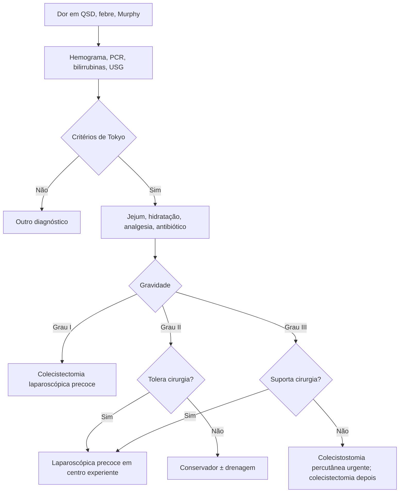

# Colecistite Aguda

> Resumo em palavras próprias do Whitebook (Condutas Cirúrgicas > Cirurgia Geral e do Aparelho Digestivo), sem fisiopatologia, autoria e referências. Confira detalhes e doses na fonte: https://whitebook.pebmed.com.br/conteudo/?id=22572&categoryId=207&subcategoryId=211

**Definição:** inflamação súbita da vesícula, com dor no quadrante superior direito, náuseas, vômitos, febre e leucocitose; ~90% por cálculo na vesícula ou no cístico.

## Mecanismo e epidemiologia
- Cálculo no infundíbulo/cístico → distensão, pressão intraluminal, comprometimento vascular e linfático; a fosfolipase A converte lecitina em lisolecitina, que inflama a mucosa e pode causar isquemia e necrose. Infecção secundária da bile: *E. coli*, *Enterococcus*, *Klebsiella*, *Bacteroides*, *Proteus*, *Pseudomonas*, *Enterobacter*.
- **Acalculosa** (5–10%): doente crítico (UTI, trauma), por estase de bile (jejum, anestesia, opioides, desidratação, imobilização); mecanismo principal isquêmico, metade evolui com gangrena e perfuração; mais em homens idosos; maior morbimortalidade; forma mais comum em crianças. Causas raras: *Ascaris*, *Clonorchis*.
- Colelitíase em 10–15%; colecistite = 3–10% das internações por dor abdominal; só 10–15% dos sintomáticos evoluem para colecistite; calculosa em mulheres de 40–60 anos. Gestação: 2º/3º trimestres, 2ª causa de abdome agudo não obstétrico (depois da apendicite).

## Clínica
- Dor em epigástrio/HCD, em cólica, irradiando para a região interescapular/ombro direito, após refeição gordurosa; início súbito, > 6 h; anorexia, náusea/vômito, febre baixa, calafrios, sudorese; poucos sintomas em idosos e crianças. Icterícia em 15% (edema pericolecístico, coledocolitíase ou síndrome de Mirizzi; bilirrubina > 4 mg/dL).
- **Fatores (calculosa):** sexo feminino, obesidade ou perda de peso rápida, bariátrica, gestação, transplantes, idade. **(Acalculosa):** estado crítico, grandes cirurgias/trauma/queimaduras, sepse, NPT, jejum prolongado, imunossupressão, HIV, *H. pylori*, *Giardia*, *S. typhi*, diabetes.
- **Exame:** dor no ponto cístico, **sinal de Murphy**, massa/plastrão no QSD; exame normal não exclui, sobretudo em idosos.

## Diagnóstico
- **Laboratório:** hemograma, função renal, eletrólitos, coagulograma, AST/ALT, FA, GGT, bilirrubinas, PCR, amilase, lipase; hemoculturas se febre alta; β-hCG e urina I em mulheres jovens. GGT > 224 U/L: VPP 50% para coledocolitíase. Bilirrubina < 4: não complicada; > 4: coledocolitíase/Mirizzi provável (especificidade 75%); > 1,8 + colédoco dilatado: risco moderado de coledocolitíase. Amilase pouco aumentada pode ser da própria colecistite.
- **USG** (1ª escolha; sensibilidade 50–88%, especificidade 80–88%): cálculos, parede > 3 mm, distensão (≥ 8 × 4 cm), líquido pericolecístico, lama, obstrução do cístico, parede laminada, fluxo mural no Doppler, peri-hepatite, abscesso/bilioma, gás, dilatação das vias biliares, **Murphy ultrassonográfico**. Acalculosa: sem cálculos, lama, vesícula estriada, distensão e líquido. Complicações: gás no fundo (sinal do champagne → enfisematosa), perfuração.
- **TC com contraste:** menos sensível que a USG, útil para complicações (coleções, pancreatite, gangrena, enfisematosa): cálculos, espessamento, líquido, halo subseroso, distensão, gás.
- **Colangiorressonância:** não de rotina; para coledocolitíase, pancreatite, tumores ou enzimas canaliculares muito altas; mais sensível para cálculos de cístico e colédoco.
- **Cintilografia hepatobiliar (HIDA):** sensibilidade > 90%, quando a USG não é conclusiva; positiva se a vesícula não aparece em 4 h. Falso-positivos: jejum, obstrução sem colecistite, hepatopatia grave, NPT, esfincterotomia prévia (rápida passagem ao delgado — conforme o texto), hiperbilirrubinemia.
- **Critérios de Tokyo 2018 (calculosa):** A — Murphy, massa/dor em QSD; B — febre, PCR ↑, leucocitose; C — imagem sugestiva. Suspeito: 1A + 1B; definitivo: 1A + 1B + 1C; reaplicar a cada 6–12 h se suspeita alta. **Acalculosa:** febre, dor, leucocitose, enzimas hepáticas ↑ + fatores de risco + imagem sugestiva sem outra explicação.

## Gravidade (Tokyo)
- **Grau II (moderada):** leucócitos > 18.000, massa palpável no QSD, sintomas > 72 h, inflamação local (gangrena, abscesso pericolecístico/hepático, peritonite biliar, enfisematosa).
- **Grau III (grave):** disfunção orgânica — cardiovascular (vasopressor: noradrenalina ou dopamina ≥ 5 µg/kg), neurológica (rebaixamento), respiratória (PaO₂/FiO₂ < 300), renal (oligúria, creatinina > 2), hepática (INR > 1,5), hematológica (plaquetas < 100.000). Reavaliar em 24 e 48 h. (Grau I = não preenche II nem III.)

**Diferenciais:** apendicite, abscesso subfrênico/hepático, pancreatite, hepatite, colelitíase sintomática, coledocolitíase, gastrite, pneumonia de base direita, AAA, úlcera, pielonefrite, colangiocarcinoma, colangite, neoplasia ou pólipo de vesícula, isquemia mesentérica, trombose portal.
**Complicações:** gangrena, enfisematosa (*C. perfringens*; diabéticos e idosos), Mirizzi, pancreatite, fístula colecistocolônica, íleo biliar, peritonite por perfuração, abscesso hepático, tromboflebite portal, sepse.

## Tratamento
**Inicial:** internar, jejum, hidratação e correção de eletrólitos; analgesia — dipirona 500 mg–1 g EV até 4/4 h; escopolamina + dipirona 10 mg + 250 mg VO até 6/6 h; paracetamol 750 mg VO 8/8 h; tramadol 100 mg em 100 mL SF EV 8/8 h; AINE se sem contraindicação (tenoxicam 20 mg EV 12/12 h; cetoprofeno 100 mg EV 12/12 h; cetorolaco 30–60 mg EV/IM 12/12 h); antieméticos (bromoprida 10 mg 8/8 h; metoclopramida 10 mg 8/8 h; ondansetrona 4–8 mg 8/8 h); graduar a gravidade (Tokyo) e o risco (CCI, ASA); monitorar.

**Antibiótico:** o texto lista três blocos de esquemas (cujos títulos não vêm no texto extraído; correspondem a gravidade/origem comunitária × associada a cuidados de saúde — confira na fonte): (1) ampicilina-sulbactam; ceftriaxona ou cefotaxima + metronidazol; ertapeném; cipro/levofloxacino + metronidazol. (2) piperacilina-tazobactam; ceftriaxona/cefotaxima/cefepima/ceftazidima + metronidazol; ertapeném; cipro/levo + metronidazol. (3) piperacilina-tazobactam; cefepima/ceftazidima + metronidazol; meropeném ou ertapeném; aztreonam ± metronidazol. Em graus I e II não manter antibiótico após a colecistectomia; no grau III manter 4–7 dias.

**Cirurgia:** colecistectomia **laparoscópica** é o padrão-ouro (menos dor, internação e recuperação; custo semelhante). Evitar em choque séptico ou risco anestésico proibitivo. **Converter** se inflamação importante, aderências, sangramento no triângulo de Calot ou suspeita de lesão biliar. Fatores de dificuldade/conversão: homem, > 65 kg, > 60 anos, cirurgia abdominal prévia, cirurgião inexperiente, ASA alto, parede > 4 mm, diabetes. Tempo: até 7 dias da admissão (10 dias do início), preferencialmente em 24–72 h. Necrose, perfuração e enfisematosa: colecistectomia de emergência. Triângulo de Calot inidentificável: **técnica de Torek** (colecistectomia parcial com cauterização do leito).
**Drenagem (colecistostomia):** para graves/alto risco em que o risco supera o benefício; reavaliar para colecistectomia eletiva após resolver. Método de escolha: percutânea trans-hepática com dreno 6–10 Fr; também endoscópica (centros experientes) ou cirúrgica; **aspiração simples não é indicada**. Pós-drenagem com alto risco: considerar extração percutânea dos cálculos ± litotripsia mecânica.

**Por gravidade:**
- *Grau I:* colecistectomia laparoscópica precoce (até 7 dias, idealmente 72 h) se os escores permitirem; senão tratamento conservador e adiar. Maior risco: CCI ≥ 6 e ASA ≥ 3.
- *Grau II:* laparoscópica precoce/urgente se o paciente tolera, em centro com expertise (maior risco de lesão biliar); converter ou colecistectomia parcial conforme achados; se não tolera: conservador e drenagem se não responde.
- *Grau III:* investigar preditores de resposta; se tolera, laparoscópica precoce por profissional experiente; se não, tratamento conservador e drenagem precoce (colecistostomia) — urgente (≤ 24 h) em sepse grave ou instabilidade; nos demais, aguardar 1–3 dias de antibiótico e drenar se não melhora. Preditores de pior evolução: disfunção neurológica ou respiratória e bilirrubina > 2 mg/dL.

**Prognóstico:** bom em leves/moderadas tratadas; reservado nas graves e na acalculosa.

## Fluxograma (refeito, a partir do texto; o original é o fluxograma de Tokyo, redesenhado aqui)

