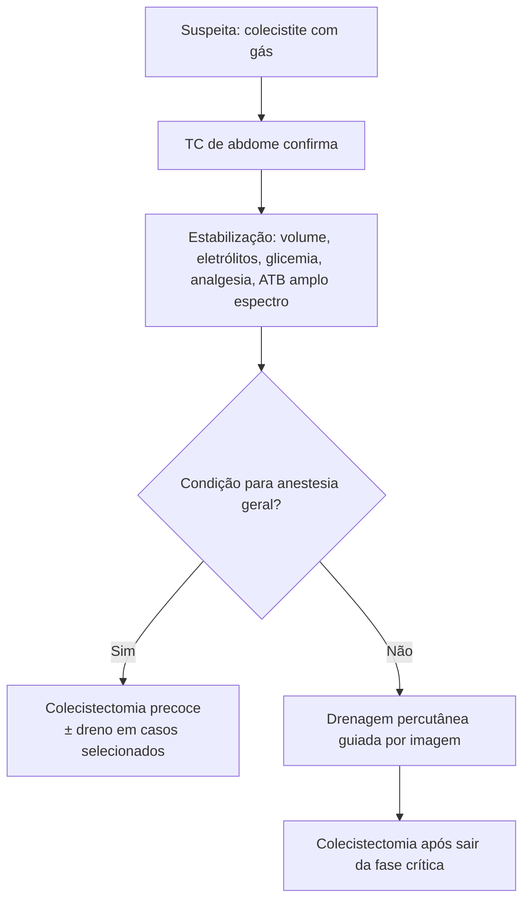

# Colecistite Enfisematosa

> Resumo em palavras próprias do Whitebook (Condutas Cirúrgicas > Cirurgia Geral e do Aparelho Digestivo), sem fisiopatologia, autoria e referências. Confira detalhes e doses na fonte: https://whitebook.pebmed.com.br/conteudo/?id=45170&categoryId=207&subcategoryId=211

**Definição:** forma rara de colecistite aguda com gás na parede ou no lúmen da vesícula, na via biliar ou nos tecidos pericolecísticos, por bactérias formadoras de gás (*Clostridium*, *E. coli*, *Klebsiella*, *Proteus*, *Aerobacter*, estafilococos, estreptococos, *Salmonella*).

## Epidemiologia
- Infrequente, insidiosa, rapidamente progressiva; **urgência cirúrgica** pelo risco de gangrena e perfuração precoces.
- Só **1–3%** das colecistites agudas, mas **15–25%** da mortalidade.
- Fatores de risco: homem (3:1), idade (5ª–7ª décadas), diabetes (**30–75%**), imunossupressão, doença vascular periférica, aterosclerose.

## Quadro clínico
- Início indistinguível da colecistite clássica: dor em HCD (pode irradiar para o dorso), febre, náuseas/vômitos, icterícia rara; taquicardia e hipotensão = toxemia.
- Dor difusa = peritonite; alívio seguido de dor difusa = perfuração.
- Exame: ruídos reduzidos/ausentes, Murphy+, vesícula palpável, hiperemia e crepitação na parede abdominal.

## Diagnóstico
- **Labs:** inespecíficos (leucocitose com desvio, TGO/TGP discretamente altas, hiperglicemia). Pedir hemograma, hepatograma, glicemia.
- **RX:** gás na topografia da vesícula ou pneumobilia; normal não exclui.
- **USG:** "rabo de cometa" e "vesícula efervescente" são diagnósticos; gás excessivo pode simular ausência de vesícula e gás intramural pode simular vesícula em porcelana (falso-negativo).
  - Estágio I: gás no lúmen; II: gás na parede; III: gás na parede, no lúmen e ao redor (gangrena/perfuração).
- **TC:** exame de escolha (alta sensibilidade/especificidade); ar livre = perfuração; exclui abscesso hepático e colangite.
- **Diferenciais:** colecistite litiásica, acalculosa, apendicite, úlcera perfurada, pancreatite, coledocolitíase, colangite, fístula bilioentérica.

## Tratamento
- Abordagem agressiva e precoce: ressuscitação, correção hidroeletrolítica, controle glicêmico, analgesia, antibiótico de amplo espectro (ampicilina-sulbactam ou piperacilina-tazobactam), escalonando conforme cultura intraoperatória.
- **Sem condição para anestesia geral:** drenagem percutânea guiada por imagem como ponte; colecistectomia depois.
- **Colecistectomia** (aberta, laparoscópica ou robótica) é o definitivo, o mais cedo possível; dreno (Blake/Jackson-Pratt) em casos selecionados.
- Complicações: infecção de ferida, abscesso/coleção, lesão de via biliar, fístula biliar.

## Prognóstico
Diagnóstico tardio e sepse elevam muito a mortalidade; pior com idade avançada, diabetes, perfuração, bacteremia e falência orgânica.

## Fluxograma (refeito, a partir do texto de conduta)

