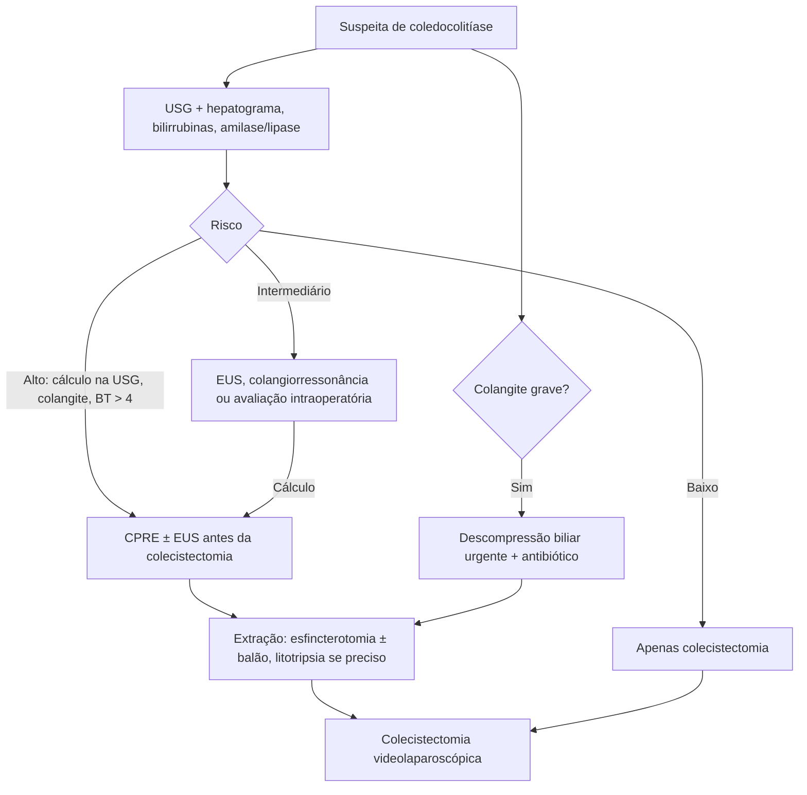

# Coledocolitíase

> Resumo em palavras próprias do Whitebook (Condutas Cirúrgicas > Cirurgia Geral e do Aparelho Digestivo), sem fisiopatologia, autoria e referências. Confira detalhes e doses na fonte: https://whitebook.pebmed.com.br/conteudo/?id=22573&categoryId=207&subcategoryId=211

**Definição:** cálculos no colédoco, assintomáticos ou causadores de estase biliar e hipertensão intrabiliar. **Primária:** estase por estenose ou infecção; **secundária:** migração de cálculo da vesícula (a mais comum). O cálculo pode passar ao duodeno ou ficar impactado se for maior que a papila; a estase leva a colangite ou, com obstrução pancreática, a pancreatite biliar.

## Epidemiologia
> 2% da população têm coledocolitíase assintomática; 10–20% dos pacientes com colelitíase sintomática; mais da metade sem sintomas; 11–21% das colelitíases têm coledocolitíase na cirurgia; cálculos biliares estão por trás de ~50% das pancreatites agudas.

## Quadro clínico
- Dor em epigástrio/HCD em cólica com irradiação para ombro direito, náuseas, vômitos, icterícia, colúria, acolia, pancreatite (dor em faixa).
- Exame: icterícia, abdome flácido doloroso em HCD, vesícula não palpável (Courvoisier).
- **Tríade de Charcot** (dor em HCD, febre com calafrio, icterícia): colangite. **Pêntade de Reynolds** (+ hipotensão e confusão): colangite grave. Dor em faixa com amilase/lipase altas: pancreatite.

## Diagnóstico
- **Laboratório:** leucocitose com desvio se colangite; transaminases normais ou altas; FA e GGT elevadas; hiperbilirrubinemia direta; amilase/lipase se pancreatite.
- **USG** (triagem sempre): sensibilidade até 96% para colelitíase, vê cálculo no colédoco em até 50%; colédoco normal 5–11 mm (maior com a idade e pós-colecistectomia). Indiretos: colédoco > 6–8 mm, muitos cálculos na vesícula, cálculos pequenos.
- **TC:** 2ª linha; melhor para pancreatite biliar; colangiografia tomográfica melhora o desempenho; raramente vê o cálculo.
- **Colangiorressonância:** exame não invasivo mais acurado (sensibilidade 85–92%, especificidade 93–97%); rastreia risco baixo a moderado antes da CPRE; menos sensível para cálculos < 6 mm vs EUS; limitada por obesidade, claustrofobia, metal, marca-passo.
- **USG endoscópica (EUS):** melhor no colédoco distal; difícil após Y de Roux/Billroth II; requer sedação; mesma especificidade da CPRE e maior sensibilidade (91% vs 75%), sobretudo cálculos < 4 mm; baixa morbidade.
- **CPRE:** padrão-ouro e terapêutica (extração, esfincterotomia, prótese); invasiva, reservada para alto risco ou colangite; abandonada como diagnóstico em risco intermediário. Complicações 2–11% (sangramento, perfuração, pancreatite, colangite); pedir amilase/lipase no dia seguinte; seguir com colecistectomia videolaparoscópica; também trata cálculo residual pós-colecistectomia.
- **Colangiografia intraoperatória:** cateterismo do cístico e contraste; uso sistemático × seletivo é controverso; sensibilidade 59–100%, especificidade 93–100%; para risco intermediário; complicações: perfuração, fístula, pancreatite.
- **USG intraoperatória:** sensibilidade 92–95%, especificidade 99–100% em mãos experientes; mais rápida e com mais sucesso que a colangiografia; sem risco de lesão biliar; pode ser feita em gestantes.

## Estratificação de risco
- **Preditores muito fortes:** coledocolitíase na USG, colangite, bilirrubina total > 4 mg/dL.
- **Fortes:** colédoco > 6 mm (não colecistectomizado), bilirrubina 1,8–4 mg/dL.
- **Moderados:** hepatograma alterado (exceto bilirrubina), idade > 55, pancreatite biliar.
- **Alto risco:** CPRE e/ou EUS antes da colecistectomia. **Risco intermediário:** avaliação adicional (EUS, colangiorressonância, colangiografia ou USG intraoperatória) antes da CPRE. **Baixo risco:** apenas colecistectomia.
- **Diferenciais:** colelitíase sintomática, colecistite, hepatite, doenças hematológicas, tumor de vesícula/vias biliares. **Complicações:** colangite, colecistite, pancreatite, abscesso hepático (raro), cirrose biliar secundária.

## Tratamento
- **Inicial:** internação, hidratação, analgesia, antiemético; se colangite: ceftriaxona 2 g EV 1×/dia + metronidazol 500 mg EV 8/8 h; ou ciprofloxacino 400 mg EV 12/12 h + metronidazol; ou ampicilina 2 g EV 6/6 h + gentamicina 4 mg/kg EV 1×/dia; ou amoxicilina-clavulanato 1 g EV 8/8 h.
- **Remoção endoscópica:** esfincterotomia e/ou dilatação com balão, extração com Dormia e balão, litotripsia mecânica nos casos difíceis. Sucesso da esfincterotomia ~90%; morbidade 5–9,8%; mortalidade 0,3–2,3%; pancreatite é a complicação mais frequente. Esfincterotomia + balão é boa opção em cálculos grandes e estenose suprapapilar. **Dilatação com balão isolada:** menos sangramento e infecção, mais pancreatite e perfuração; indicada em idosos, risco infeccioso ou coagulopatia.
- **Momento da CPRE:** antes da colecistectomia (permite novo tratamento se falhar), durante (*rendez-vous*, procedimento único) ou depois (melhor seleção, outro procedimento se falhar). Sempre completar com colecistectomia laparoscópica; sem CPRE, explorar o colédoco na colecistectomia.
- **Litotripsia** (mecânica, eletro-hidráulica, laser, ondas de choque): útil nos difíceis; não aplicável na colelitíase (lama aumenta recorrência).
- **Cirurgia:** técnica aberta (coledocotomia, duodenostomia/esfincterotomia ou derivação biliodigestiva) como último recurso. Laparoscópica: após dissecar o cístico, colangiografia e/ou EUS; limpeza com lavagem pelo cístico ou coledocotomia longitudinal (colédoco aumentado); falha: coledocoscópio e Dormia; dreno de Kehr normalmente desnecessário (exceto inflamação); derivação biliodigestiva laparoscópica é possível, mas não simples.
- **Foco:** colecistectomia formal (laparoscópica de eleição), junto ou após a desobstrução.

## Situações especiais
- **Colangite grave:** descomprimir a via biliar antes de qualquer outro procedimento (endoscópica tem menor morbimortalidade); indicar esfincterotomia e passagem de balão/basket mesmo sem cálculo visível.
- **Pancreatite aguda grave:** CPRE não indicada, exceto com colangite ou alta suspeita de cálculo.
- **Anticoagulados/coagulopatas:** suspender fármacos se possível; preferir dilatação com balão à esfincterotomia; prótese biliar é opção em idosos.
- **Cálculo residual pós-colecistectomia** (2% não identificados; causa mais comum da síndrome pós-colecistectomia; colédoco normal sobe para 7,6–10 mm): colangiorressonância e EUS equivalentes; terapia endoscópica de eleição (com litotripsia); cirurgia (geralmente aberta) se falhar.
- **Derivação biliodigestiva:** colédoco > 2 cm, lesões graves do ducto, > 6 cálculos, refratariedade.

## Fluxograma (refeito, a partir do texto)

