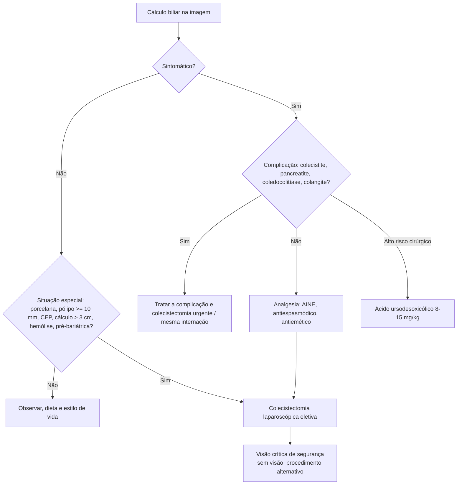

# Colelitíase

> Resumo em palavras próprias do Whitebook (Condutas Cirúrgicas > Cirurgia Geral e do Aparelho Digestivo), sem fisiopatologia, autoria e referências. Confira detalhes e doses na fonte: https://whitebook.pebmed.com.br/conteudo/?id=22574&categoryId=207&subcategoryId=211

**Definição:** cálculos na vesícula e/ou nos ductos biliares. Sinônimos: litíase biliar, colecistolitíase.

## Tipos de cálculo
- **Colesterol:** 80%. A maioria é de colesterol e cálcio (70%); < 10% é colesterol puro.
- **Pigmentados marrons:** estase/obstrução e infecção biliar (*E. coli*, *A. lumbricoides*, *Opisthorchis sinensis*); no Ocidente surgem nas vias biliares após colecistectomia e na CEP; no Oriente, em colangite infecciosa crônica; formam-se principalmente no colédoco.
- **Pigmentados pretos:** hemólise crônica e cirrose.
- Colesterol e pretos formam-se sobretudo na vesícula. Lama biliar não causa cálculo; surge com a estase.

## Epidemiologia
- Doença benigna que mais acomete a vesícula; 10–20% da população (15–24% após os 70 anos); ~80% assintomáticos a vida toda.
- Assintomático → sintomático: 1–4%/ano (cai com o tempo); complicações em doença assintomática: 0,1–0,3%/ano.
- Após a primeira cólica, complicações totalizam 1–3%/ano: colecistite aguda 0,3%, icterícia obstrutiva 0,2%, pancreatite biliar 0,1–1,5%. A cólica geralmente precede as complicações.

## Quadro clínico
- **Assintomáticos (80%):** achado incidental.
- **Cólica biliar (20%):** dor intensa epigástrica ou em HCD que sobe até estabilizar, 15–30 min, irradia para escápula/ombro direito, responde a analgésico, resolve sozinha; por obstrução transitória do cístico, tipicamente após refeição gordurosa. Altamente sugestivo: periodicidade irregular, início ~1 h após refeição, fim da tarde ou noite, despertar noturno, duração > 1 h. **> 2 h** sugere colecistite ou colangite, sobretudo com febre/leucocitose. Em 50% a dor recorre.
- **Associados:** náusea, vômito, distensão, plenitude pós-prandial, pirose, eructação, flatulência, sinal de Kehr, anorexia, intolerância a gordura.
- **Colecistite aguda:** complicação mais comum, ~10% dos sintomáticos; febre e dor intensa em QSD > 2 h; **sinal de Murphy** (parada da inspiração à palpação do ponto cístico).

## Fatores de risco
Dislipidemia, dieta hipercalórica e pobre em fibras, ceftriaxona, estrógenos (contraceptivos, TRH), tiazídicos, síndrome metabólica, obesidade, perda de peso rápida (bariátrica, semaglutida; 28–71% após bypass), oscilação de peso, tabagismo, DM2, NPT, jejum prolongado, idade ≥ 40 (4–10×), história familiar (5×), sexo feminino fértil, gestação (2º/3º trimestres), cirrose, Crohn ileal, hiperbilirrubinemia, transplantes, fibrose cística, ressecção ileal, infecções biliares recorrentes, vagotomia, análogos de somatostatina, anemias hemolíticas, erros inatos dos ácidos biliares. **Gene ABCB4 (LPAC):** 2 de 3 — início < 40 anos, recorrência após colecistectomia, microlitíase intra-hepática.
- **Protetores:** dieta com gorduras monoinsaturadas, fibras, ômega-3, vitamina C, atividade física, estatinas; café, frutas e legumes (controverso).

## Diagnóstico
- Laboratório não ajuda na doença não complicada; se complicação: transaminases, GGT, FA, bilirrubinas, amilase, lipase.
- **RX:** só para excluir diferenciais; cálculos em geral radiotransparentes (5–75% dos pigmentados são radiopacos).
- **USG:** exame de escolha (dor em quadrantes superiores, idoso com dor atípica, imunossuprimido com foco indefinido); sensibilidade 95%, especificidade 98%, falso-negativo 1–4%; jejum de 8 h. Espessamento de parede ≥ 4 mm, aumento do órgão ou líquido pericolecístico sugerem colecistite (Murphy ultrassonográfico é o mais específico); hipoalbuminemia, ICC e arboviroses também espessam a parede (causa não cirúrgica).
- **USG endoscópica:** detecta colecistolitíase em 94–98% dos com cólica mesmo com USG normal; pode achar lama em pancreatite inexplicada. Indicada se alta suspeita com USG normal ou suspeita de coledocolitíase não vista.
- **Cintilografia:** sintomas persistentes com demais exames negativos; avaliação funcional; segura na gestação (< 5 mGy, Tc-99m); não rotineira.
- **Diferenciais:** colecistite, coledocolitíase, pancreatite, úlcera péptica, dispepsia, gastrite, gastroenterite, apendicite, DRGE, nefroureterolitíase.
- **Complicações:** colecistite aguda, pancreatite biliar, coledocolitíase, colangite, íleo biliar, carcinoma de vesícula.

## Tratamento
- **Medidas gerais:** exercício, peso ideal; sintomáticos reduzem gordura; evitar excesso de carboidrato, colesterol e proteína animal; mais fibras; atenção à TRH.
- **Ácido ursodesoxicólico:** dissolve cálculos de colesterol; **8–15 mg/kg VO, 2–3×/dia, 6–18 meses**; para colesterol bem estabelecido com alto risco cirúrgico; recorrência alta (25–64% em 5 anos; 49–80% em 10). A colecistectomia é a opção preferencial. **Prevenção:** obesos em perda de peso rápida (pelo menos 500 mg/dia até estabilizar), uso prolongado de somatostatina/análogos, mutação ABCB4; pode ser considerado em gestantes.
- **Cólica biliar:** analgésico comum (dipirona, paracetamol), escopolamina, AINE (cetoprofeno, diclofenaco — primeira escolha, eficácia similar à dos opioides), opioides (tramadol, morfina) nos casos intensos; associar antiemético. **Internar:** dor refratária (considerar cirurgia) ou complicações. **Alta:** assintomático, sem complicações, com seguimento cirúrgico para colecistectomia eletiva.
- **Colecistectomia**, de preferência laparoscópica.
  - **Sintomáticos:** sempre indicada (eletiva conforme risco; recidiva alta); complicados: urgência/emergência; pancreatite biliar: na mesma internação.
  - **Assintomáticos:** em geral não operar; considerar em vesícula em porcelana (20% associam neoplasia), pólipo ≥ 10 mm ou crescente, CEP, cálculo > 3 cm, anomalia congênita, pré-bariátrica ou pré-transplante cardíaco, anemia hemolítica.
  - **Contraindicações relativas:** falta de expertise/material; suspeita de malignidade.
  - **Pontos práticos:** principal complicação é lesão de via biliar (encaminhar a centro de referência); sem dreno rotineiro; seguro em cirrose Child A/B compensada sem hipertensão portal significativa (Child C ou MELD > 13: maior risco); antibioticoprofilaxia eletiva questionável; colangiografia intraoperatória liberal e de rotina se risco/suspeita de coledocolitíase; gestação: laparoscopia em qualquer trimestre na urgência, 2º trimestre no eletivo; 30–40% mantêm sintomas após a cirurgia.
  - **Visão crítica de segurança (Strasberg):** terço inferior da vesícula liberado da placa cística; apenas duas estruturas (cístico e artéria cística) entrando na vesícula; trígono hepatocístico dissecado e limpo. Trígono: limite superior fígado, medial ducto hepático comum, inferior ducto cístico; contém artéria cística e linfonodo. Sem a visão, adotar alternativa (ex.: colecistectomia subtotal).

## Fluxograma (refeito, a partir do texto; o texto original não traz um algoritmo único)

