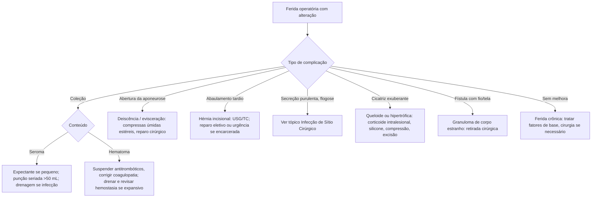

# Complicações da Ferida Operatória

> Resumo em palavras próprias do Whitebook (Condutas Cirúrgicas > Cirurgia Geral e do Aparelho Digestivo), sem fisiopatologia, autoria e referências. Confira detalhes e doses na fonte: https://whitebook.pebmed.com.br/conteudo/?id=22575&categoryId=207&subcategoryId=211

## Seroma
**Definição:** coleção de gordura liquefeita, plasma ou linfa na ferida; precoce e a mais benigna; proporcional à extensão da dissecção; esperada em tireoidectomia, abdominoplastia, mastectomia, dissecção axilar, hérnias.
- **Diagnóstico:** secreção serosa espontânea ou induzida, abaulamento flutuante indolor; se infectado, sinais flogísticos e secreção turva fétida; US para coleções profundas.
- **Tratamento** (maioria é autolimitada): expectante se pequeno e assintomático; **punção seriada** (> 50 mL, estéril; aspirações muito frequentes aumentam infecção e pseudocisto); **drenagem** (abertura parcial ou nova incisão) se infecção ou **> 200 mL**.
- **Complicações:** infecção, deiscência, necrose de retalho, atraso de cicatrização, prejuízo estético, pseudocisto, hérnia.
- **Prevenção:** dissecção cuidadosa, reduzir espaço morto, dreno de sucção, pontos de tensão progressiva (quilting), preservar fáscia de Scarpa, selantes biológicos (controverso), transecção do saco em hernioplastia, curativo compressivo, restrição de esforço por 3–4 semanas, não retirar dreno precocemente.
- **Complementares:** pressão negativa (VAC) 5–10 dias; escleroterapia (doxiciclina 10–20 mg/mL em 30–50 mL de SF 0,9%, pouco usada); pseudocisto: ressecção da cápsula ou marsupialização, idealmente 6–8 semanas depois.

## Hematoma
**Definição:** coleção de sangue/coágulos por sangramento ativo ou contido; maior risco de infecção.
- **Fatores de risco:** antiplaquetários, AINE, anticoagulantes, HAS não controlada, hipotensão intraoperatória, hemostasia falha, dissecção extensa, coagulopatia.
- **Diagnóstico:** abaulamento expansivo, dor, flutuação, drenagem de sangue/coágulos, equimose; US/TC se profundo.
- **Tratamento:** suspender fármacos que alterem coagulação, corrigir distúrbios; expectante se pequeno e estável (compressas frias 48 h); cirúrgico: exploração, drenagem estéril, curativo compressivo, revisão da hemostasia. Em região cervical, drenar rapidamente (compressão de via aérea).
- **Ácido tranexâmico:** sistêmico **10–15 mg/kg EV** antes da incisão; local **1–3 g em 100 mL SF** irrigando o leito antes do fechamento.
- **Complicações:** infecção, compressão de via aérea, isquemia, equimose, deiscência, necrose cutânea.
- **Prevenção:** manejo perioperatório de antitrombóticos, corrigir coagulopatia, controle pressórico, hemostasia, curativo compressivo.

## Deiscência precoce e evisceração
**Definição:** deiscência = falência da cicatrização com separação da aponeurose; evisceração = atinge todos os planos com exposição de vísceras. Aparece entre o 2º e o 21º PO (mais no 7º–10º); incidência **0,3–4,1%**. Frequentemente associada a complicações intra-abdominais (abscesso, deiscência anastomótica, fístula). Formas: parcial/pequena (pode virar eventração) ou completa (evisceração).
- **Fatores de risco** — *sistêmicos:* sexo masculino, idade, sepse, desnutrição grave (albumina **< 2 g/dL**), obesidade, aumento de pressão abdominal (tosse, distensão, ascite), câncer, corticoide crônico, quimioterapia (doxorrubicina), colagenoses, DPOC, imunossupressão, DM (não independente), instabilidade. *Locais:* isquemia, sangramento, infecção, relaparotomia. *Técnicos:* cirurgia de emergência, tipo/diâmetro do fio, sutura inadequada ou isquemiante, pouca experiência, tecido frágil. Preferir fio monofilamentar 2-0 ou 0 de absorção prolongada e alta resistência.
- **Diagnóstico:** íleo prolongado precedendo; sensação de ruptura; secreção serossanguinolenta ("água de carne"/"salmão") abundante entre pontos; abaulamento; defeito aponeurótico à palpação estéril; omento/alças exteriorizados; após retirada de pontos com aumento de pressão abdominal.
- **Conduta:** na dúvida, retirar alguns pontos e explorar em condições estéreis; compressas estéreis úmidas com SF; curativo envolvendo o abdome com atadura (**sem compressão** se evisceração completa); repouso horizontal. Corrigir causas, afastar focos sépticos e fístulas, lavar a cavidade, desbridar bordas e priorizar fechamento primário. Antibiótico apenas em pequenas deiscências tardias, com curativos úmidos e bandagem.
- **Prevenção:** fios inabsorvíveis ou de absorção lenta (≥ 6 semanas: PDS, prolene), diâmetro 0 ou 2-0; sutura contínua sem tensão excessiva, ~1 cm entre pontos; *small bites* a 0,5 cm da borda; razão comprimento da sutura/ferida **≥ 4:1**; evitar > 5 kg por 4–6 semanas; retirar pontos no tempo adequado.

## Hérnia incisional e eventração
**Definição:** defeito adquirido da parede abdominal na incisão prévia. Principal complicação tardia; incidência **10–15%**; ~**40%** surgem no 1º mês; mais nas incisões de linha média, quando as bordas da aponeurose se afastam **> 12 mm** no 1º mês.
- **Fatores de risco:** infecção, tabagismo, desnutrição, radioterapia prévia, tosse crônica, obesidade, falha técnica.
- **Diagnóstico:** dor na cicatriz, abaulamento à manobra de Valsalva, afastamento aponeurótico palpável, conteúdo herniado (omento, vísceras), encarceramento com obstrução (10–15%); USG/TC de parede para planejamento. Defeitos grandes: dor lombar crônica, restrição respiratória, alteração da imagem corporal.
- **Tratamento:** indicado se sintomática, assintomática com alto risco de encarceramento ou com prejuízo de qualidade de vida. Eletivo (após ≥ 6 meses da cirurgia inicial e com condições otimizadas) ou urgência (encarceramento/estrangulamento). Reparo simples sem tela ou com tela (sublay preferido); defeito **> 1 cm**: tela preferível; separação de componentes (anterior/posterior) em grandes defeitos; via laparoscópica reduz infecção de ferida/tela e recorrência. Perda de domicílio: TAR, pneumoperitônio progressivo, viscerorredução, toxina botulínica em oblíquos/transverso (objetivo: evitar síndrome compartimental). Recorrência geralmente por má posição da tela ou hérnia não reconhecida.
- **Prevenção:** fio inabsorvível ou de absorção lenta; pontos só na aponeurose a 5–8 mm da borda, 4–5 mm entre pontos; cintas sem evidência isolada; evitar > 5 kg por 4–6 semanas.
- **Complicações:** perda de domicílio, encarceramento/estrangulamento, obstrução, queda de qualidade de vida, prejuízo estético.

## Infecção de sítio cirúrgico
Tema abordado em tópico próprio (Infecção de Sítio Cirúrgico).

## Cicatrização anormal
| | Queloide | Cicatriz hipertrófica |
|---|---|---|
| Sexo/etnia | Sim | Não |
| Quando surge | Espontaneamente | Em geral após 4 semanas do trauma |
| Involução | Não | Cresce nos 6 primeiros meses e involui em 12–18 meses |
| Locais | Lóbulo da orelha, deltoide, pré-esternal, dorso alto, cabeça e pescoço | Flexoras e áreas de tensão |
| Dor/prurido | Frequente | Menos comum |
Queloide ultrapassa os limites da ferida; hipertrófica (geralmente ≤ 4 mm) se limita a ela.
- **Fatores de risco:** queloide: etnias negra e hispânica, genética (AD); hipertrófica: epitelização > 21 dias.
- **Diagnóstico:** clínico; biópsia na dúvida. Diferenciais: esclerodermia nodular, dermatofibrossarcoma protuberans, lobomicose, granuloma piogênico, fibroblastoma de células gigantes.
- **Tratamento:** corticoide intralesional (triancinolona), 5-fluoruracila intralesional, placas de silicone, terapia compressiva, crioterapia/laser/radioterapia, excisão com ou sem adjuvantes.
- **Prevenção:** ferida úmida na fase inicial, fita ou gel de silicone, evitar sol (FPS 50).

## Granuloma de corpo estranho
Reação a fio ou material esquecido: nódulos subcutâneos, fístula com secreção seropurulenta, extrusão de fio/tela. Tratamento: retirada cirúrgica do corpo estranho.

## Ferida crônica
Redução de área **< 15% por semana** ou **< 50% ao mês**. Cirurgia pode ser necessária para controlar infecção e fatores de base (deformidade óssea, corpo estranho, instabilidade biomecânica).

## Fluxograma (refeito, a partir do texto; o original não traz algoritmo)

