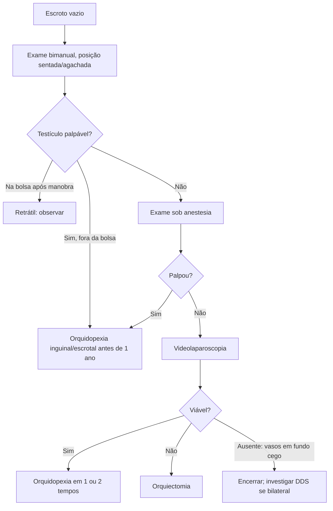

# Criptorquidia

> Resumo em palavras próprias do Whitebook (Condutas Cirúrgicas > Cirurgia Pediátrica), sem autoria e referências. Confira detalhes e doses na fonte: https://whitebook.pebmed.com.br/conteudo/?id=38897&categoryId=207&subcategoryId=826

**Definição:** distopia testicular: falha de migração/desenvolvimento, com testículo não palpável no respectivo hemiescroto.

## Classificação
- **Criptorquidia:** testículo que não está ou não desce para a bolsa até **4–6 meses** (idade corrigida em prematuros); pode ser não descido ou ausente.
- **Não descido:** parou ao longo do trajeto normal (abdome, canal inguinal, anel externo).
- **Ectópico (1%):** passa o anel externo e desvia (região inguinal fora do trajeto, suprapúbico, femoral, períneo, escroto contralateral).
- **Ausente:** agenesia ou atrofia (torção pré-natal); bilateral = anorquia.
- **Ascendente:** estava na bolsa ao nascer e sobe na infância.
- **Retrátil:** descida normal; sobe pelo reflexo cremastérico, mas é levado à bolsa e fica sem tensão.

## Epidemiologia
- Anomalia congênita mais comum do trato urinário; unilateral predomina à direita (70%); local mais comum: canal inguinal (72%); bilateral ~10%.
- 2–5% dos RN a termo e **30% dos prematuros**; ~90% descem espontaneamente até 3–6 meses (prevalência de 1% ao ano, como no adulto).
- Fatores de risco: prematuridade, PIG, peso < 2,5 kg, disruptores endócrinos (dietilestilbestrol, pesticidas). Associações: defeitos de parede abdominal e tubo neural, paralisia cerebral, distúrbios do desenvolvimento sexual, distúrbios genéticos de testosterona/hipogonadismo.

## Clínica e complicações
Hemiescroto vazio, hipoplásico e pouco enrugado; abaulamento inguinal.
- **Hérnia inguinal** (até 90% com conduto peritônio-vaginal patente), **torção** (risco muito elevado), **trauma** (compressão contra o púbis), **infertilidade** (calor → fibrose intersticial, perda tubular; pior no bilateral e com maior tempo supraescrotal).
- **Histologia:** lesão a partir dos 6 meses, irreversível e progressiva; perda de células germinativas e de Leydig, maior nos intra-abdominais.
- **Malignização:** risco até **15×** maior (seminoma); a cirurgia facilita o diagnóstico precoce (controverso se reduz o risco).

## Diagnóstico
Clínico (anamnese + exame); exames de imagem não são rotina.
- **Anamnese:** testículo na bolsa ao nascer?, cirurgia inguinal prévia, alterações endócrinas na gestação, história familiar de morte neonatal, anomalias genitais, puberdade, infertilidade.
- **Exame bimanual:** uma mão no anel externo, outra no escroto; examinar hemiescroto, canal e períneo. Testículo ectópico/retrátil pode ser "ordenhado" para o escroto. Para diferenciar retrátil: criança sentada de pernas cruzadas ou agachada; manter o testículo na bolsa por **1 minuto**; o retrátil permanece.
- **Impalpável:** USG apenas em fenótipo masculino com impalpáveis bilaterais (procurar útero/ovários) ou em obesos, a pedido do especialista. **Videolaparoscopia diagnóstica (e terapêutica)** é a conduta; sem exames radiológicos prévios.
- **Diferencial:** não descido (vasos e deferente normais no trajeto), agenesia (nenhuma estrutura), atrofia (remanescentes), ectópico (estruturas normais em posição aberrante). Com hipospadia associada, investigar distúrbio do desenvolvimento sexual.
- **RN com impalpáveis bilaterais:** avaliação imediata (HAC com virilização de 46,XX, DDS com atividade testicular anormal, síndrome do ducto mülleriano persistente, disgenesia gonadal, insensibilidade a androgênios, Kallmann, anorquia): cariótipo, USG pélvica, hormônios e metabólitos adrenais, LH, FSH, AMH.
- **Crianças:** testosterona, LH, FSH, AMH com estímulo de hCG (gonadotrofinas elevadas + testosterona e AMH ausentes = testículo ausente; pouco usado, em geral exploração cirúrgica).

## Tratamento
Encaminhar ao cirurgião pediátrico, de preferência **antes de 1 ano**. Meta: fixar o testículo viável no escroto ou remover o inviável.
- **Congênito:** orquidopexia idealmente antes de 1 ano; **ascendente:** em até 6 meses do diagnóstico.
- **Palpável:** orquidopexia (liberar cordão, levar ao escroto e fixar), via inguinal (preferida, pelo conduto patente) ou escrotal.
- **Impalpável:** exame sob anestesia; se persistir, videolaparoscopia (ausência confirmada por vasos em fundo cego); viável → orquidopexia (1 ou 2 tempos); inviável → orquiectomia. Sem laparoscopia: inguinotomia com extensão para a cavidade.
- **Complicações:** infecção de ferida (a mais comum), linfedema/congestão (resolvem), atrofia isquêmica.
- **Hormonal:** em geral não indicado; controverso como adjuvante à cirurgia.
- **Seguimento:** vigiar atrofia e reposicionamento; ensinar **autoexame testicular mensal** desde a adolescência. Bom prognóstico: testículo baixo, ascendente/retrátil, cirurgia precoce; pior: displasia, intra-abdominal/intracanalicular, hérnia associada, cirurgia após 2 anos.

## Fluxograma (refeito, a partir do texto; o original traz apenas uma figura clínica)

