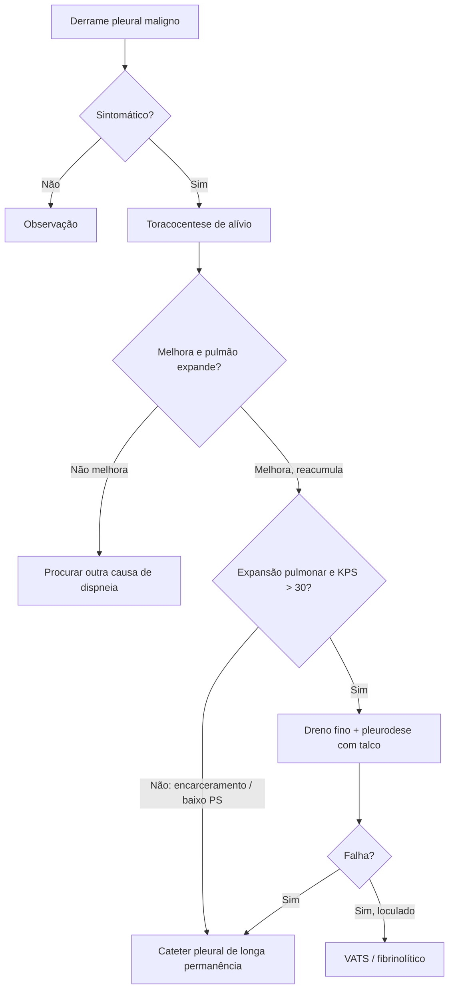

# Derrame Pleural Maligno

> Resumo em palavras próprias do Whitebook (Condutas Cirúrgicas > Cirurgia Torácica), sem fisiopatologia, autoria e referências. Confira detalhes e doses na fonte: https://whitebook.pebmed.com.br/conteudo/?id=39174&categoryId=207&subcategoryId=215

**Definição:** exsudato pleural com células malignas ou tecido tumoral, em geral doença metastática de má resposta ao tratamento.

## Epidemiologia
2ª causa de exsudato (após parapneumônico); > 15% dos pacientes com câncer. Principais primários (50–65%): pulmão (homens), mama (mulheres); outros: ovário, TGI, TGU, linfomas (linfomas + TGU + TGI ≈ 25%). Mesotelioma: derrame em 90%. Sem primário identificado: 7–15%. Sobrevida média 3–12 meses (varia com histologia, estádio, performance).

## Clínica
Dispneia (mais comum), dor torácica (invasão pleural/parede), tosse, ortopneia, sintomas consumptivos. Exame: taquipneia, dessaturação, cianose, ↓ expansibilidade, ↓/abolição do murmúrio, ↓/ausência de frêmito, desvio de ictus e traqueia nos volumosos.

## Diagnóstico
- **RX:** opacificação, sinal do menisco (Damoiseau), desvio mediastinal contralateral, rebaixamento diafragmático, nível hidroaéreo; derrame maciço = opacificação (quase) total do hemitórax.
- **USG:** diagnóstico e guia de intervenção; espessamento/nodularidade pleural ou diafragmática (muito específico), septações. **TC com contraste** (padrão-ouro): tumor primário, espessamento/nódulos pleurais, loculação, prediz encarceramento pulmonar, diferencia massa/atelectasia.
- **Toracoscopia/pleuroscopia** (sob anestesia local e sedação; contraindicada se aderências, tosse incontrolável, hipercapnia, obesidade mórbida, infecção aguda) e **VATS** (anestesia geral): biópsia e pleurodese em tempo único.
- **Líquido** (toracocentese guiada por USG): seroso, serossanguinolento ou hemorrágico; exsudato (proteína pleural/sérica > 0,5; LDH pleural/sérico > 0,6; LDH pleural > 2/3 do limite superior sérico, > 200 U/L); linfocitose > 50%; **citologia** positiva (sensibilidade ~60%, pior em mesotelioma); citometria/imunofenotipagem se linfoproliferativo.
- **Biópsia pleural** se líquido inconclusivo com suspeita persistente, citologia positiva com primário desconhecido ou áreas suspeitas de difícil acesso; mais acurada que citologia e fornece material para IHQ/genotipagem. Agulha de Cope/Abrams "às cegas": sensibilidade 43–68%, não indicada; guiada por imagem melhora; **VATS/cirúrgica** > 90–95%.

## Tratamento (paliativo; foco em sintomas e qualidade de vida)
Tratar a doença de base. A escolha depende de sintomas, performance, histologia/resposta à quimioterapia, septações e reexpansão pulmonar.
- **Assintomático:** observação clínica e radiológica; intervir só para obter líquido para diagnóstico/marcadores.
- **Toracocentese de alívio:** alívio imediato, útil em KPS ≤ 30, falha de pleurodese ou pulmão encarcerado; testa expansibilidade; se não melhorar, buscar outra causa de dispneia. > 60% reacumulam em 9 dias, 97% em 30 dias; não indicada se sobrevida > 1 mês. Risco de edema de reexpansão: parar se sintomas ou limitar a 1,5 L.
- **Drenagem pleural:** mantém via até cessar o processo; recidiva em 50–80% ao retirar; retirar 1,5 L a cada 2 h até esvaziar ou até sintomas.
- **Pleurodese** (sínfise pleural química/mecânica): derrame recorrente sintomático sem encarceramento; após dreno de pequeno calibre (10–14 F) ou achado intraoperatório. **Pré-requisitos:** derrame recorrente sintomático, confirmação neoplásica, sem controle pelo tratamento oncológico, melhora após esvaziar, expansão pulmonar completa ou parcial (> metade das pleuras em aposição), KPS > 30, sem linfangite carcinomatosa/obstrução brônquica. **Contraindicações:** absolutas — sem melhora clínica após esvaziar, reexpansão inadequada; relativas — sobrevida < 90 dias, disseminação extensa, baixo desempenho, comprometimento extenso do pulmão ipsilateral.
  - **Agentes:** talco (eleição; > 15 µm; efetividade > 90%): *slurry* pelo dreno ou *poudrage* por pleuroscopia/VATS, sem superioridade comprovada; bleomicina 60.000 U (61%); nitrato de prata (95%, mais barato); iodopovidona 2% 100 mL (85%; risco de cegueira em doses altas); doxiciclina/tetraciclina (dor intensa). Mecânica: abrasão, pleurectomia.
  - **Complicações:** febre (10%), dor pleurítica (30%), tosse, náuseas, taquicardia, pneumonite, SDRA (1,2–9%). Preditores de falha: corticoide, grande volume de doença pleural; AINEs não reduzem efetividade. Avaliação: controle dos sintomas e expansão mantida em 30 dias; ~30% falham e 14% loculam; falha → toracocenteses repetidas, nova drenagem/pleurodese, VATS ou cateter de longa permanência.
  - **Técnica de talco slurry (BTS 2010):** consentimento; analgesia/sedação; assepsia do dreno; lidocaína intrapleural 3 mg/kg (máx. 250 mg); 4–5 g de talco em 50 mL SF 0,9% lentamente; clampear 1–2 h e reabrir; atenção a dor e febre em 24–48 h; sem sucção (se usar, −20 mmHg); sem rotação do paciente; retirar o dreno em 24–48 h se expansão mantida e débito < 250 mL/dia.
- **Cateter pleural de longa permanência (tunelizado):** recorrente sintomático com encarceramento pulmonar e baixa expectativa de vida; sem encarceramento (sem dados de superioridade vs. pleurodese); falha de pleurodese ou loculação. Seldinger guiado por USG, drenagem a vácuo por válvula unidirecional. Encarceramento em ~30% (obstrução brônquica proximal, espessamento pleural, atelectasia crônica). Controle completo 38%, parcial 50%, ausente 3,5%; pleurodese espontânea 42,9%; pode ficar até o óbito; custo alto; celulite 7,3%, empiema 4,6%; infecção: antibiótico sem retirar (ATS 2018), retirar se sepse/falta de resposta.
- **Pleurectomia/decorticação:** grande morbidade, em geral não indicada (exceção: mesotelioma recorrente); empiema, hemorragia, falência cardiorrespiratória.
- **Fibrinolíticos intrapleurais** (estreptoquinase, uroquinase, rtPA): aumentam drenagem e melhoram imagem em loculados, sem impacto em dispneia ou pleurodese; úteis se inaptos para cirurgia; risco hemorrágico.
- **Terapia antitumoral** (quimio, alvo, imunoterapia): sem consenso para antecipar aos procedimentos pleurais; quimio pode ser 1ª escolha em tumores sensíveis (linfoma, CPPC).
- **Shunt pleuroperitoneal** (Denver): pouco usado; refratário à pleurodese/encarceramento; obstrução, implante peritoneal.
- **VATS terapêutica:** bom PS; biópsia, derrames recorrentes (livres ou loculados), complicações infecciosas de intervenções prévias; permite drenar, quebrar loculações, retirar coágulos e fazer talco *poudrage* se houver reexpansão; mortalidade < 0,5%.
- Sintomáticos podem seguir o esquema usual de analgesia/antiemético.

## Fluxograma (refeito a partir do texto; o original é uma figura "Algoritmo de Manejo")

