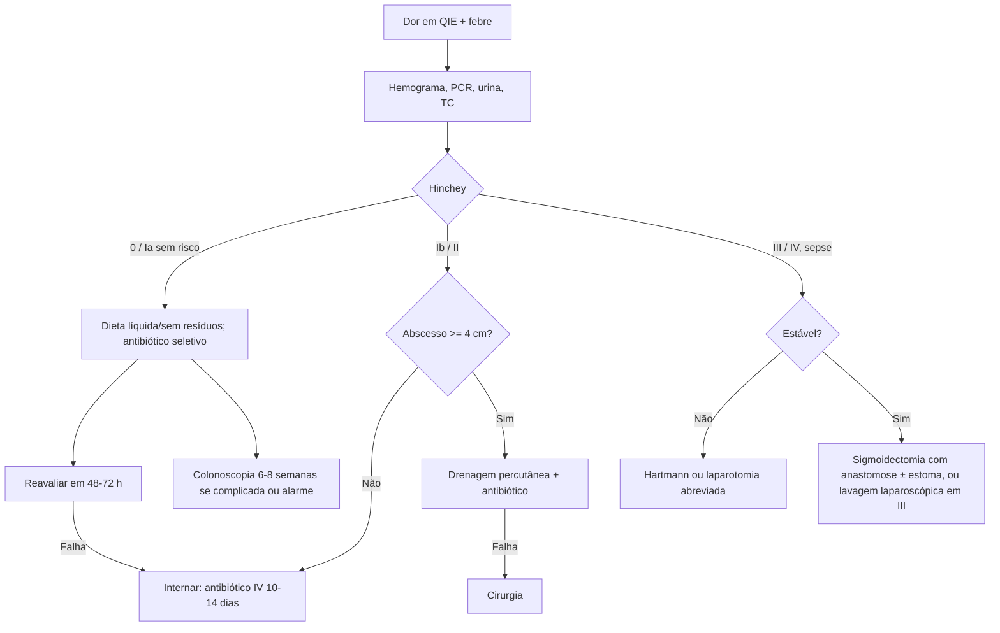

# Diverticulite Aguda

> Resumo em palavras próprias do Whitebook (Condutas Cirúrgicas > Cirurgia Geral e do Aparelho Digestivo), sem fisiopatologia, autoria e referências. Confira detalhes e doses na fonte: https://whitebook.pebmed.com.br/conteudo/?id=50815&categoryId=207&subcategoryId=211

**Definição:** inflamação-infecção aguda de um divertículo colônico, de dor leve localizada a peritonite fecal com sepse. Sinônimos: surto de doença diverticular, doença diverticular inflamada/complicada. Complicações: abscessos, peritonite purulenta ou fecal, sepse, fístulas, estenoses. Flora: gram-negativos entéricos (*E. coli*, *Klebsiella*), enterococos, anaeróbios (*Bacteroides*).

## Epidemiologia
- Diverticulose: ~50% aos 50 anos, 80% acima dos 85; antes dos 50 predomina o sexo masculino, depois o feminino.
- Só 1–4% dos diverticulóticos têm diverticulite; incidência ~180/100.000/ano. Não complicada: 75–85%; complicada: 15–25% (abscesso 70%), mais no primeiro episódio. Recorrência em 20% em 10 anos.
- Ocidente: esquerda (65–70%, sigmoide); Ásia: direita, mais jovens, homens e Hinchey menos avançado. Mais casos no verão/outono.

## Clínica
- **Sintomas:** dor aguda gradual no QIE (às vezes suprapúbica ou QID), náusea, vômito, febre, taquicardia, calafrios; diarreia (35%) ou constipação (50%); episódios prévios; disúria/piúria estéril por contato com a bexiga; fístulas: fecalúria, pneumatúria, fezes pela vagina.
- **Fatores associados:** idade > 65, obesidade (IMC ≥ 30), sedentarismo, dieta rica em gordura/carne vermelha, DM2, HAS, tabagismo, imunossupressão (HIV, quimioterapia, tocilizumabe, tofacitinibe), opioides, corticoides, AINE, doenças do tecido conjuntivo (rim policístico, Marfan, Ehlers-Danlos, Williams-Beuren), variantes genéticas (TNFSF15). **Protetores:** bloqueadores de canal de cálcio, atividade física, dieta rica em fibras (estatinas/metformina duvidosos).
- **Exame:** dor e defesa no QIE; massa (plastrão) em 20%; irritação peritoneal ou sepse indica complicação por perfuração (emergência).

## Diagnóstico
- **Laboratório:** leucocitose com desvio; leucócitos > 15.000 sugerem forma complicada. **PCR** > 140 mg/L apoia antibiótico (pico tardio, 48 h; normal não exclui). Urina (piúria estéril). Procalcitonina distingue complicada; calprotectina fecal se associa à recorrência (não de rotina). Eletrólitos, glicemia e função renal.
- **TC de abdome** (padrão-ouro: sensibilidade 94–99%, especificidade 95–100%), com contraste. Indicações: 1º episódio sem imagem prévia, dor em FIE + PCR > 50 mg/dL (conforme o texto), falha do tratamento clínico, suspeita de complicação/drenagem, imunossuprimidos ou múltiplas recorrências. A TC pode ser dispensada com sintomas típicos, episódio prévio semelhante e sem complicação (ACR).
- **USG:** sensibilidade 77–98%, especificidade 80–99%; útil para causas ginecológicas, gestantes (transabdominal, transvaginal, transretal).
- **Colonoscopia** 6–8 semanas após o episódio: fortemente recomendada na complicada (abscesso, perfuração, fístula, obstrução); na não complicada, só com sinais de alarme (emagrecimento, sangramento, anemia, mudança do hábito, dor contínua) ou rastreamento atrasado.

## Hinchey modificado (Sher)
0 — inflamação pericólica leve com espessamento parietal; **Ia** — inflamação pericólica ou flegmão; **Ib** — abscesso pericólico ou mesocólico; **II** — abscesso pélvico/intra-abdominal; **III** — peritonite purulenta generalizada; **IV** — peritonite fecal generalizada. (O original traz uma figura.)

**Diferenciais:** câncer colorretal, DII, colite segmentar associada à diverticulose, apendicite, apendagite epiploica, volvo, fecaloma, hérnias, obstrução, DIP, torção de cisto, gravidez ectópica, colites infecciosas, SII, isquemia mesentérica, infarto omental, nefrolitíase, ITU, abscesso de psoas, hemorragia retroperitoneal.

## Tratamento da diverticulite não complicada (Hinchey 0 e I)
- Dieta líquida sem resíduos por 1–2 dias e depois pobre em fibras; já não se recomenda evitar nozes, milho, sementes ou pipoca.
- **Antibiótico não é rotina** em baixo risco (imunocompetente, aderente, sem comorbidade grave nem gestação); Cochrane 2022 (1.329 pacientes) não mostrou superioridade sobre a conduta expectante. **Indicado** em gestantes, imunossuprimidos, sépticos, instáveis, frágeis ou com suspeita de complicação.
- **VO ambulatorial 7–10 dias:** amoxicilina-clavulanato 875/125 mg 12/12 h; moxifloxacino 400 mg 24/24 h ou levofloxacino 500 mg 24/24 h; ciprofloxacino 500 mg 12/12 h + metronidazol 500 mg 8/8 h; ou SMX-TMP 800/160 mg 12/12 h.
- Reavaliar em 48–72 h: sucesso se sinais vitais normais, sem dor e leucocitose, dieta oral aceita; senão internar. Encaminhar ao proctologista.
- **Internar se:** piora em 48–72 h; imunossupressão, idade avançada, fragilidade, comorbidades; febre > 38,5 °C ou marcadores muito elevados; difícil seguimento; intolerância oral ou vômitos; imagem preocupante (coleções, segmentos longos).
- **Internação:** jejum e depois dieta pobre em fibras; hidratação IV; sintomáticos; antibiótico IV 10–14 dias (amoxicilina-clavulanato; cipro/ceftriaxona + metronidazol; ampicilina-sulbactam; piperacilina-tazobactam; cobrir ESBL/KPC conforme perfil/culturas).
- **Recorrência:** maior risco < 50 anos e episódio prévio. Não há evidência para mesalazina, rifaximina ou probióticos.

## Diverticulite complicada
- **Abscesso:** pericólico/intramesentérico ≤ 4 cm → antibiótico IV e observação. **Drenagem percutânea** (TC/USG): ≥ 4 cm com janela, refratário, sem controle infeccioso ou sepse; enviar cultura (aeróbios e anaeróbios); retirar o dreno após controle e queda do débito; resolução ~80%; sem antibiótico prolongado após drenagem adequada. Se inacessível ou falhar, cirurgia. Estáveis sem peritonismo: tentar não operatório; abscesso à distância ou pneumotórax = falha.
- **Sepse/peritonite:** ressuscitação, culturas, antibiótico precoce de amplo espectro e controle do foco por cirurgia de emergência (laparotomia, evacuação de pus/fezes, lavagem, ressecção).
  - *Instáveis:* **Hartmann**; em grande instabilidade, laparotomia abreviada (controle de danos: ressecar sem anastomose, limpar, fechamento temporário) e UTI 24–48 h, depois ressecção definitiva, colostomia, Hartmann ou até anastomose primária.
  - *Estáveis:* sigmoidectomia com anastomose primária (boa vascularização, sem tensão, contaminação controlada); a colectomia eletiva reduz a recorrência em 5 anos de 60% para 15%. Sigmoidectomia laparoscópica (com ou sem estoma) em mãos experientes reduz complicações. Lavagem laparoscópica com drenagem pode ser feita em Hinchey III. Reduzir estomas deve ser ponderado contra mais complicações e reintervenções.
- **Dúvida com câncer:** ressecar o segmento.
- **Fístulas:** ~2% dos casos; colovesical 65%; também colovaginal, coloentérica, colouterina, colocutânea.

## Cirurgia eletiva
- **Indicações:** imunossuprimidos já com um episódio complicado; diverticulite recorrente não complicada com impacto na qualidade de vida (decisão compartilhada); algumas complicadas; após estenose ou fístula; corticoterapia prolongada; DRC, doença vascular ou do colágeno; sintomas persistentes sem resposta clínica.
- A cirurgia reduz, mas não elimina o risco; pode não melhorar sintomas crônicos; não indicar pelo número de episódios; não de rotina após um único episódio Hinchey I/II tratado; < 50 anos seguem as mesmas indicações.
- **Técnica:** laparoscopia preferencial, idealmente após 6 semanas; ressecar proximal ao flegmão (sem caçar divertículos proximais sem inflamação); ressecção distal na porção proximal do reto; anastomose primária (sem Hartmann).

## Complicações e prognóstico
Abscessos, peritonite, estenose, fístulas, compressão ureteral, trombose séptica de veia porta, abscesso hepático piogênico, óbito. Peritonite purulenta/fecal: mortalidade 35–50%. Recorrência aumenta a cada episódio; fatores: número de episódios, tabagismo, obesidade, início precoce, sexo masculino, extensão, história familiar e gravidade do 1º episódio.

## Fluxograma (refeito, a partir do texto; o original não vem como texto)

